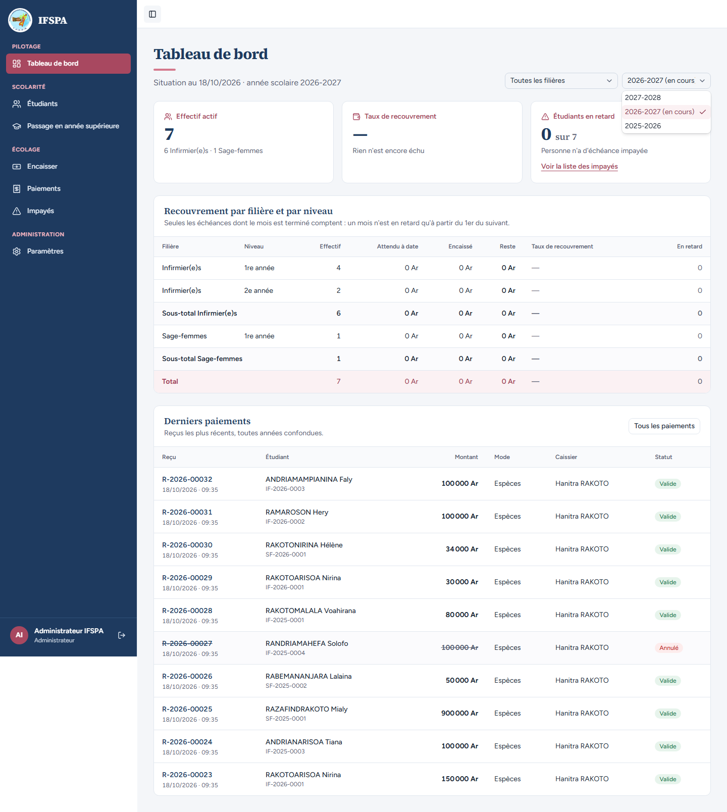
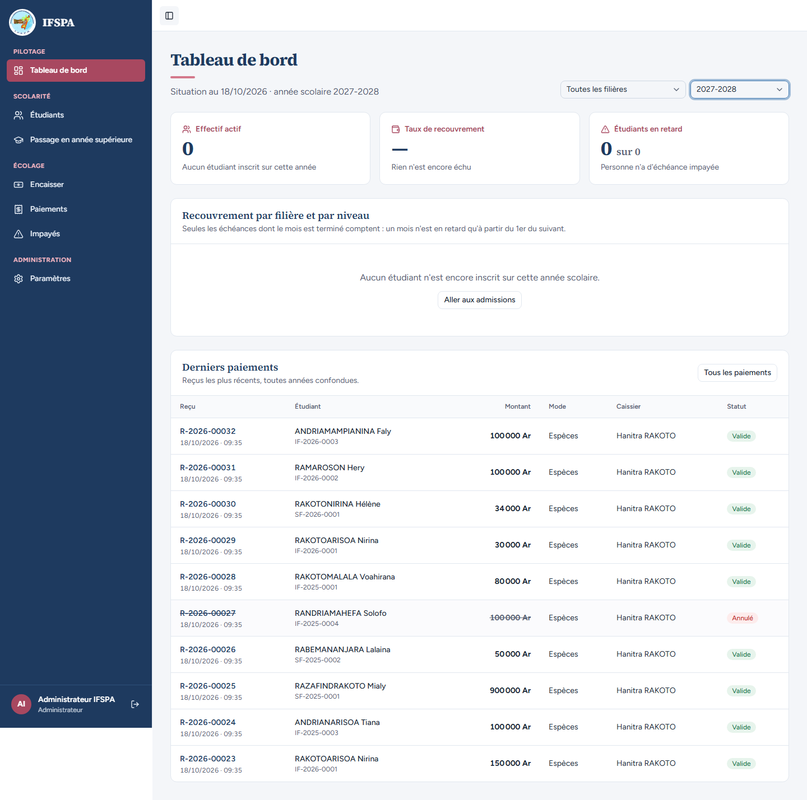
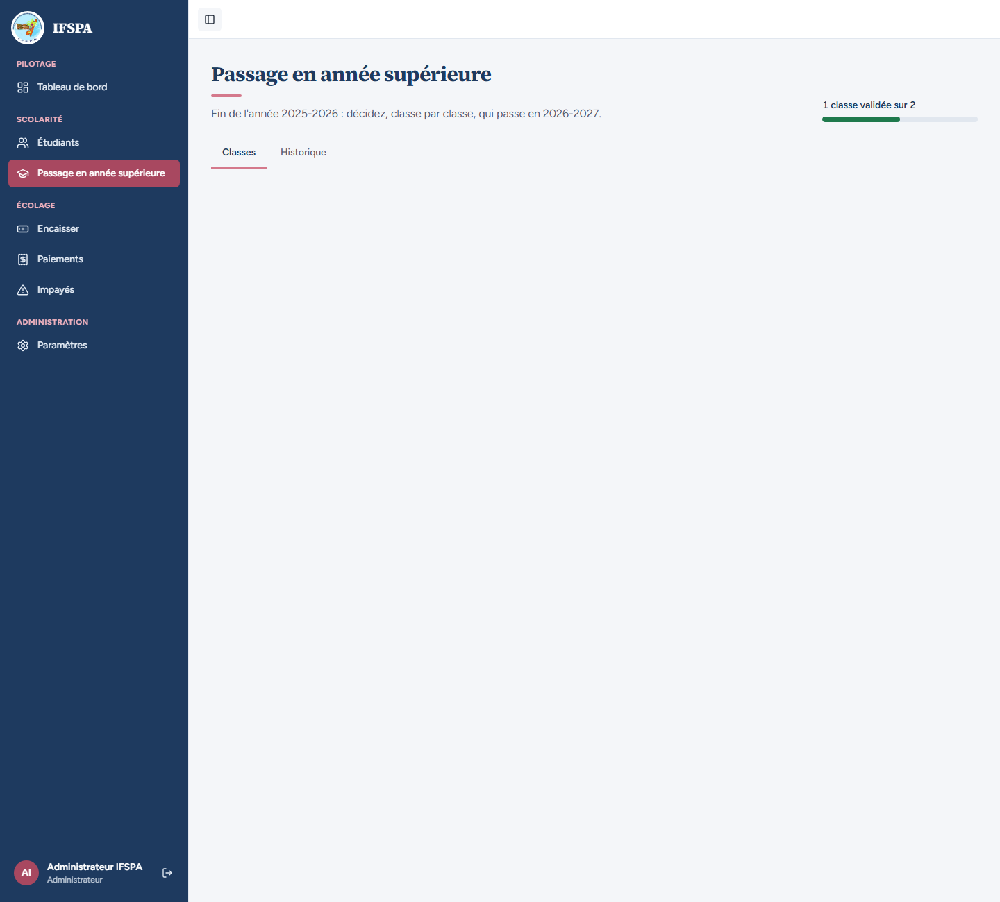

# UC12-08. Une année scolaire sans inscrit : un tableau de bord vide, avec un chemin vers les admissions

| | |
|---|---|
| Use case | UC12. Suivre le recouvrement |
| Règles couvertes | R-DASH (états vides : taux inconnu, tableau remplacé par un message) |
| Rôle | Administrateur, compte « Administrateur IFSPA » |
| Durée estimée | 5 minutes |

## La situation

L'administrateur prépare la rentrée suivante : il crée l'année 2027-2028 dans Paramètres. Il ouvre ensuite le tableau de bord sur cette année, encore vide, et doit comprendre qu'il n'y a pas d'erreur : personne n'est inscrit.

## Avant de commencer

1. `pnpm recette:base`, `pnpm build`, `pnpm recette:app`.
2. Avoir déroulé [00-PREPARATION.md](../00-PREPARATION.md) sections A, B, C, H, G, I, puis UC12-01 à [UC12-07](UC12-07-passage-par-niveau.md). **Ce cas crée l'année 2027-2028** (elle s'ajoute au sélecteur des cas suivants).
3. Compte **administrateur**.

## Étapes

| # | Qui | Action | Résultat attendu | Capture | ✓ |
|---|---|---|---|---|---|
| 1 | Administrateur | **Paramètres**, onglet **Années scolaires**, **Nouvelle année**, saisir `2027` dans « Année de début », **Créer l'année**. | L'aperçu dit « Année 2027-2028 : mensualités de … ». L'année est créée (lien « Tarifs de l'année 2027-2028 »). | | |
| 2 | Administrateur | **Tableau de bord**, ouvrir le filtre « Année scolaire ». | Trois choix : « 2027-2028 », « 2026-2027 (en cours) », « 2025-2026 ». L'année en cours reste 2026-2027. |  | |
| 3 | Administrateur | Choisir **2027-2028**. | « … année scolaire 2027-2028 ». « Effectif actif » **0** (« Aucun étudiant inscrit sur cette année »), « Taux de recouvrement » **—** (« Rien n'est encore échu »), « Étudiants en retard » **0 sur 0**, sans lien « Voir la liste des impayés ». À la place du tableau : « Aucun étudiant n'est encore inscrit sur cette année scolaire. » et le bouton « Aller aux admissions ». |  | |
| 4 | Administrateur | Regarder « Derniers paiements ». | Les 10 derniers reçus sont toujours là (toutes années confondues), R-2026-00027 « Annulé ». | | |
| 5 | Administrateur | Cliquer **Aller aux admissions**. | « Passage en année supérieure » s'ouvre. |  | |
| 6 | Administrateur | Revenir au Tableau de bord. | Il s'ouvre sur 2026-2027 (l'année en cours), pas sur 2027-2028. | | |

## Ce que ce scénario ne couvre pas

- « Aucune année scolaire » (base sans année) : couvert par Vitest, `tests/integration/lectures-dashboard.test.ts` (« aucune année courante : la plus récente ; aucune année du tout : pas d'année, rien à afficher »). Non démontré à l'écran : on ne peut pas supprimer toutes les années depuis la recette.
- Le texte d'invitation du secrétariat sans année (« Demandez à l'administrateur de créer l'année scolaire… ») : même cause, non démontré.

## Dernière exécution par l'agent

- 18/10/2026 : ✅ 6 étapes sur 6. Voir [RAPPORT_2026-10-18_UC12](../../rapports/RAPPORT_2026-10-18_UC12.md).
- Parcours : [UC12-08-annee-sans-inscrits.recette.ts](../../parcours/UC12-08-annee-sans-inscrits.recette.ts) (`pnpm recette:parcours UC12-08 --project ordinateur`).
