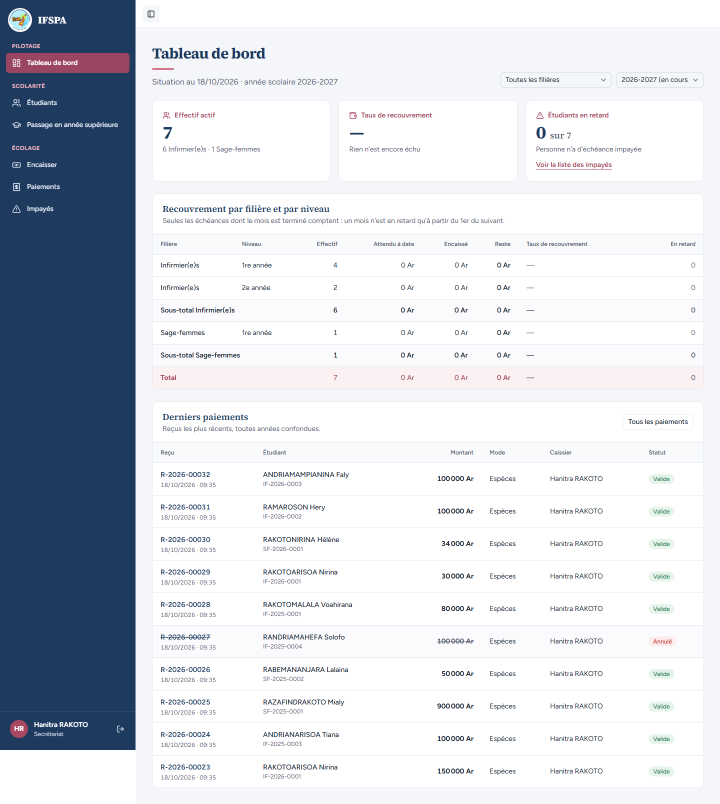
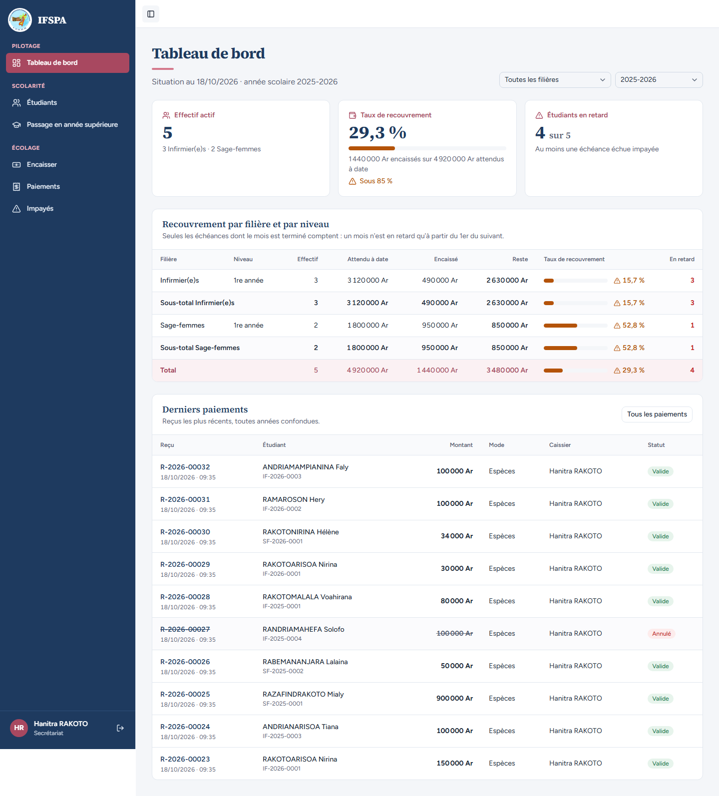
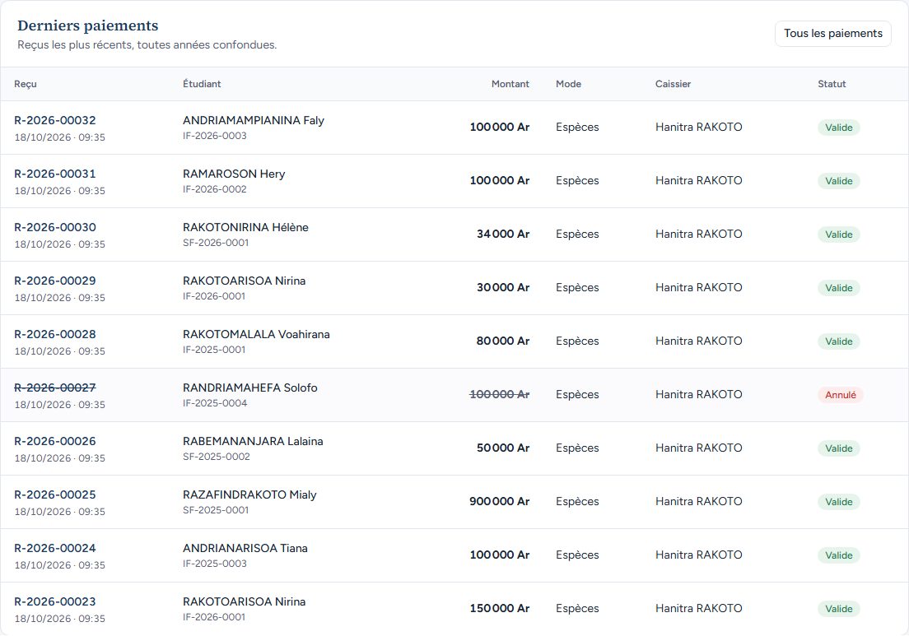
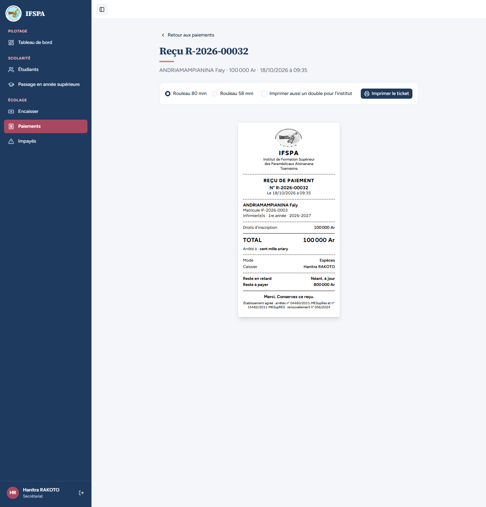
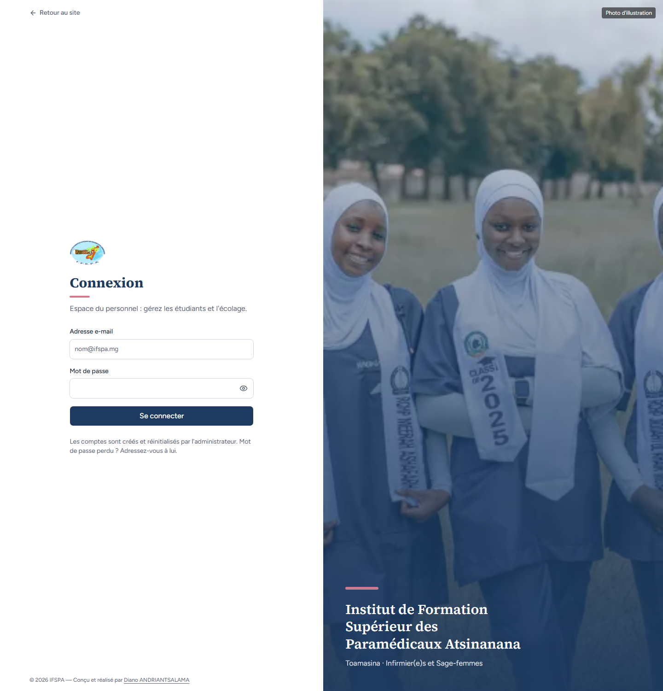

# UC12-09. La secrétaire voit le même tableau de bord que l'administrateur ; un visiteur sans compte est renvoyé à la connexion

| | |
|---|---|
| Use case | UC12. Suivre le recouvrement |
| Règles couvertes | R-DASH, R-ROLE (le tableau de bord est consultable par l'administrateur et le secrétariat, sans aucune action de modification) |
| Rôle | Secrétariat, compte « Hanitra RAKOTO » ; puis un visiteur sans session |
| Durée estimée | 6 minutes |

## La situation

Le plan donne la consultation du tableau de bord aux deux rôles. La secrétaire l'ouvre : mêmes chiffres que l'administrateur, aucune rubrique Paramètres, aucune action d'annulation sur les derniers paiements. Quelqu'un sans compte qui tape l'adresse du tableau de bord est renvoyé à la page de connexion et ne voit aucun chiffre.

## Avant de commencer

1. `pnpm recette:base`, `pnpm build`, `pnpm recette:app`.
2. Avoir déroulé [00-PREPARATION.md](../00-PREPARATION.md) sections A, B, C, H, G, I, puis UC12-01 à [UC12-08](UC12-08-annee-sans-inscrits.md) (ce cas ne modifie rien).
3. Compte **secrétariat** (identifiants `SEED_USER_*`).

## Étapes

| # | Qui | Action | Résultat attendu | Capture | ✓ |
|---|---|---|---|---|---|
| 1 | Secrétariat | Menu **Encaisser**, puis **Tableau de bord**. | « Hanitra RAKOTO » et « Secrétariat » en bas de la barre latérale ; **pas** de rubrique Paramètres. Année 2026-2027 : « Effectif actif » 7 (« 6 Infirmier(e)s · 1 Sage-femmes »), lien « Voir la liste des impayés ». |  | |
| 2 | Secrétariat | Choisir l'année **2025-2026**. | Les chiffres de l'administrateur : « 29,3 % », « 4 sur 5 », total 5 / 4 920 000 Ar / 1 440 000 Ar / 3 480 000 Ar / 29,3 % / 4. |  | |
| 3 | Secrétariat | Regarder « Derniers paiements ». | Le reçu R-2026-00027 est visible, « Annulé ». Aucun bouton dans cette zone (ni « Annuler », ni autre action). |  | |
| 4 | Secrétariat | Cliquer le numéro R-2026-00032, revenir en arrière, cliquer « RAMAROSON Hery ». | Le numéro ouvre « Reçu R-2026-00032 » (ticket, ANDRIAMAMPIANINA Faly, 100 000 Ar, « cent mille ariary »). Le nom ouvre la fiche de RAMAROSON Hery. |  | |
| 5 | Visiteur (navigateur sans session, ou fenêtre privée) | Ouvrir `http://localhost:3200/app/dashboard`. | Renvoi vers la page « Connexion » (adresse `/connexion`). Aucun chiffre du tableau de bord n'est affiché. |  | |

## Ce que ce scénario ne couvre pas

- L'accès de l'administrateur : [UC12-01](UC12-01-vue-du-jour.md) à UC12-08.
- Le renvoi du visiteur côté serveur (lecture sans session redirigée) et « le secrétariat et l'administrateur voient le même tableau de bord » : aussi couverts par Vitest, `tests/integration/lectures-dashboard.test.ts` (bloc « accès »).

## Dernière exécution par l'agent

- 18/10/2026 : ✅ 5 étapes sur 5. Voir [RAPPORT_2026-10-18_UC12](../../rapports/RAPPORT_2026-10-18_UC12.md).
- Parcours : [UC12-09-secretariat-et-visiteur.recette.ts](../../parcours/UC12-09-secretariat-et-visiteur.recette.ts) (`pnpm recette:parcours UC12-09 --project ordinateur`).
