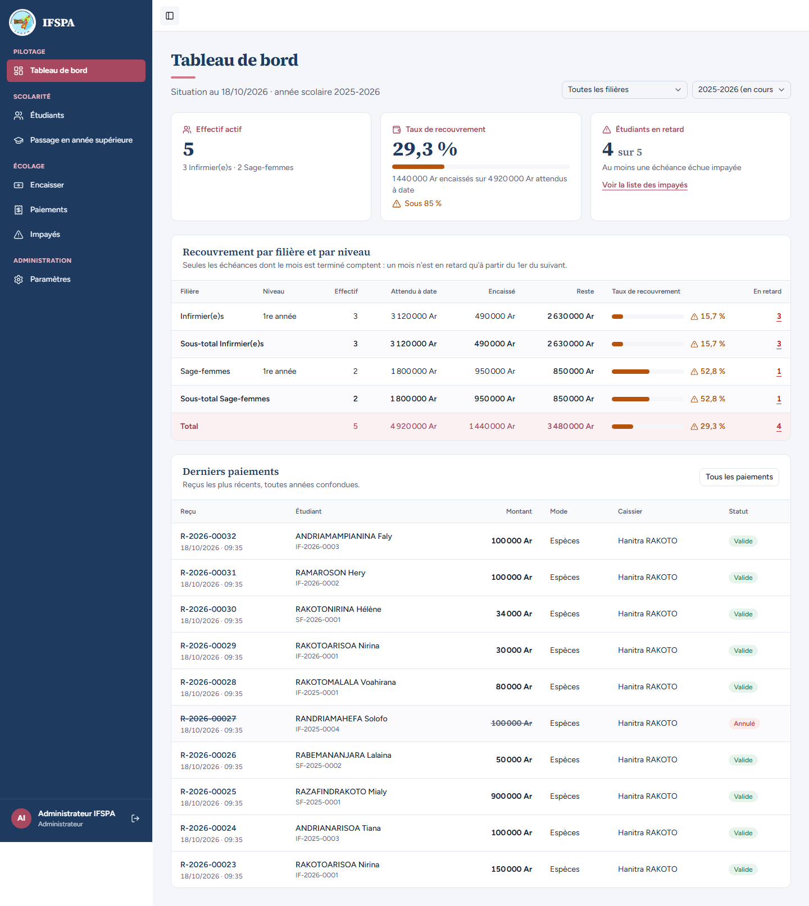
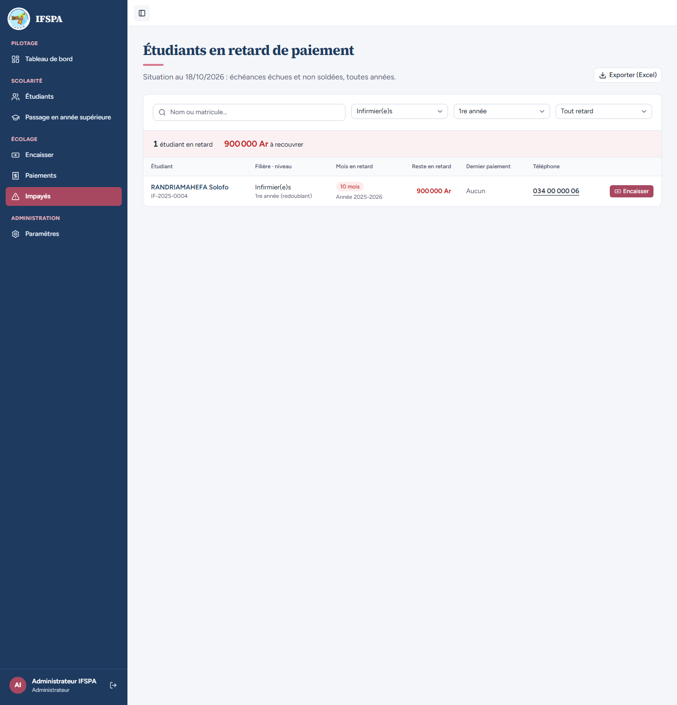
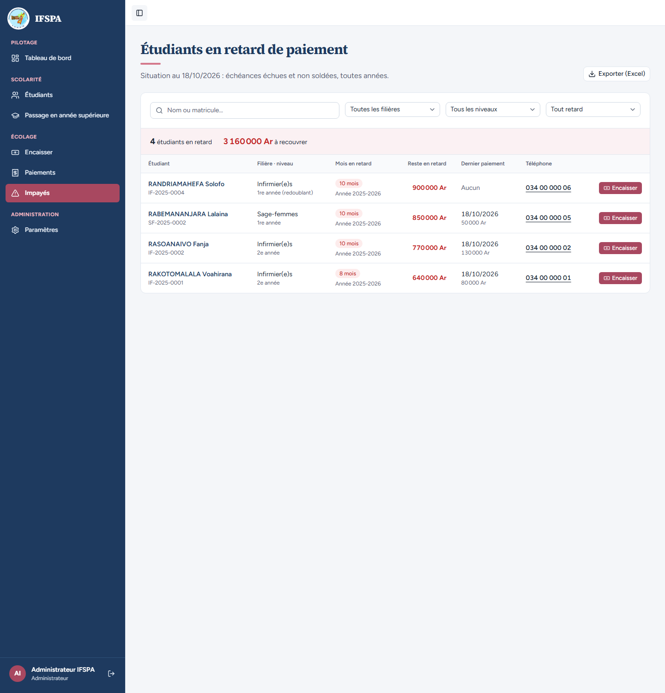
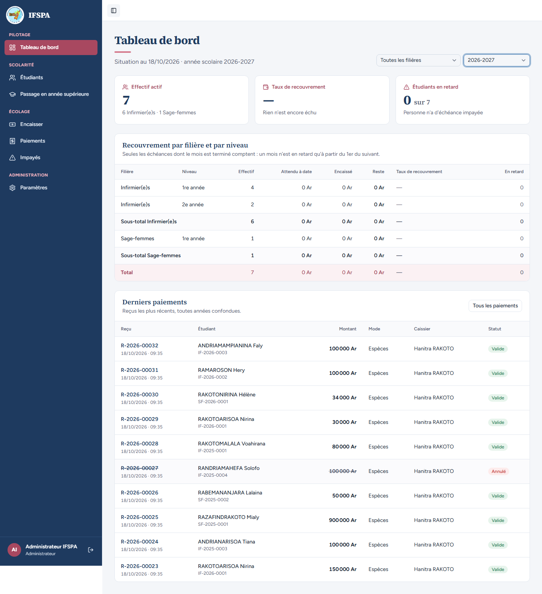

# UC12-10. Sur l'année en cours, les retards du tableau mènent à la liste des impayés

| | |
|---|---|
| Use case | UC12. Suivre le recouvrement |
| Règles couvertes | R-DASH (liens vers Impayés), R-IMP, R-ROLE (administrateur : Paramètres › Années) |
| Rôle | Administrateur, compte « Administrateur IFSPA » |
| Durée estimée | 8 minutes |

## La situation

Avant le 1er novembre, l'année en cours n'a aucun retard : les liens du tableau de bord vers Impayés n'ont rien à montrer. Pour les voir, l'administrateur rend un instant 2025-2026 année en cours (là où sont les retards), clique le nombre d'étudiants en retard d'une classe, puis rétablit 2026-2027. Ces liens n'existent que sur l'année en cours, car Impayés ne se filtre pas par année.

## Avant de commencer

1. `pnpm recette:base`, `pnpm build`, `pnpm recette:app`.
2. Avoir déroulé [00-PREPARATION.md](../00-PREPARATION.md) sections A, B, C, H, G, I, puis UC12-01 à [UC12-09](UC12-09-secretariat-et-visiteur.md). **Le cas change l'année en cours puis la rétablit.**
3. Compte **administrateur**.

## Étapes

| # | Qui | Action | Résultat attendu | Capture | ✓ |
|---|---|---|---|---|---|
| 1 | Administrateur | **Paramètres**, **Années scolaires**, sur 2025-2026 cliquer **Définir comme année courante**, confirmer. | 2026-2027 propose à son tour « Définir comme année courante ». | | |
| 2 | Administrateur | **Tableau de bord**. | Il s'ouvre sur 2025-2026, filtre « 2025-2026 (en cours) ». « 4 sur 5 », lien « Voir la liste des impayés » présent. Dans le tableau, les nombres de la colonne « En retard » (3, 1 et 4) sont soulignés : ce sont des liens. |  | |
| 3 | Administrateur | Cliquer le **3** de la ligne Infirmier(e)s 1re année. | Impayés s'ouvre filtré (adresse `/app/impayes?filiereId=…&niveau=1`, filtres « Infirmier(e)s » et « 1re année »). Il affiche « **1 étudiant en retard** », « 900 000 Ar à recouvrer » : RANDRIAMAHEFA Solofo, « 1re année (redoublant) ». **Constat** : le tableau annonçait 3 étudiants en retard dans cette classe en 2025-2026 ; Impayés filtre sur le niveau actuel, et Voahirana et Fanja sont passées en 2e année (question 3 du rapport). |  | |
| 4 | Administrateur | Revenir au Tableau de bord, cliquer le **4** de la ligne Total. | Impayés sans filtre : « 4 étudiants en retard », « 3 160 000 Ar à recouvrer ». |  | |
| 5 | Administrateur | Choisir l'année **2026-2027** (qui n'est plus l'année en cours). | Plus aucun lien : ni « Voir la liste des impayés », ni nombre cliquable dans le tableau. |  | |
| 6 | Administrateur | **Paramètres › Années scolaires**, sur 2026-2027 **Définir comme année courante**, confirmer. | 2025-2026 propose « Définir comme année courante ». Le Tableau de bord s'ouvre de nouveau sur 2026-2027. | | |

## Ce que ce scénario ne couvre pas

- Les liens sur l'année en cours **avec des retards de l'année en cours** : impossibles avant le 1er novembre 2026. À refaire après cette date.
- Le lien d'une ligne de sous-total (filière seule).

## Dernière exécution par l'agent

- 18/10/2026 : ✅ 6 étapes sur 6 (avec le constat de l'étape 3, mineur). Voir [RAPPORT_2026-10-18_UC12](../../rapports/RAPPORT_2026-10-18_UC12.md).
- Parcours : [UC12-10-liens-vers-impayes.recette.ts](../../parcours/UC12-10-liens-vers-impayes.recette.ts) (`pnpm recette:parcours UC12-10 --project ordinateur`).
