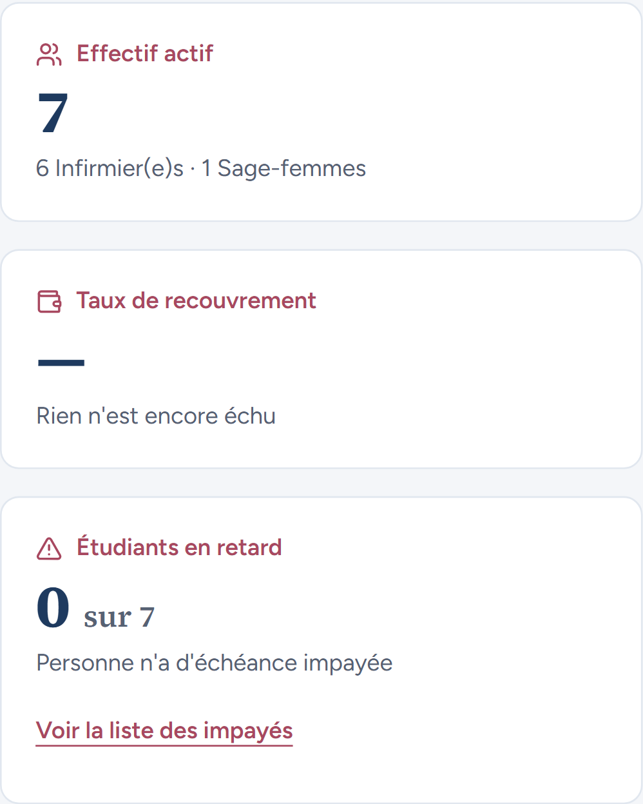
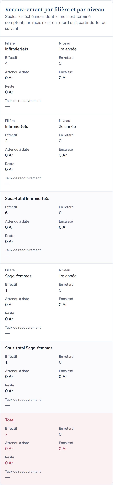
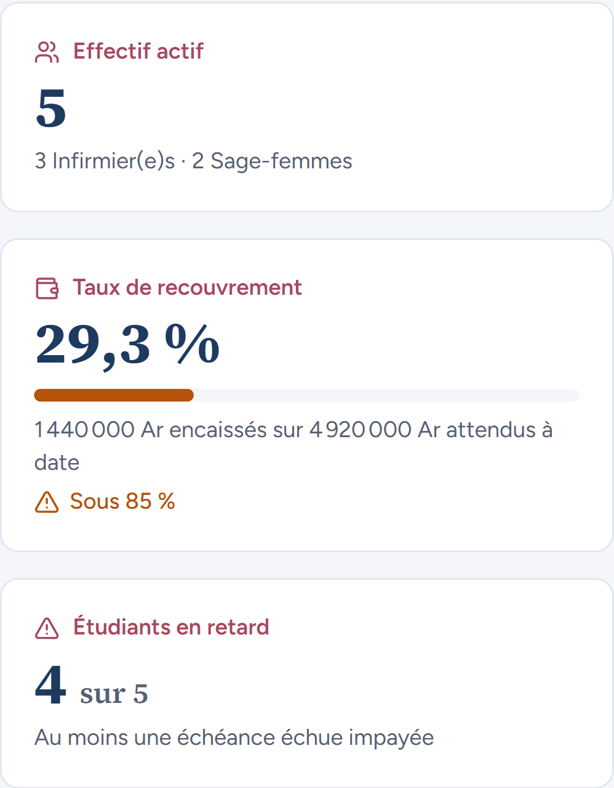
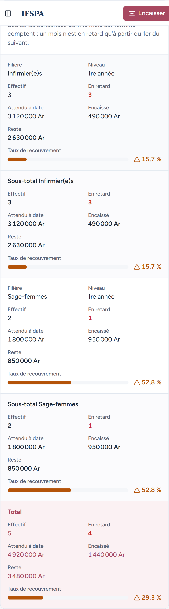
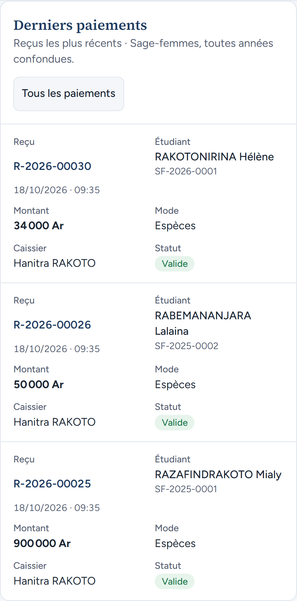

# UC12-11. La secrétaire lit le tableau de bord sur son téléphone

| | |
|---|---|
| Use case | UC12. Suivre le recouvrement |
| Règles couvertes | R-DASH (cartes, tableau, derniers paiements lisibles sur téléphone) |
| Rôle | Secrétariat, compte « Hanitra RAKOTO » |
| Durée estimée | 5 minutes |

## La situation

La secrétaire consulte le tableau de bord sur son téléphone : les trois cartes s'empilent, chaque ligne du tableau devient une carte avec l'intitulé de chaque chiffre, les derniers paiements aussi.

## Avant de commencer

1. `pnpm recette:base`, `pnpm build`, `pnpm recette:app`. Ouvrir `http://localhost:3200` **sur un téléphone** ou, dans Chrome, F12 puis le mode appareil mobile (Pixel 7).
2. Avoir déroulé [00-PREPARATION.md](../00-PREPARATION.md) sections A, B, C, H, G, I, puis UC12-01 à [UC12-10](UC12-10-liens-vers-impayes.md) (année en cours 2026-2027 rétablie). Ce cas ne modifie rien.
3. Compte **secrétariat**.

## Étapes

| # | Qui | Action | Résultat attendu | Capture | ✓ |
|---|---|---|---|---|---|
| 1 | Secrétariat | Ouvrir le Tableau de bord. | Les filtres « Filière » et « Année scolaire » s'empilent, puis trois cartes : « Effectif actif » 7 (« 6 Infirmier(e)s · 1 Sage-femmes »), « Taux de recouvrement » — (« Rien n'est encore échu »), « Étudiants en retard » 0 sur 7. Le lien « Voir la liste des impayés » mesure au moins 44 px de haut. **Constat** : les deux filtres ne mesurent que 32 px de haut (44 px attendus, comme les autres contrôles tactiles de l'application : constat mineur du rapport). |  | |
| 2 | Secrétariat | Descendre au tableau. | Une carte par ligne (Infirmier(e)s 1re année, 2e année, sous-totaux, Sage-femmes, Total), chaque chiffre précédé de son intitulé : « Effectif », « En retard », « Attendu à date », « Encaissé », « Reste », « Taux de recouvrement ». |  | |
| 3 | Secrétariat | Choisir l'année **2025-2026**. | Cartes : « 29,3 % », « 4 sur 5 ». Cartes du tableau : Sage-femmes sous-total 2 / 1 800 000 Ar / 950 000 Ar / 850 000 Ar / 52,8 % / 1 ; Total 5 / 4 920 000 Ar / 1 440 000 Ar / 3 480 000 Ar / 29,3 % / 4. La barre d'en-tête collante apparaît en haut de la capture du tableau (artefact de capture). |   | |
| 4 | Secrétariat | Choisir la filière **Sage-femmes**. | « 52,8 % » ; « Derniers paiements » : 3 cartes (R-2026-00030, 00026, 00025). |  | |

## Ce que ce scénario ne couvre pas

- Un appareil réel (seul l'émulateur Pixel 7 de Playwright est utilisé).
- Les cas UC12-01 à UC12-10 sur téléphone : seul ce cas est joué en mobile.

## Dernière exécution par l'agent

- 18/10/2026 : ❌ étape 1 (constat mineur : filtres de 32 px au lieu de 44 px) ; étapes 2 à 4 ✅. Voir [RAPPORT_2026-10-18_UC12](../../rapports/RAPPORT_2026-10-18_UC12.md).
- Parcours : [UC12-11-telephone.recette.ts](../../parcours/UC12-11-telephone.recette.ts) (`pnpm recette:parcours UC12-11 --project mobile`).
