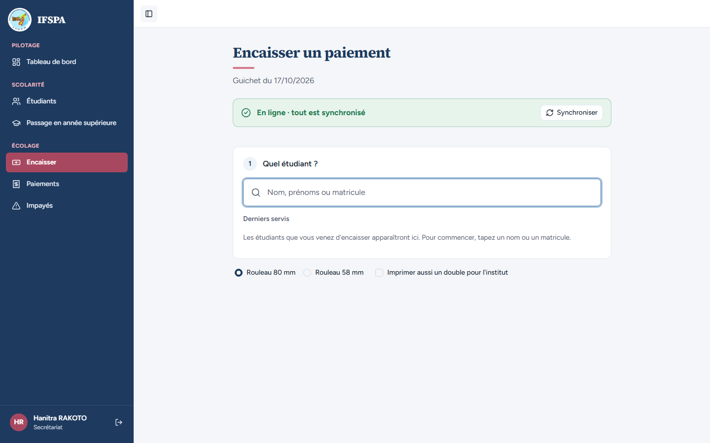
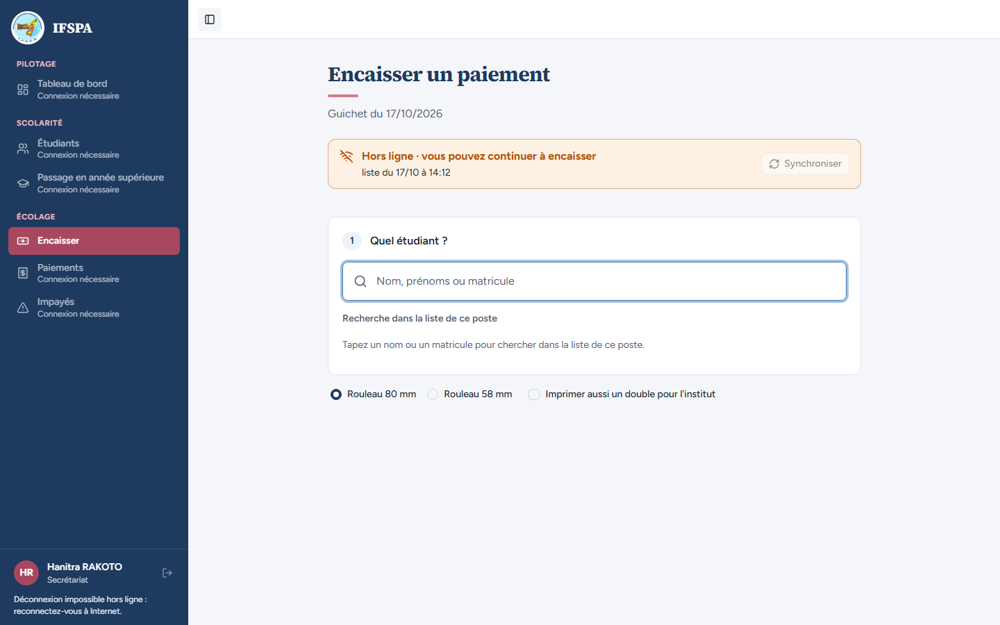
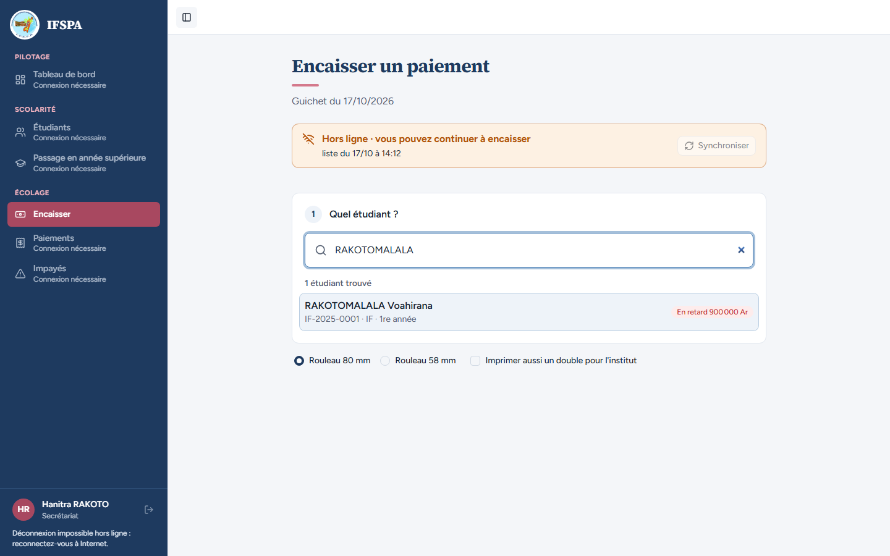
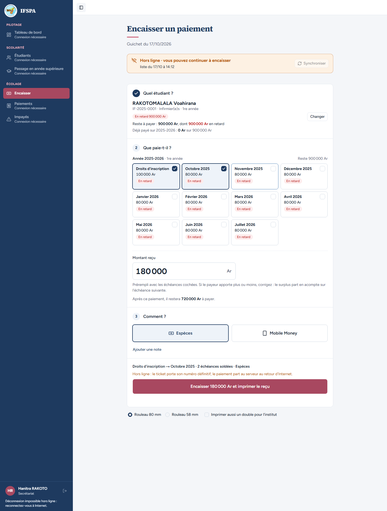
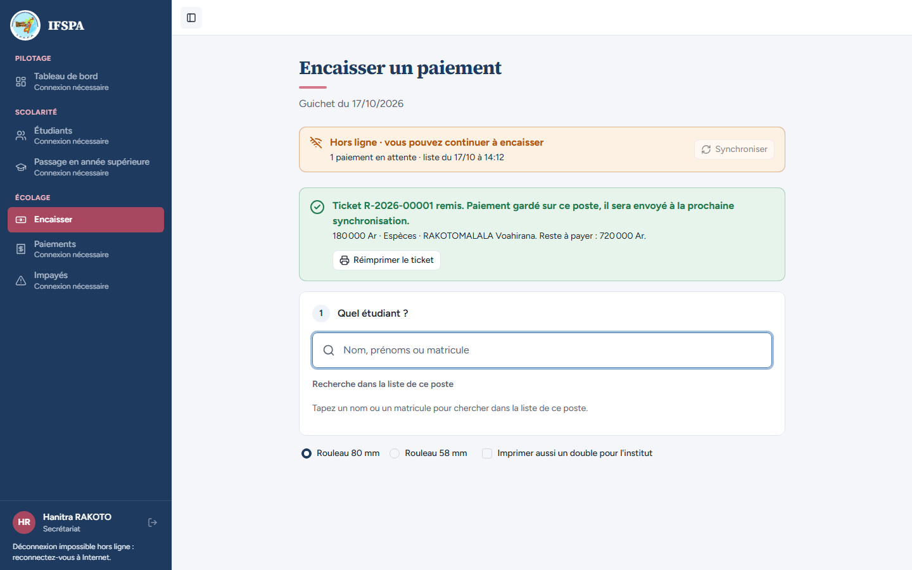
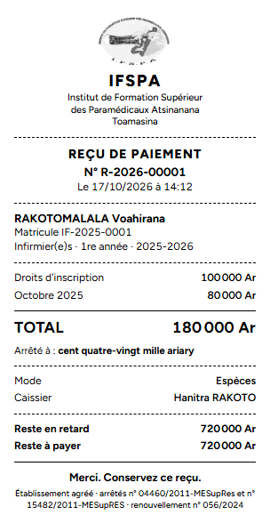
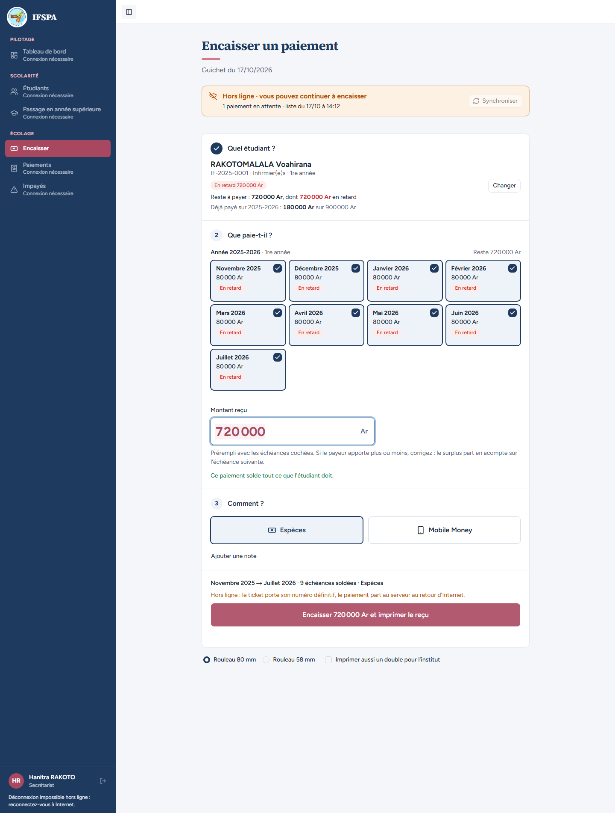
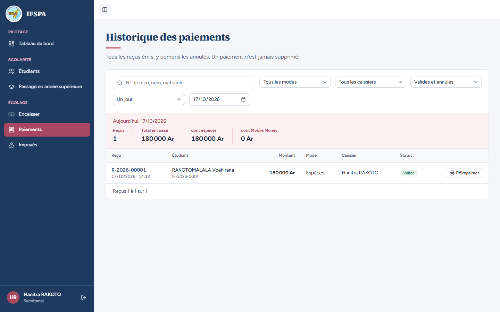
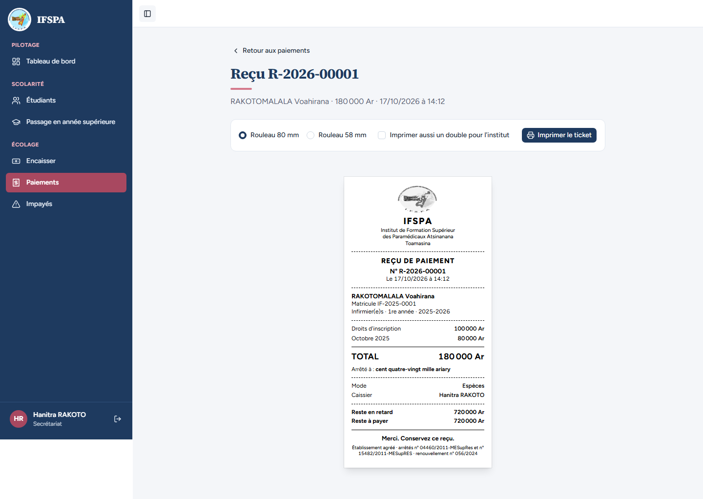

# UC13-01. Internet est coupé, la secrétaire encaisse deux échéances en espèces et tout part au retour du réseau

| | |
|---|---|
| Use case | UC13. Encaisser sans Internet |
| Règles couvertes | R-HL (page Encaisser hors ligne, copie locale, file d'attente, numéro de reçu définitif, synchronisation automatique), R-RECU (ticket, montant en lettres, reste à payer), R-REP (de la plus ancienne à la plus récente), R-ROLE (menu grisé) |
| Rôle | Secrétariat, compte « Hanitra RAKOTO » |
| Durée estimée | 10 minutes |

## La situation

Une coupure d'Internet frappe l'institut pendant la rentrée. La mère de Voahirana RAKOTOMALALA se présente quand même au guichet pour payer les droits d'inscription et octobre en espèces. La secrétaire recharge la page Encaisser (le poste ne sait plus où est Internet), cherche l'étudiante dans la liste du poste, encaisse et remet le ticket, qui porte déjà son numéro définitif. Quand Internet revient, le paiement part tout seul au serveur.

## Avant de commencer

1. `pnpm recette:base`, `pnpm build`, `pnpm recette:app`, puis ouvrir `http://localhost:3200` dans Chrome ou Edge. Le service worker n'existe que dans la version construite : pas de `pnpm dev`.
2. Avoir déroulé [00-PREPARATION.md](../00-PREPARATION.md), sections A, B et C (étudiante RAKOTOMALALA Voahirana, **IF-2025-0001**, 900 000 Ar en retard).
3. Se connecter avec le compte **secrétariat** (identifiants `SEED_USER_*` de `.env`). Le nom « Hanitra RAKOTO » est en bas de la barre latérale.
4. Ce cas est le **premier** du lot UC13 : le navigateur sert de poste de guichet et garde ses numéros de reçu, sa liste et sa file d'un cas à l'autre. Dérouler les cas 01 à 08 **dans l'ordre, dans le même navigateur** : les numéros de reçu ci-dessous en dépendent (premier ticket du poste : R-2026-00001).
5. Couper Internet à la main : débrancher le câble ou couper le Wi-Fi du poste, **ou** ouvrir les outils du navigateur (F12), onglet Réseau, liste « Limitation » (« No throttling ») et choisir « Hors connexion » (« Offline »). Pour rétablir : remettre « Aucune limitation ».

## Étapes

| # | Qui | Action | Résultat attendu | Capture | ✓ |
|---|---|---|---|---|---|
| 1 | Secrétariat | Menu **Encaisser**, avec Internet. Attendre quelques secondes (le poste prépare sa liste). | Bandeau vert « En ligne · tout est synchronisé » avec le bouton « Synchroniser » actif. Tout le menu est actif. « Hanitra RAKOTO » est affiché en bas à gauche. |  | |
| 2 | Secrétariat | Couper Internet (voir « Avant de commencer »). Ne rien toucher d'autre. | Sans recharger : bandeau orange « **Hors ligne · vous pouvez continuer à encaisser** » avec « liste du JJ/MM à HH:MM » (heure de la dernière mise à jour de la liste), bouton « Synchroniser » grisé. Les entrées Tableau de bord, Étudiants, Passage en année supérieure, Paiements, Impayés portent « Connexion nécessaire » ; Encaisser reste actif. En bas à gauche : « Déconnexion impossible hors ligne : reconnectez-vous à Internet. » |  | |
| 3 | Secrétariat | Recharger la page (F5). | La page Encaisser s'ouvre quand même, avec le même bandeau orange, le même menu grisé, le nom « Hanitra RAKOTO » et le **logo de l'institut en haut de la barre latérale**. |  | |
| 4 | Secrétariat | Cliquer dans la recherche et taper `RAKOTOMALALA`. | Titre « Recherche dans la liste de ce poste », puis « 1 étudiant trouvé » : **RAKOTOMALALA Voahirana**, IF-2025-0001 · IF · 1re année, badge « En retard 900 000 Ar ». |  | |
| 5 | Secrétariat | Appuyer sur Entrée. Cliquer sur la carte **Novembre 2025** pour ne garder que les deux premières échéances. | « Reste à payer : **900 000 Ar**, dont 900 000 Ar en retard ». Onze cartes « En retard » cochées d'office, puis seules **Droits d'inscription** (100 000 Ar) et **Octobre 2025** (80 000 Ar) restent cochées. « Montant reçu » : **180 000**. Récapitulatif « Droits d'inscription → Octobre 2025 · 2 échéances soldées · Espèces ». Message orange « Hors ligne : le ticket porte son numéro définitif, le paiement part au serveur au retour d'Internet. » Bouton « Encaisser 180 000 Ar et imprimer le reçu ». |  | |
| 6 | Secrétariat | Cliquer **Encaisser 180 000 Ar et imprimer le reçu**. | Message vert « **Ticket R-2026-00001 remis.** Paiement gardé sur ce poste, il sera envoyé à la prochaine synchronisation. » puis « 180 000 Ar · Espèces · RAKOTOMALALA Voahirana. Reste à payer : 720 000 Ar. » Le navigateur lance l'impression. Le bandeau dit « **1 paiement en attente** · liste du JJ/MM à HH:MM ». L'écran est remis à zéro pour le parent suivant. |  | |
| 7 | Secrétariat | Regarder le ticket dans l'aperçu avant impression (ou sur le papier). | Ticket 80 mm, noir et blanc, sans QR code : **N° R-2026-00001**, Droits d'inscription 100 000 Ar, Octobre 2025 80 000 Ar, **TOTAL 180 000 Ar**, « Arrêté à : cent quatre-vingt mille ariary », Mode Espèces, Caissier Hanitra RAKOTO, Reste en retard 720 000 Ar, Reste à payer 720 000 Ar. **Le logo de l'institut figure en tête**, comme sur le ticket du serveur (étape 11). |  | |
| 8 | Secrétariat | Chercher de nouveau `RAKOTOMALALA`, Entrée. | Le reste dû a déjà baissé sur le poste : « Reste à payer : **720 000 Ar**, dont 720 000 Ar en retard », « Déjà payé sur 2025-2026 : 180 000 Ar sur 900 000 Ar ». La liste des échéances commence à Novembre 2025. |  | |
| 9 | Secrétariat | Rétablir Internet (sans toucher à la page). | Après quelques secondes, bandeau vert « **En ligne · tout est synchronisé** » et compte rendu « **1 paiement envoyé au serveur** ». Le menu est de nouveau actif. |  | |
| 10 | Secrétariat | Menu **Paiements**. | Aujourd'hui : « Reçus 1 », « Total encaissé 180 000 Ar ». Ligne **R-2026-00001**, RAKOTOMALALA Voahirana (IF-2025-0001), 180 000 Ar, Espèces, Hanitra RAKOTO, badge « Valide », **pas** de badge « À vérifier ». |  | |
| 11 | Secrétariat | Cliquer **Réimprimer** sur cette ligne. | Reçu R-2026-00001 lu au serveur : même numéro que le ticket remis, mêmes lignes, « Reste à payer 720 000 Ar », avec le logo de l'institut. |  | |

## Ce que ce scénario ne couvre pas

- **Coupure réelle du Wi-Fi ou du câble** : le parcours automatique coupe le réseau du navigateur (`setOffline`). À faire par vous au poste (voir le rapport).
- **Impression sur l'imprimante thermique** : le parcours capture l'aperçu en média « impression », pas le papier.
- Poste qui n'a **jamais** eu Internet (première ouverture sans copie locale) : non démontré.
- Refus du serveur à la synchronisation (rôle, session d'un autre caissier) : couverts par Vitest, `tests/integration/routes-encaissement.test.ts` et `tests/integration/synchronisation-hors-ligne.test.ts`.
- Décision provisoire n° 35 (coupure plus longue que la session de 12 h) : non démontrable ici.

## Dernière exécution par l'agent

- 17/10/2026 (après corrections) : ✅ 11 étapes sur 11. Premier passage du jour : ❌ étapes 3 et 7 (logos cassés hors ligne), corrigé ensuite, voir [RAPPORT_2026-10-17_UC13](../../rapports/RAPPORT_2026-10-17_UC13.md), anomalie n° 1.
- Parcours : [UC13-01-nominal.recette.ts](../../parcours/UC13-01-nominal.recette.ts) (le logo du poste neuf est contrôlé à part par [UC13-09](UC13-09-logo-poste-neuf.md)).
