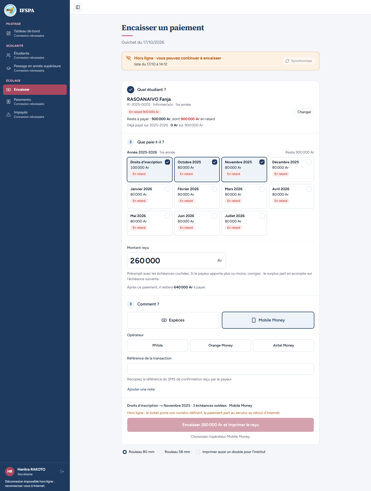
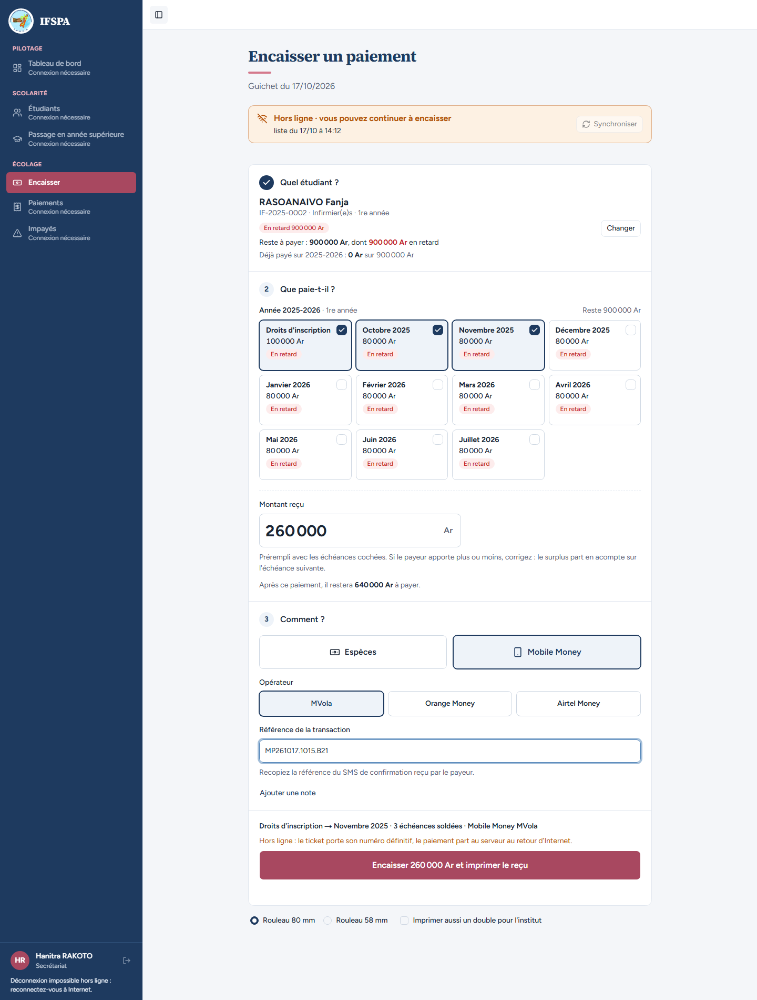
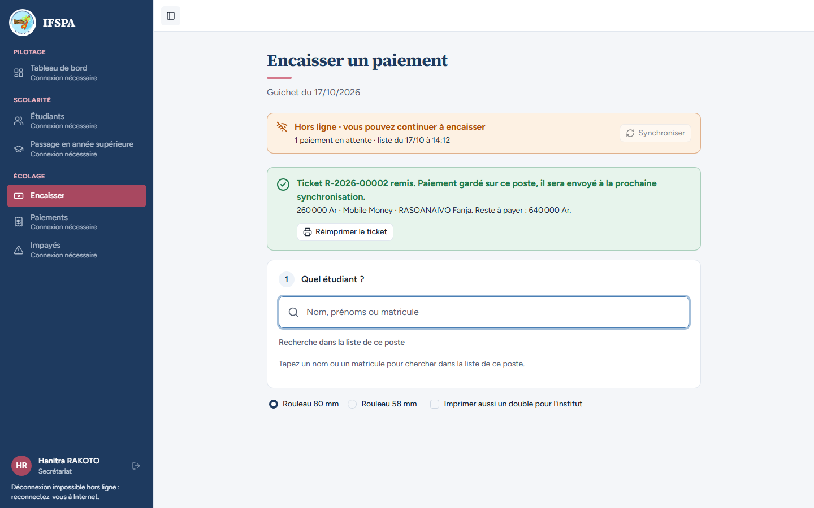
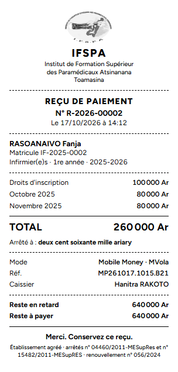
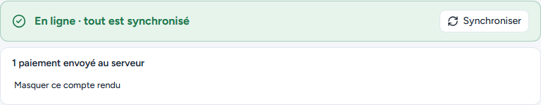
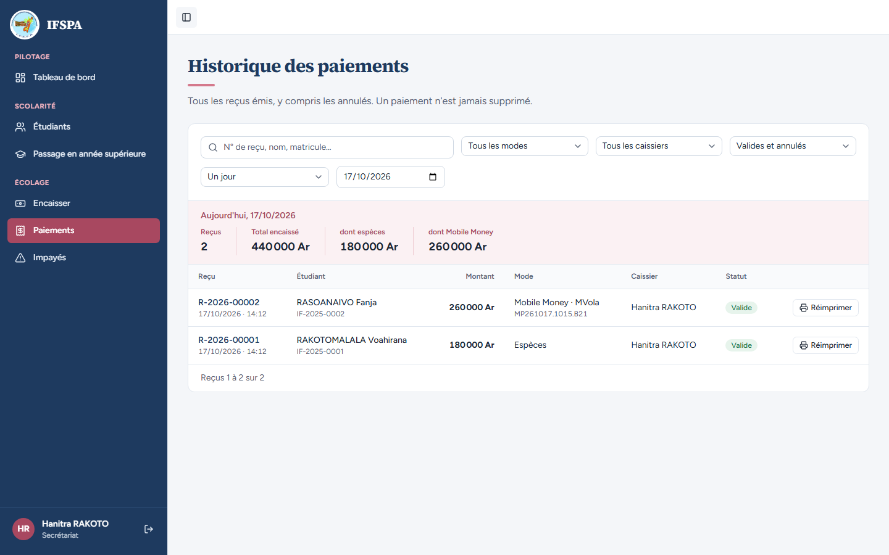

# UC13-02. Sans Internet, un parent paie trois échéances en Mobile Money (MVola)

| | |
|---|---|
| Use case | UC13. Encaisser sans Internet |
| Règles couvertes | R-HL, R-PAR (mode de paiement), R-RECU (mode, référence, montant en lettres, reste), R-REP |
| Rôle | Secrétariat, compte « Hanitra RAKOTO » |
| Durée estimée | 10 minutes |

## La situation

Internet est toujours coupé. Le père de Fanja RASOANAIVO paie les droits d'inscription, octobre et novembre par MVola et montre le SMS de confirmation. La secrétaire choisit Mobile Money, l'opérateur, recopie la référence du SMS, encaisse et remet le ticket, qui porte le mode et la référence.

## Avant de commencer

- Mêmes préparatifs que [UC13-01](UC13-01-nominal.md) (dont « Avant de commencer », points 1 à 5). Avoir déroulé **UC13-01** dans le même navigateur : le premier ticket du poste est R-2026-00001, celui-ci est le **R-2026-00002**.
- Étudiante : RASOANAIVO Fanja, **IF-2025-0002**, 900 000 Ar en retard ([00-PREPARATION.md](../00-PREPARATION.md), section B2).
- Compte **secrétariat** (`SEED_USER_*`).

## Étapes

| # | Qui | Action | Résultat attendu | Capture | ✓ |
|---|---|---|---|---|---|
| 1 | Secrétariat | Ouvrir **Encaisser** avec Internet, attendre le bandeau vert « En ligne · tout est synchronisé », couper Internet, recharger (F5). | Bandeau orange « Hors ligne · vous pouvez continuer à encaisser », menu grisé « Connexion nécessaire ». |  | |
| 2 | Secrétariat | Chercher `RASOANAIVO`, Entrée. Cliquer sur la carte **Décembre 2025** pour ne garder que trois échéances. | « Reste à payer : 900 000 Ar ». Droits d'inscription, Octobre 2025 et Novembre 2025 cochés ; « Montant reçu » **260 000** ; « Après ce paiement, il restera 640 000 Ar à payer. » | | |
| 3 | Secrétariat | Choisir **Mobile Money** (sans rien d'autre). | Les trois opérateurs MVola, Orange Money, Airtel Money et le champ « Référence de la transaction » apparaissent. Sous le bouton « Encaisser 260 000 Ar et imprimer le reçu », grisé : « **Choisissez l'opérateur Mobile Money.** » |  | |
| 4 | Secrétariat | Choisir **MVola**, puis saisir la référence `MP261017.1015.B21`. | Avant la référence : « Saisissez la référence de la transaction Mobile Money. » Après : le bouton s'ouvre. Récapitulatif « Droits d'inscription → Novembre 2025 · 3 échéances soldées · Mobile Money MVola ». |  | |
| 5 | Secrétariat | Cliquer **Encaisser 260 000 Ar et imprimer le reçu**. | « **Ticket R-2026-00002 remis.** Paiement gardé sur ce poste, il sera envoyé à la prochaine synchronisation. » Bandeau « 1 paiement en attente ». |  | |
| 6 | Secrétariat | Regarder le ticket dans l'aperçu avant impression. | N° R-2026-00002 ; Droits d'inscription 100 000 Ar, Octobre 2025 80 000 Ar, Novembre 2025 80 000 Ar ; **TOTAL 260 000 Ar** ; « Arrêté à : deux cent soixante mille ariary » ; Mode « Mobile Money · MVola » ; Réf. MP261017.1015.B21 ; Caissier Hanitra RAKOTO ; Reste en retard 640 000 Ar ; Reste à payer 640 000 Ar. **Le logo de l'institut figure en tête.** |  | |
| 7 | Secrétariat | Rétablir Internet. | Bandeau vert « En ligne · tout est synchronisé » et « 1 paiement envoyé au serveur ». |  | |
| 8 | Secrétariat | Menu **Paiements**. | Ligne **R-2026-00002**, RASOANAIVO Fanja, 260 000 Ar, « Mobile Money · MVola » avec la référence **MP261017.1015.B21** dessous, badge « Valide ». Totaux du jour : Reçus 2, Total encaissé 440 000 Ar, dont espèces 180 000 Ar, dont Mobile Money 260 000 Ar. |  | |

## Ce que ce scénario ne couvre pas

- Orange Money et Airtel Money : même écran, non déroulés.
- Opérateur ou référence manquants **au serveur** : refus couvert par les tests d'encaissement (`tests/integration/`), pas démontré ici.
- Coupure réelle et imprimante thermique : voir UC13-01.

## Dernière exécution par l'agent

- 17/10/2026 (après corrections) : ✅ 8 étapes sur 8. Premier passage du jour : ❌ étape 6 (logo du ticket cassé hors ligne), corrigé ensuite. Voir [RAPPORT_2026-10-17_UC13](../../rapports/RAPPORT_2026-10-17_UC13.md).
- Parcours : [UC13-02-mobile-money.recette.ts](../../parcours/UC13-02-mobile-money.recette.ts).
