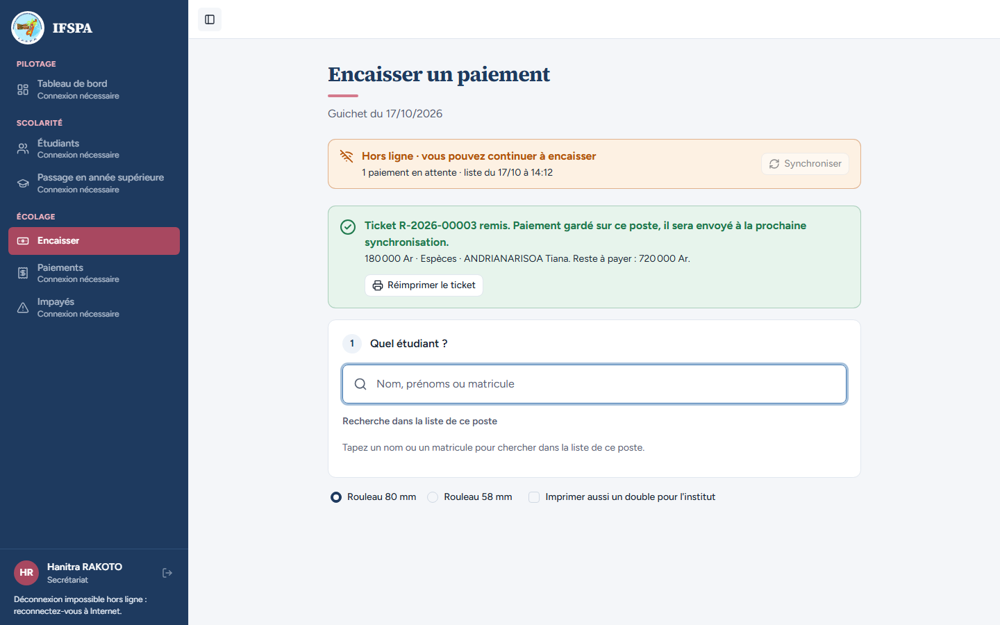
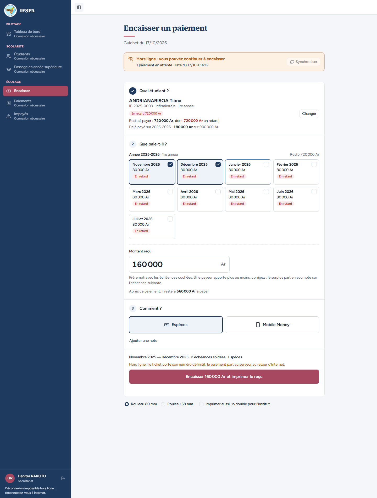
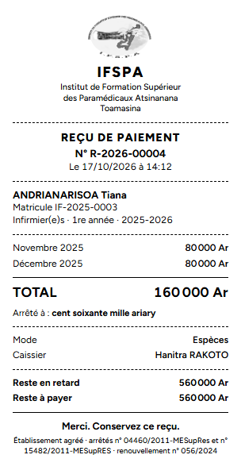
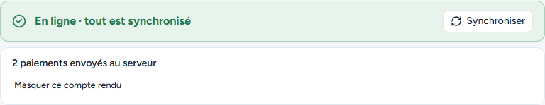
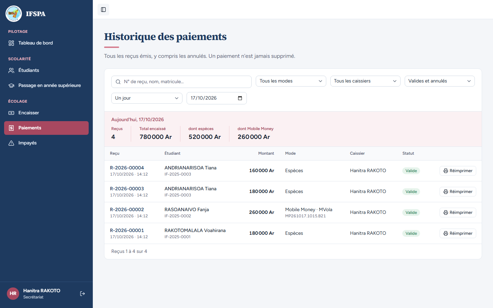
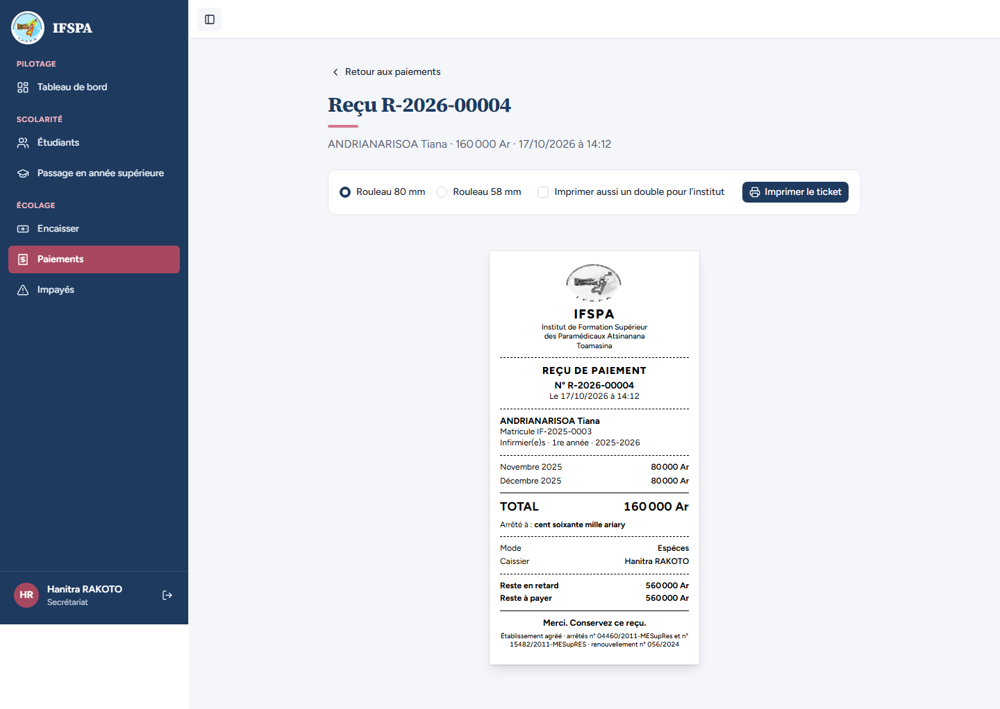
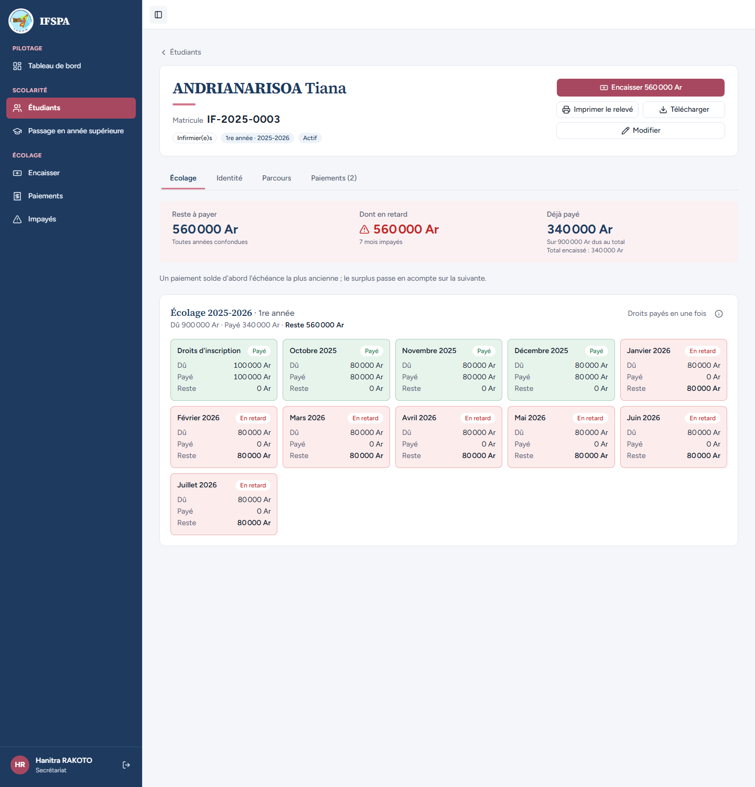

# UC13-03. Sans Internet, le même étudiant paie deux fois : le second paiement part des restes déjà diminués

| | |
|---|---|
| Use case | UC13. Encaisser sans Internet |
| Règles couvertes | R-HL (file d'attente, ordre d'envoi, numéros conservés), R-REP (plus ancienne d'abord), R-RECU (reste figé à l'émission) |
| Rôle | Secrétariat, compte « Hanitra RAKOTO » |
| Durée estimée | 12 minutes |

## La situation

Internet est coupé. Le frère de Tiana ANDRIANARISOA paie d'abord les droits d'inscription et octobre ; une heure plus tard, la mère revient payer novembre et décembre. Le poste n'a toujours pas Internet : le second paiement doit tenir compte du premier. Au retour du réseau, les deux paiements partent dans l'ordre et gardent leurs numéros.

## Avant de commencer

- Mêmes préparatifs que [UC13-01](UC13-01-nominal.md) (points 1 à 5). Avoir déroulé UC13-01 et UC13-02 dans le même navigateur : les tickets de ce cas sont les **R-2026-00003** et **R-2026-00004**.
- Étudiant : ANDRIANARISOA Tiana, **IF-2025-0003**, 900 000 Ar en retard ([00-PREPARATION.md](../00-PREPARATION.md), section B3).
- Compte **secrétariat** (`SEED_USER_*`).

## Étapes

| # | Qui | Action | Résultat attendu | Capture | ✓ |
|---|---|---|---|---|---|
| 1 | Secrétariat | **Encaisser** avec Internet, attendre le bandeau vert, couper Internet, recharger (F5). | Bandeau « Hors ligne · vous pouvez continuer à encaisser ». | | |
| 2 | Secrétariat | Chercher `ANDRIANARISOA`, Entrée, cliquer sur la carte **Novembre 2025**, puis **Encaisser 180 000 Ar et imprimer le reçu**. | « Reste à payer : 900 000 Ar ». « **Ticket R-2026-00003 remis.** Paiement gardé sur ce poste… » ; bandeau « 1 paiement en attente ». |  | |
| 3 | Secrétariat | Chercher de nouveau `ANDRIANARISOA`, Entrée. Cliquer sur la carte **Janvier 2026**. | « Reste à payer : **720 000 Ar** », « Déjà payé sur 2025-2026 : 180 000 Ar sur 900 000 Ar ». La carte « Droits d'inscription » a disparu, la liste commence à **Novembre 2025**. Novembre et Décembre sont cochés, « Montant reçu » **160 000**, « Après ce paiement, il restera 560 000 Ar à payer. » |  | |
| 4 | Secrétariat | Cliquer **Encaisser 160 000 Ar et imprimer le reçu**. | « **Ticket R-2026-00004 remis.** » ; bandeau « **2 paiements en attente** ». |  | |
| 5 | Secrétariat | Regarder le second ticket dans l'aperçu avant impression. | N° R-2026-00004 ; Novembre 2025 80 000 Ar, Décembre 2025 80 000 Ar ; TOTAL 160 000 Ar ; « Arrêté à : cent soixante mille ariary » ; Reste en retard **560 000 Ar** ; Reste à payer **560 000 Ar** (le reste tient compte du premier paiement). **Logo en tête.** |  | |
| 6 | Secrétariat | Rétablir Internet. | Bandeau vert « En ligne · tout est synchronisé » et « **2 paiements envoyés au serveur** », sans mention « à vérifier ». |  | |
| 7 | Secrétariat | Menu **Paiements**. | Les reçus **R-2026-00003** (180 000 Ar) et **R-2026-00004** (160 000 Ar) d'ANDRIANARISOA Tiana, tous deux « Valide », numéros inchangés. Totaux du jour avec les cas précédents : Reçus 4, Total encaissé 780 000 Ar, dont espèces 520 000 Ar, dont Mobile Money 260 000 Ar. |  | |
| 8 | Secrétariat | Cliquer **Réimprimer** sur R-2026-00004. | Le reçu relu au serveur donne le même « Reste à payer 560 000 Ar ». |  | |
| 9 | Secrétariat | Retour à **Paiements**, cliquer le nom **ANDRIANARISOA Tiana** pour ouvrir sa fiche. | Fiche IF-2025-0003 : « Reste à payer **560 000 Ar** », « Déjà payé **340 000 Ar** », onglet « Paiements (2) ». Droits d'inscription, Octobre, Novembre et Décembre 2025 « Payé » ; Janvier à Juillet 2026 « En retard ». |  | |

## Ce que ce scénario ne couvre pas

- Plus de deux paiements en file, ou plusieurs étudiants en file : non déroulé (ordre d'envoi par heure de saisie couvert par Vitest, `tests/integration/routes-encaissement.test.ts`).
- Coupure réelle et imprimante thermique : voir UC13-01.

## Dernière exécution par l'agent

- 17/10/2026 (après corrections) : ✅ 9 étapes sur 9. Premier passage du jour : ❌ étape 5 (logo du ticket cassé hors ligne), corrigé ensuite. Voir [RAPPORT_2026-10-17_UC13](../../rapports/RAPPORT_2026-10-17_UC13.md).
- Parcours : [UC13-03-deux-paiements.recette.ts](../../parcours/UC13-03-deux-paiements.recette.ts).
