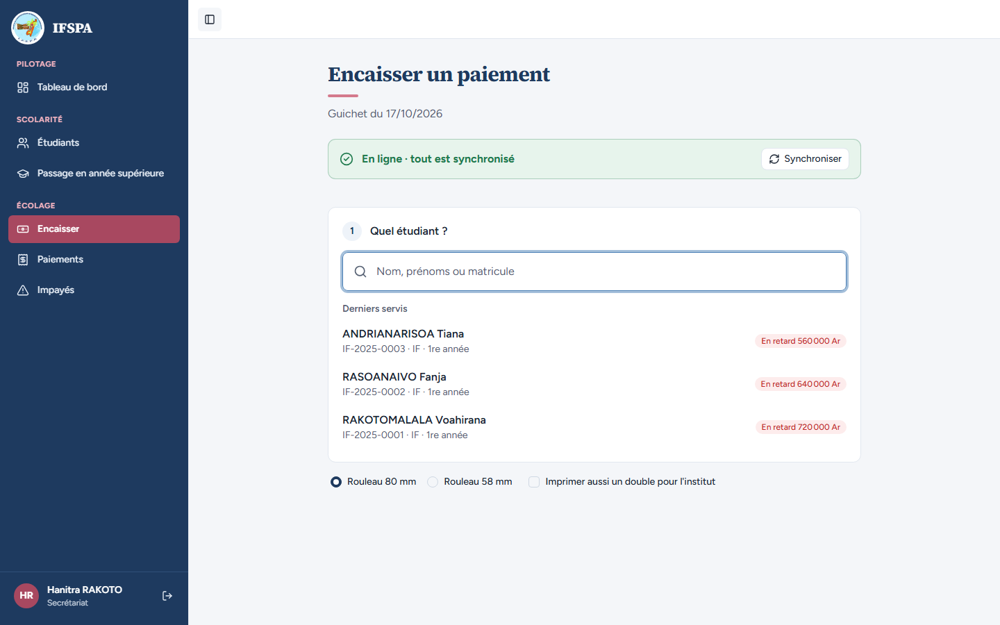
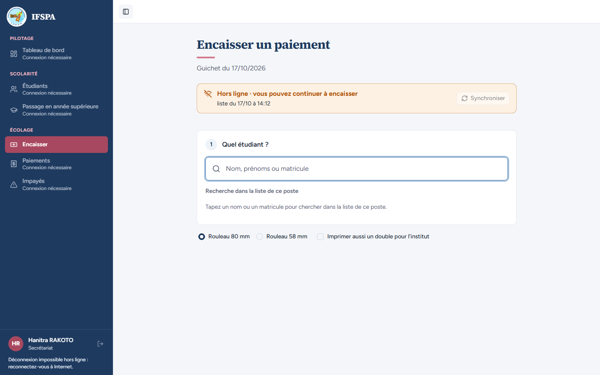
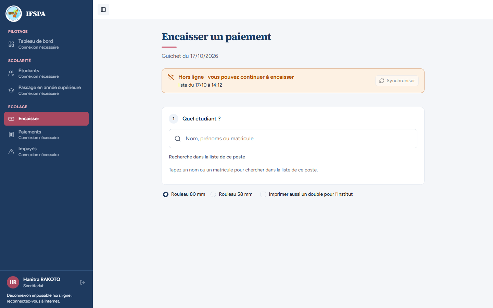
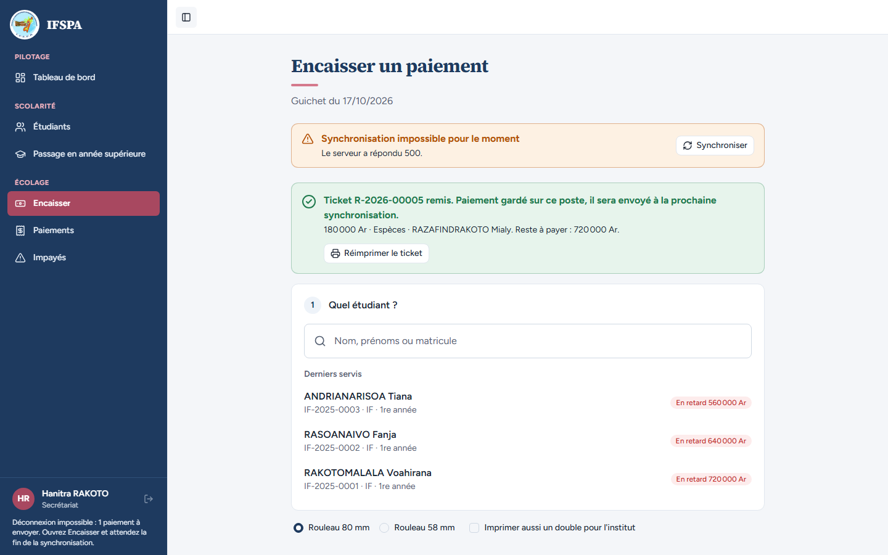
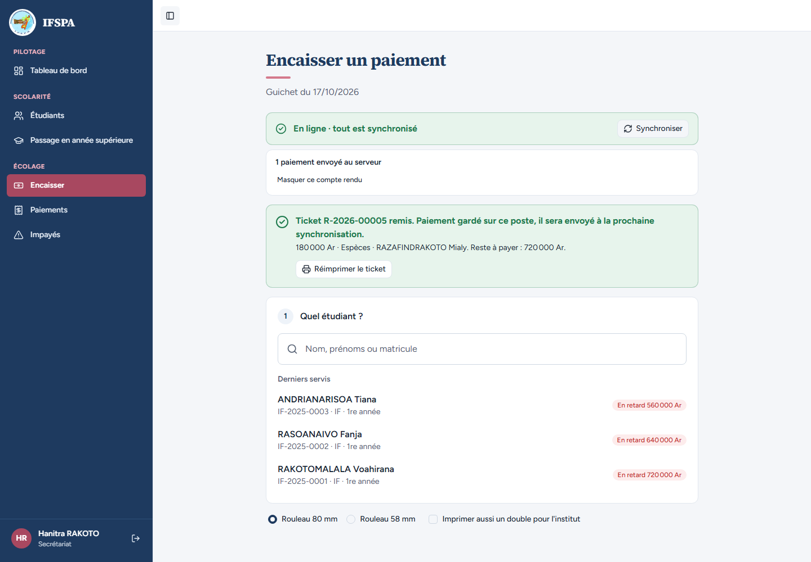

# UC13-04. Sans Internet, le menu est grisé et la déconnexion est refusée tant qu'un paiement attend d'être envoyé

| | |
|---|---|
| Use case | UC13. Encaisser sans Internet |
| Règles couvertes | R-HL (cadre hors ligne, déconnexion bloquée avec sa raison, synchronisation manuelle), R-ROLE (le secrétariat ne voit pas Paramètres) |
| Rôle | Secrétariat, compte « Hanitra RAKOTO » |
| Durée estimée | 10 minutes |

## La situation

Internet est coupé. La secrétaire a un paiement en main et veut aussi consulter la liste des étudiants : le menu lui dit que ces écrans demandent Internet. Pressée de partir, elle essaie de se déconnecter : l'application refuse, car de l'argent déjà encaissé n'est pas encore parti au serveur, et le lui explique.

## Avant de commencer

- Mêmes préparatifs que [UC13-01](UC13-01-nominal.md) (points 1 à 5). Avoir déroulé UC13-01 à UC13-03 dans le même navigateur : le ticket de ce cas est le **R-2026-00005**.
- Étudiante : RAZAFINDRAKOTO Mialy, **SF-2025-0001**, 900 000 Ar en retard ([00-PREPARATION.md](../00-PREPARATION.md), section B4).
- Compte **secrétariat** (`SEED_USER_*`). **Ne pas cliquer réellement sur « Se déconnecter »** à la fin : cela fermerait la session pour les cas suivants.

## Étapes

| # | Qui | Action | Résultat attendu | Capture | ✓ |
|---|---|---|---|---|---|
| 1 | Secrétariat | Menu **Encaisser**, avec Internet. | Bandeau vert « En ligne · tout est synchronisé ». Le menu complet est actif (liens Tableau de bord, Étudiants, Passage en année supérieure, Paiements, Impayés). Le bouton « Se déconnecter » (icône, en bas à gauche) est actif. Pas de rubrique Paramètres pour le secrétariat. |  | |
| 2 | Secrétariat | Couper Internet, recharger (F5). | Bandeau orange « Hors ligne · vous pouvez continuer à encaisser ». Tableau de bord, Étudiants, Passage en année supérieure, Paiements et Impayés sont grisés avec la mention « **Connexion nécessaire** » ; **Encaisser reste actif**. |  | |
| 3 | Secrétariat | Cliquer sur **Étudiants (Connexion nécessaire)**. | Rien ne se passe : l'écran reste sur Encaisser (adresse `/app/encaisser`), le bandeau reste orange. |  | |
| 4 | Secrétariat | Cliquer sur le bouton **Se déconnecter** (icône, en bas à gauche). | Refusé : l'utilisatrice reste connectée (« Hanitra RAKOTO » toujours affiché). La raison est écrite sous son nom : « **Déconnexion impossible hors ligne : reconnectez-vous à Internet.** » |  | |
| 5 | Secrétariat | Chercher `RAZAFINDRAKOTO`, Entrée, cliquer la carte **Novembre 2025**, **Encaisser 180 000 Ar et imprimer le reçu**. | « **Ticket R-2026-00005 remis.** Paiement gardé sur ce poste… » ; bandeau « 1 paiement en attente ». | | |
| 6 | Secrétariat | Rétablir Internet **alors que le serveur répond une erreur** à l'envoi (étape technique, voir ci-dessous). | Bandeau orange « **Synchronisation impossible pour le moment** · Le serveur a répondu 500. » avec le bouton « Synchroniser » **actif**. En bas à gauche : « **Déconnexion impossible : 1 paiement à envoyer. Ouvrez Encaisser et attendez la fin de la synchronisation.** » Le clic sur « Se déconnecter » ne fait rien. |  | |
| 7 | Secrétariat | Quand le serveur répond de nouveau, cliquer **Synchroniser**. | Bandeau vert « En ligne · tout est synchronisé », compte rendu « **1 paiement envoyé au serveur** ». Le message de déconnexion disparaît, le bouton « Se déconnecter » est de nouveau actif. |  | |

**Étapes 6 et 7, technique.** Le parcours automatique fait répondre une erreur 500 à l'adresse `/api/encaissement/synchroniser`. À la main, on ne sait pas provoquer proprement une erreur 500 : pour retrouver la **raison de déconnexion « 1 paiement à envoyer »**, arrêter le serveur de recette (Ctrl+C dans la fenêtre de `pnpm recette:app`) après l'étape 5, puis rétablir Internet : le message du bas de la barre latérale est le même, mais le bandeau reste orange « Hors ligne » (voir UC13-07). Relancer ensuite `pnpm recette:app` ; l'envoi se fait seul au plus tard 5 minutes plus tard (UC13-07).

## Ce que ce scénario ne couvre pas

- La déconnexion elle-même (clic sur « Se déconnecter » une fois tout envoyé) : non cliquée pour garder la session du lot.
- Un paiement saisi par **un autre compte** resté en attente sur le poste (« saisi par X, attend sa connexion », décision provisoire n° 36) : non déroulé.
- Un paiement **refusé définitivement** resté sur le poste (décision provisoire n° 44, ne bloque plus la déconnexion) : non déroulé.
- Refus de l'accès aux Paramètres par le secrétariat : démontré dans le scénario UC02/UC03 (à venir) ; ici seulement l'absence de la rubrique dans le menu.

## Dernière exécution par l'agent

- 17/10/2026 : ✅ 7 étapes sur 7 (étapes 6 et 7 avec réponse 500 simulée). Voir [RAPPORT_2026-10-17_UC13](../../rapports/RAPPORT_2026-10-17_UC13.md).
- Parcours : [UC13-04-menu-deconnexion.recette.ts](../../parcours/UC13-04-menu-deconnexion.recette.ts).
