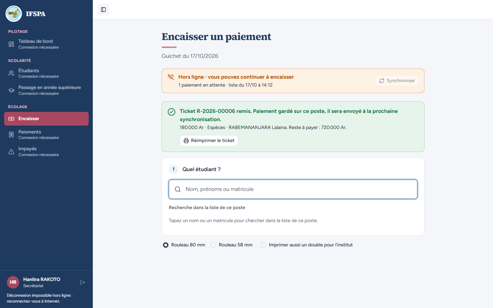
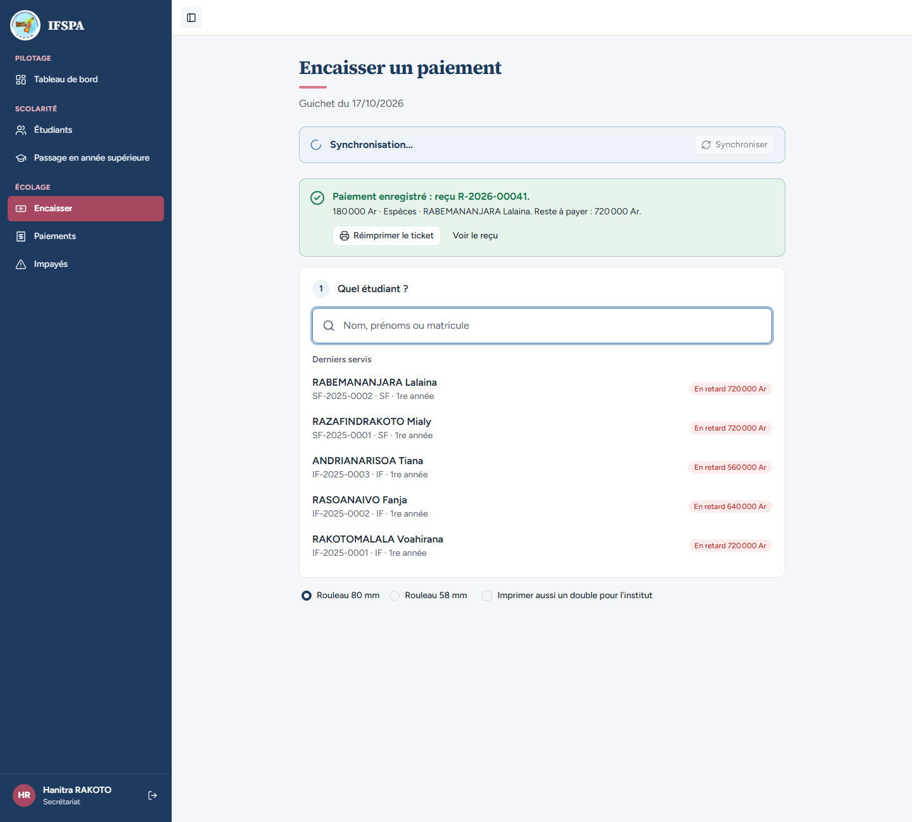
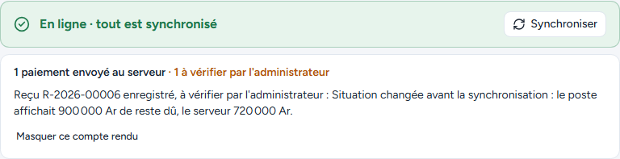
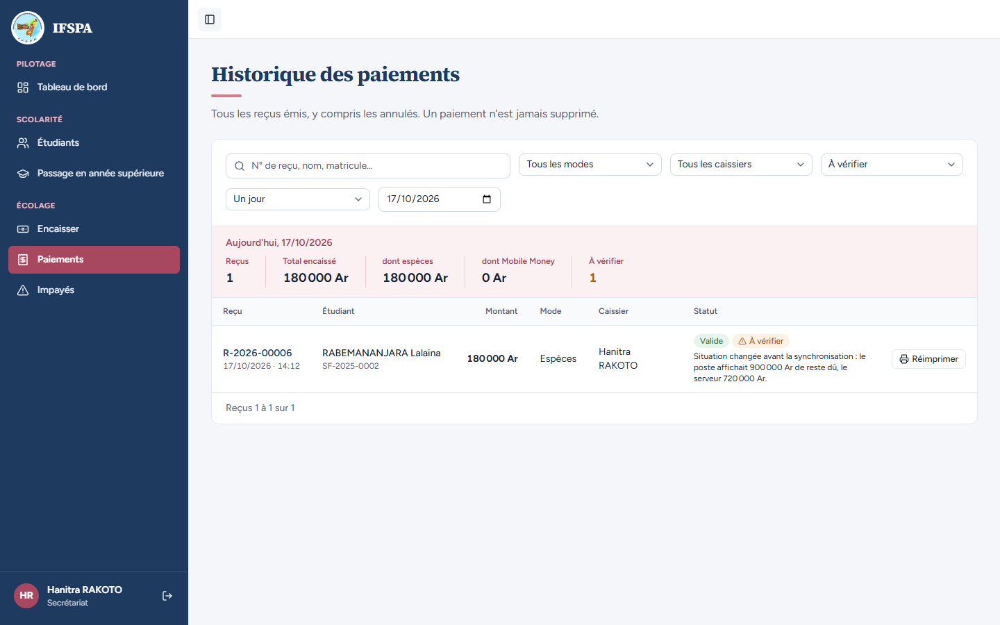
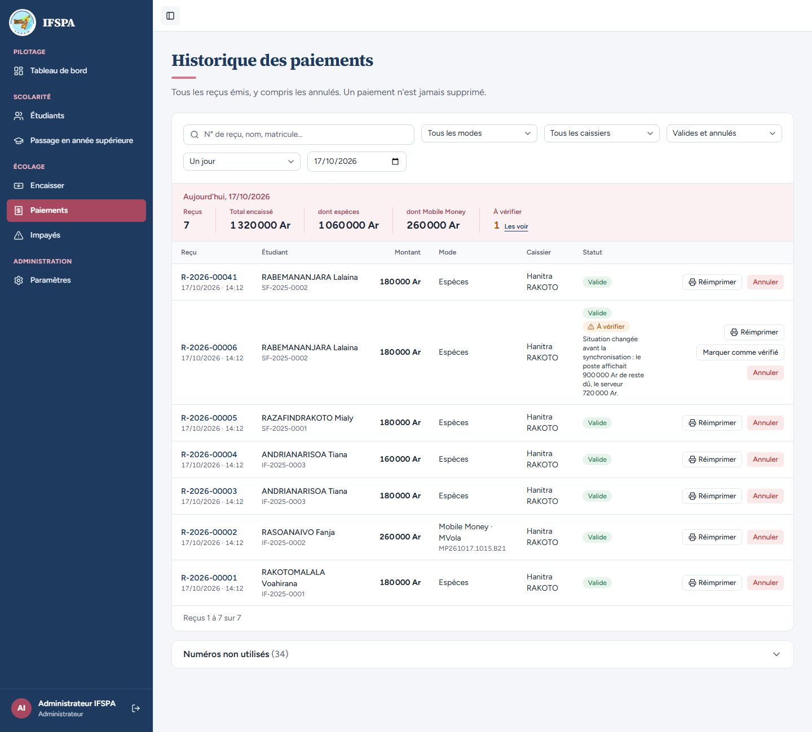
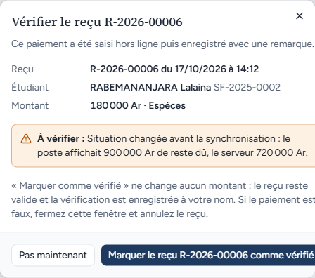
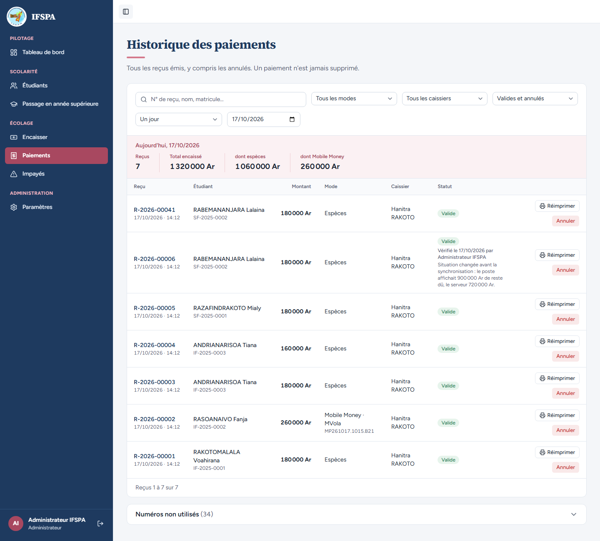
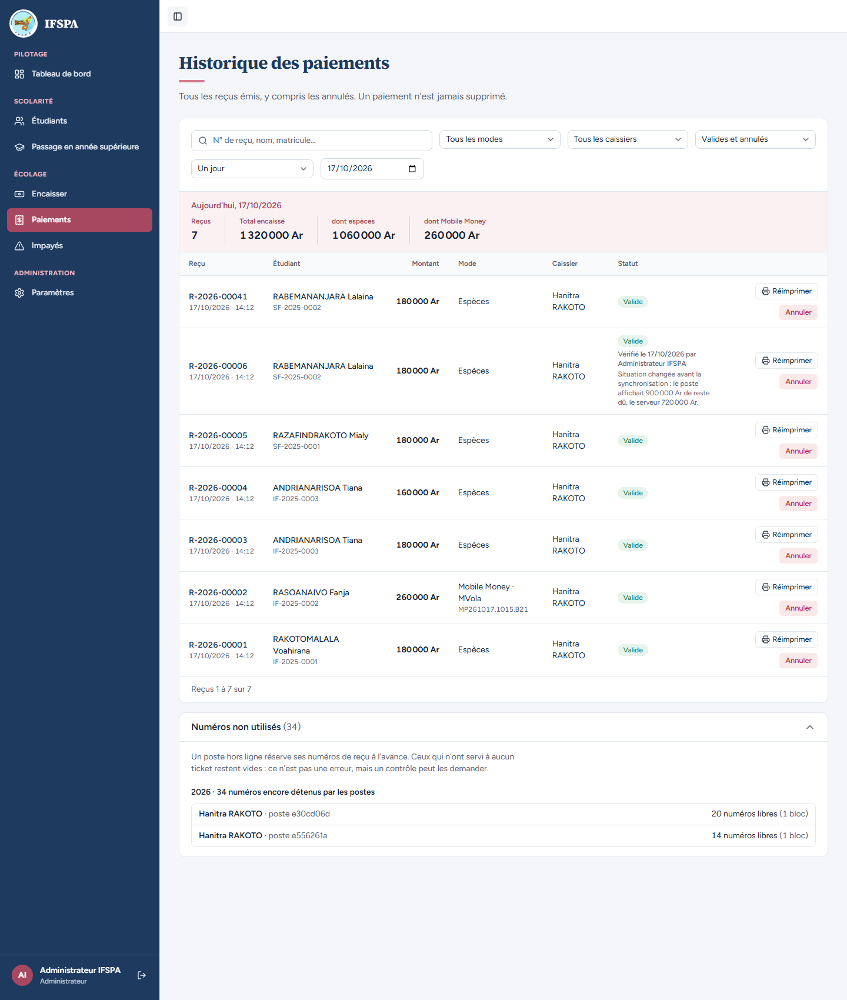
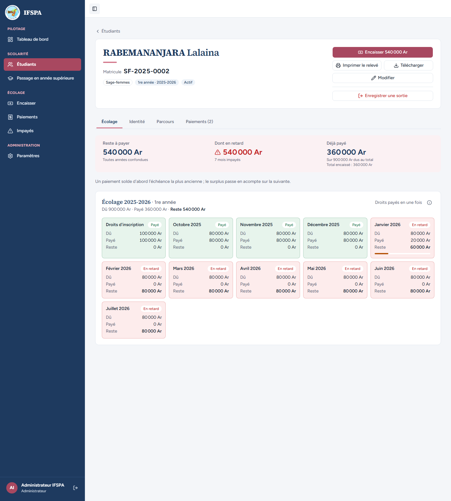
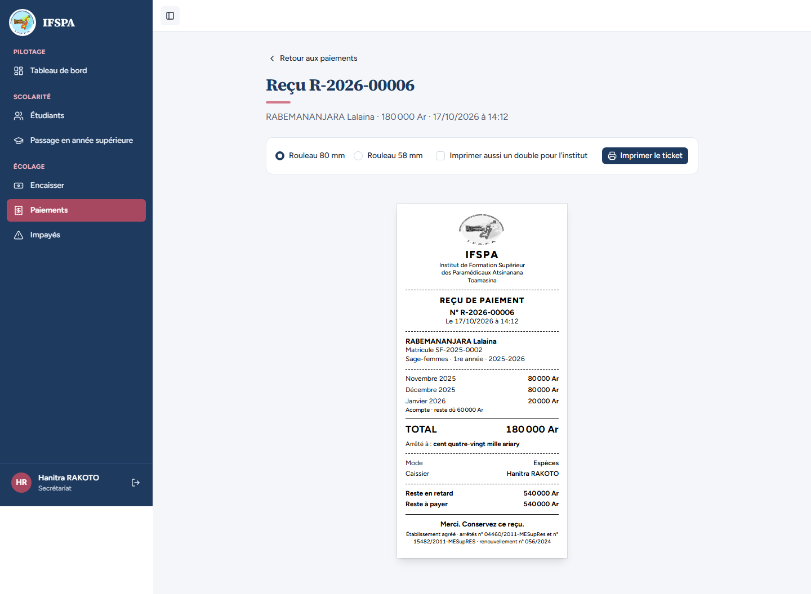

# UC13-05. Un autre poste a encaissé les mêmes mois pendant la coupure : le paiement est enregistré « à vérifier » et l'administrateur le traite

| | |
|---|---|
| Use case | UC13. Encaisser sans Internet |
| Règles couvertes | R-HL (revalidation au serveur, « à vérifier », l'argent n'est jamais perdu, numéros non utilisés), R-REP (la répartition est refaite sur ce qui reste dû), R-ROLE (le secrétariat voit mais ne traite pas ; l'administrateur traite) |
| Rôles | Secrétariat « Hanitra RAKOTO » (deux postes) puis administrateur « Administrateur IFSPA » |
| Durée estimée | 20 minutes |

## La situation

Internet est coupé au poste 1. La secrétaire encaisse en espèces les droits d'inscription et octobre de Lalaina RABEMANANJARA et remet un ticket. Pendant ce temps, la même famille s'est présentée à un second guichet, en ligne, et y a payé les mêmes mois. Quand le poste 1 retrouve Internet, son paiement est enregistré (l'argent a été reçu et un ticket remis) mais signalé « à vérifier ». L'administrateur lit la remarque et marque le reçu comme vérifié ; le secrétariat voit l'alerte mais ne peut pas la traiter.

## Avant de commencer

- Mêmes préparatifs que [UC13-01](UC13-01-nominal.md) (points 1 à 5). Avoir déroulé UC13-01 à UC13-04 dans le même navigateur (poste 1) : son ticket est le **R-2026-00006**.
- Un **second poste** : un autre navigateur ou une fenêtre de navigation privée (poste 2), connecté lui aussi au compte **secrétariat**, avec Internet. Ouvrir Encaisser une fois pour qu'il réserve ses numéros.
- Étudiante : RABEMANANJARA Lalaina, **SF-2025-0002**, 900 000 Ar en retard ([00-PREPARATION.md](../00-PREPARATION.md), section B5).
- Un troisième accès pour l'étape 5 : le compte **administrateur** (`SEED_ADMIN_*`), nom « Administrateur IFSPA ».

## Étapes

| # | Qui | Action | Résultat attendu | Capture | ✓ |
|---|---|---|---|---|---|
| 1 | Secrétariat, poste 1 | **Encaisser** avec Internet, attendre le bandeau vert, couper Internet, recharger. Chercher `RABEMANANJARA`, Entrée, cliquer la carte **Novembre 2025**, **Encaisser 180 000 Ar et imprimer le reçu**. | « Reste à payer : 900 000 Ar ». « **Ticket R-2026-00006 remis.** Paiement gardé sur ce poste… » ; bandeau « 1 paiement en attente ». |  | |
| 2 | Secrétariat, poste 2 (en ligne) | Dans l'autre navigateur : **Encaisser**, chercher `RABEMANANJARA`, Entrée, cliquer la carte **Novembre 2025**, **Encaisser 180 000 Ar et imprimer le reçu**. | « **Paiement enregistré : reçu R-2026-00041.** » avec « 180 000 Ar · Espèces · RABEMANANJARA Lalaina. Reste à payer : 720 000 Ar. » (le numéro vient après les blocs réservés par les deux postes : 41 sur une base fraîche suivie des cas 01 à 04). |  | |
| 3 | Secrétariat, poste 1 | Rétablir Internet au poste 1. | Bandeau vert « En ligne · tout est synchronisé ». Compte rendu : « **1 paiement envoyé au serveur · 1 à vérifier par l'administrateur** » puis « Reçu R-2026-00006 enregistré, à vérifier par l'administrateur : Situation changée avant la synchronisation : le poste affichait 900 000 Ar de reste dû, le serveur 720 000 Ar. » |  | |
| 4 | Secrétariat, poste 1 | Menu **Paiements**, lien **Les voir** à côté de « À vérifier ». | Filtre « À vérifier » : une ligne **R-2026-00006**, RABEMANANJARA Lalaina, 180 000 Ar, badges « Valide » et « **À vérifier** », la remarque « Situation changée avant la synchronisation… ». Seul le bouton « Réimprimer » est proposé : **ni « Marquer comme vérifié » ni « Annuler »**. Pas de section « Numéros non utilisés ». |  | |
| 5 | Administrateur | Se connecter avec le compte **administrateur** (autre navigateur). Menu **Paiements**, lien **Les voir**. | Même ligne R-2026-00006, mais avec les boutons « **Marquer comme vérifié** » et « **Annuler** ». Sous la liste : section repliée « **Numéros non utilisés** (34) ». Le nom « Administrateur IFSPA » est en bas à gauche. |  | |
| 6 | Administrateur | Cliquer **Marquer comme vérifié**. | Fenêtre « **Vérifier le reçu R-2026-00006** » : « Ce paiement a été saisi hors ligne puis enregistré avec une remarque. » ; Reçu R-2026-00006 du JJ/MM/AAAA à HH:MM ; RABEMANANJARA Lalaina SF-2025-0002 ; 180 000 Ar · Espèces ; encadré « À vérifier : Situation changée… » ; boutons « Pas maintenant » et « Marquer le reçu R-2026-00006 comme vérifié ». |  | |
| 7 | Administrateur | Cliquer **Marquer le reçu R-2026-00006 comme vérifié**, puis recharger Paiements. | La fenêtre se ferme. La ligne R-2026-00006 reste « Valide », sans badge « À vérifier », avec la mention « **Vérifié le JJ/MM/AAAA par Administrateur IFSPA** » et la remarque. Le lien « Les voir » a disparu des totaux. Aucun montant n'a changé. |  | |
| 8 | Administrateur | Dérouler **Numéros non utilisés**. | « Un poste hors ligne réserve ses numéros de reçu à l'avance. Ceux qui n'ont servi à aucun ticket restent vides : ce n'est pas une erreur, mais un contrôle peut les demander. » Puis « 2026 · 34 numéros encore détenus par les postes » : deux lignes « Hanitra RAKOTO · poste XXXXXXXX », **20 numéros libres (1 bloc)** et **14 numéros libres (1 bloc)**. |  | |
| 9 | Administrateur | Dans Paiements, cliquer le nom **RABEMANANJARA Lalaina**. | Fiche SF-2025-0002 : « Reste à payer **540 000 Ar** », « Déjà payé **360 000 Ar** ». Droits d'inscription, Octobre, Novembre et Décembre 2025 « Payé » ; **Janvier 2026** « En retard » avec 20 000 Ar payés et 60 000 Ar de reste. Les deux paiements (180 000 Ar chacun) sont comptés. |  | |
| 10 | Secrétariat, poste 1 | Menu **Paiements**, **Réimprimer** sur R-2026-00006. | Le reçu au serveur porte **le même numéro R-2026-00006** que le ticket remis, mais la répartition du serveur : Novembre 2025 80 000 Ar, Décembre 2025 80 000 Ar, Janvier 2026 20 000 Ar (« Acompte · reste dû 60 000 Ar »), Reste à payer **540 000 Ar**. Le ticket remis au parent disait « Droits d'inscription » et « Octobre 2025 », reste 720 000 Ar. (Décision provisoire n° 37 : la réimpression ne mentionne pas cette différence.) |  | |

## Ce que ce scénario ne couvre pas

- **Annuler** le paiement « à vérifier » (bouton « Annuler », motif) : démontré dans le futur scénario UC07.
- Refus du serveur à « Marquer comme vérifié » pour le secrétariat : couvert par Vitest, `tests/integration/actions-verification.test.ts` (« refuse le rôle user côté serveur, sans rien modifier »). Ici seulement l'absence du bouton à l'écran.
- Autres causes de « à vérifier » : trop-perçu, numéro de reçu refusé et remplacé (« Ticket X à remplacer par le reçu Y »), heure du poste incohérente. Couvertes par `tests/integration/synchronisation-hors-ligne.test.ts` (décisions provisoires n° 34, 40, 42), non déroulées à l'écran.
- Décision n° 22 (deux postes **en ligne** : le second est refusé) : non déroulée ici.

## Dernière exécution par l'agent

- 17/10/2026 : ✅ 10 étapes sur 10. Voir [RAPPORT_2026-10-17_UC13](../../rapports/RAPPORT_2026-10-17_UC13.md), question n° 2 (reçu réimprimé différent du ticket remis) et question n° 3 (numéros non utilisés).
- Parcours : [UC13-05-conflit-verifier.recette.ts](../../parcours/UC13-05-conflit-verifier.recette.ts).
