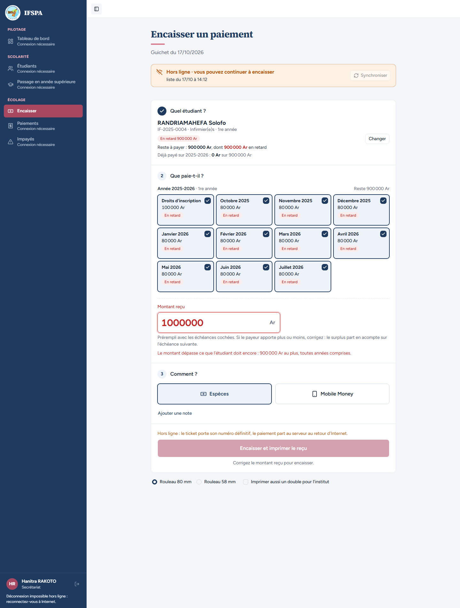
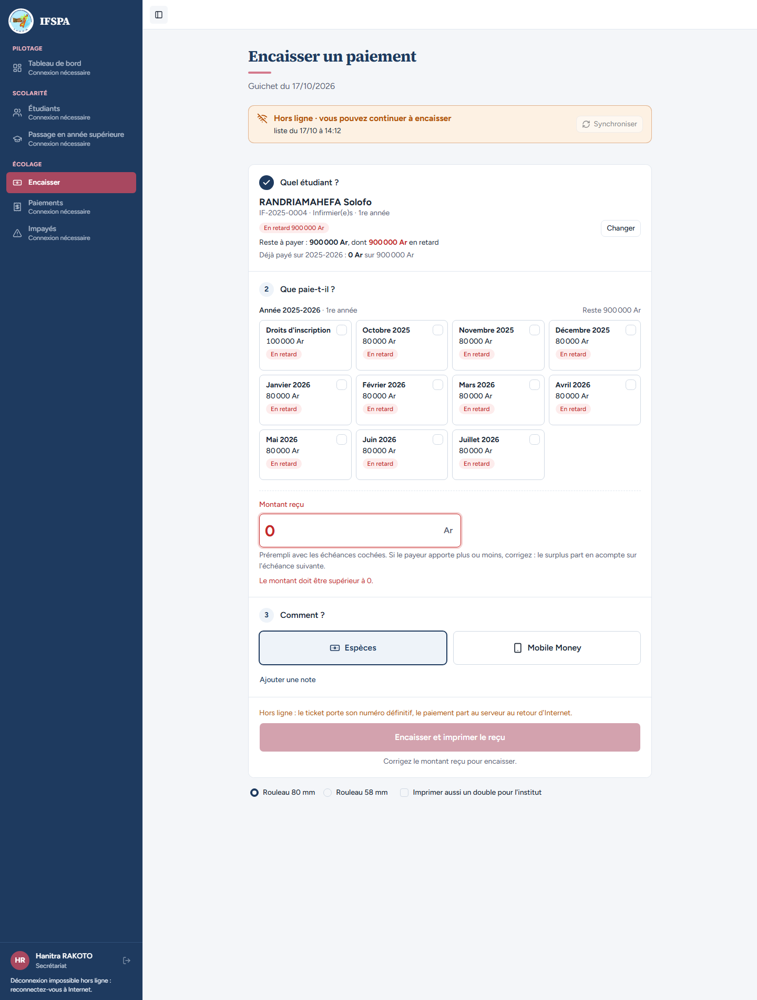
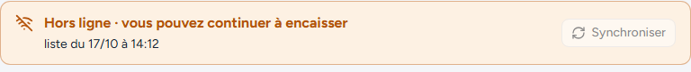
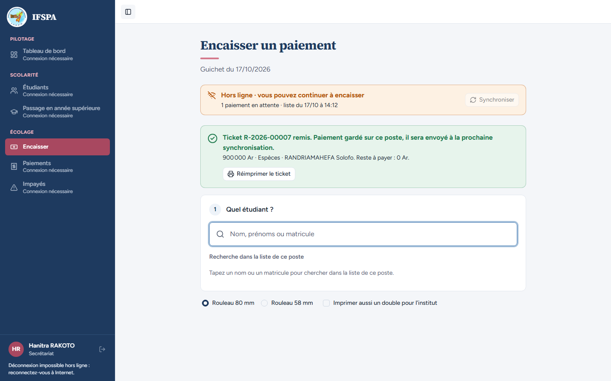
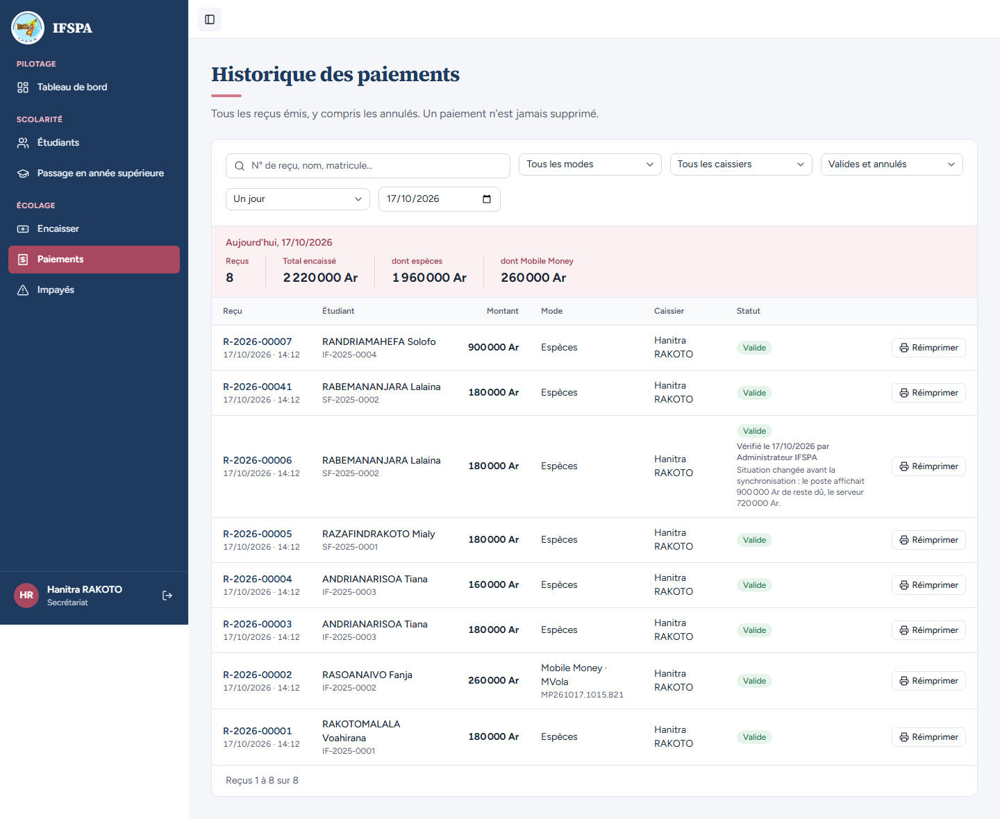

# UC13-06. Sans Internet, un montant au-delà du reste dû, ou nul, est refusé ; le reste dû exact est accepté

| | |
|---|---|
| Use case | UC13. Encaisser sans Internet |
| Règles couvertes | R-TROP (montant refusé au-delà du reste dû total, montant nul refusé), R-HL (mêmes contrôles qu'en ligne, aucun numéro de reçu consommé par un refus), R-RECU |
| Rôle | Secrétariat, compte « Hanitra RAKOTO » |
| Durée estimée | 10 minutes |

## La situation

Internet est coupé. Un parent veut tout solder, puis se trompe en comptant ses billets : la secrétaire saisit 1 000 000 Ar pour un reste dû de 900 000 Ar. L'écran refuse, comme il le ferait en ligne, et ne garde rien en attente. Un zéro saisi par erreur est refusé aussi. Elle corrige à 900 000 Ar : le paiement est accepté et solde tout.

## Avant de commencer

- Mêmes préparatifs que [UC13-01](UC13-01-nominal.md) (points 1 à 5). Avoir déroulé UC13-01 à UC13-05 dans le même navigateur : le ticket de ce cas est le **R-2026-00007** (les refus des étapes 2 et 3 ne consomment aucun numéro).
- Étudiant : RANDRIAMAHEFA Solofo, **IF-2025-0004**, 900 000 Ar en retard ([00-PREPARATION.md](../00-PREPARATION.md), section B6).
- Compte **secrétariat** (`SEED_USER_*`).

## Étapes

| # | Qui | Action | Résultat attendu | Capture | ✓ |
|---|---|---|---|---|---|
| 1 | Secrétariat | **Encaisser** avec Internet, attendre le bandeau vert, couper Internet, recharger. Chercher `RANDRIAMAHEFA`, Entrée. | Bandeau orange « Hors ligne · vous pouvez continuer à encaisser ». « Reste à payer : **900 000 Ar**, dont 900 000 Ar en retard ». | | |
| 2 | Secrétariat | Dans « Montant reçu », saisir `1000000`. | Champ en rouge ; message « **Le montant dépasse ce que l'étudiant doit encore : 900 000 Ar au plus, toutes années comprises.** » Le bouton « Encaisser et imprimer le reçu » est grisé ; sous lui : « Corrigez le montant reçu pour encaisser. » |  | |
| 3 | Secrétariat | Remplacer par `0`. | Champ en rouge ; message « **Le montant doit être supérieur à 0.** » Bouton grisé, « Corrigez le montant reçu pour encaisser. » |  | |
| 4 | Secrétariat | Regarder le bandeau en haut de l'écran. | Il dit seulement « Hors ligne · vous pouvez continuer à encaisser » et « liste du JJ/MM à HH:MM » : **aucun paiement en attente**. |  | |
| 5 | Secrétariat | Saisir `900000` (exactement le reste dû), cliquer **Encaisser 900 000 Ar et imprimer le reçu**. | « Ce paiement solde tout ce que l'étudiant doit. » avant le clic. Puis « **Ticket R-2026-00007 remis.** Paiement gardé sur ce poste… » avec « 900 000 Ar · Espèces · RANDRIAMAHEFA Solofo. **Reste à payer : 0 Ar.** » ; bandeau « 1 paiement en attente ». Le numéro suit celui du cas précédent : les refus n'ont consommé aucun numéro. |  | |
| 6 | Secrétariat | Rétablir Internet, puis menu **Paiements**. | Bandeau « En ligne · tout est synchronisé », « 1 paiement envoyé au serveur ». Ligne **R-2026-00007**, RANDRIAMAHEFA Solofo, 900 000 Ar, Espèces, « Valide ». |  | |

## Ce que ce scénario ne couvre pas

- Le refus **au serveur** d'un paiement hors ligne qui dépasse le reste dû (échéances soldées ailleurs entre-temps) : le paiement est enregistré « à vérifier » avec une note de surplus (décision provisoire n° 34), couvert par `tests/integration/synchronisation-hors-ligne.test.ts` (« trop-perçu : imputé jusqu'au reste… »). Non déroulé à l'écran.
- Un montant avec des décimales ou du texte : refus par `lireMontant`, non déroulé.

## Dernière exécution par l'agent

- 17/10/2026 : ✅ 6 étapes sur 6. Voir [RAPPORT_2026-10-17_UC13](../../rapports/RAPPORT_2026-10-17_UC13.md).
- Parcours : [UC13-06-refus-trop-percu.recette.ts](../../parcours/UC13-06-refus-trop-percu.recette.ts).
