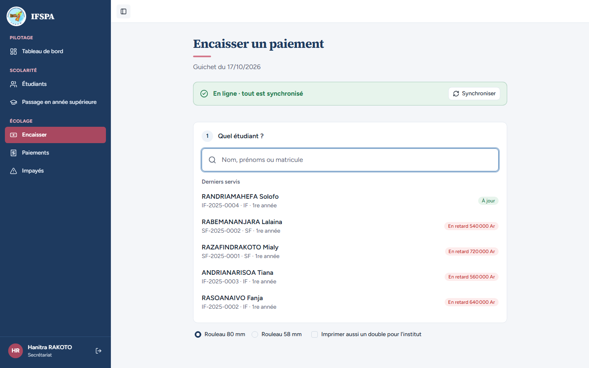
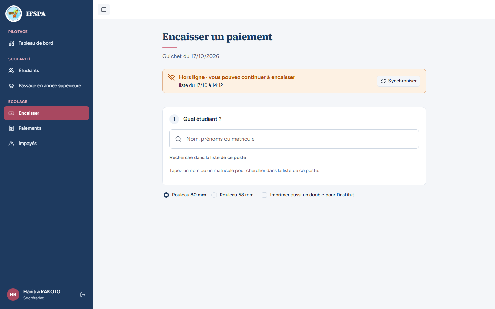
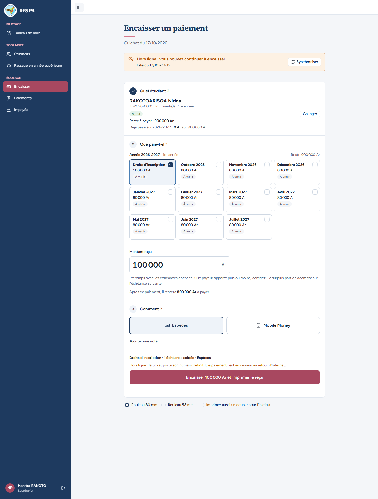
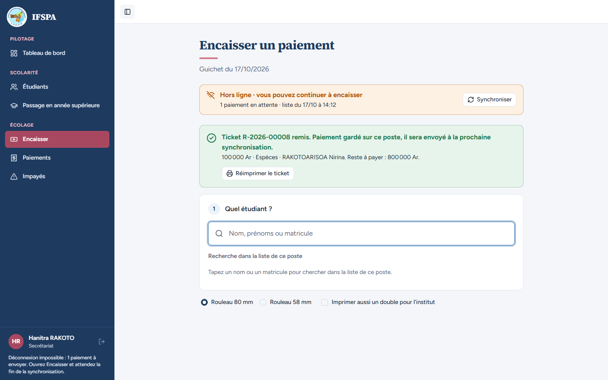
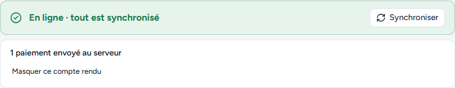
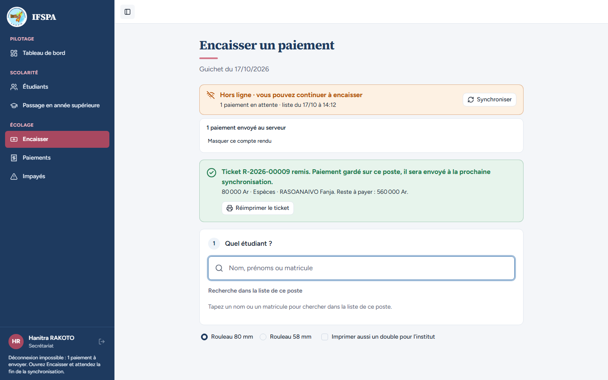
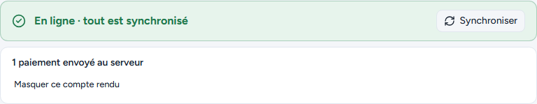
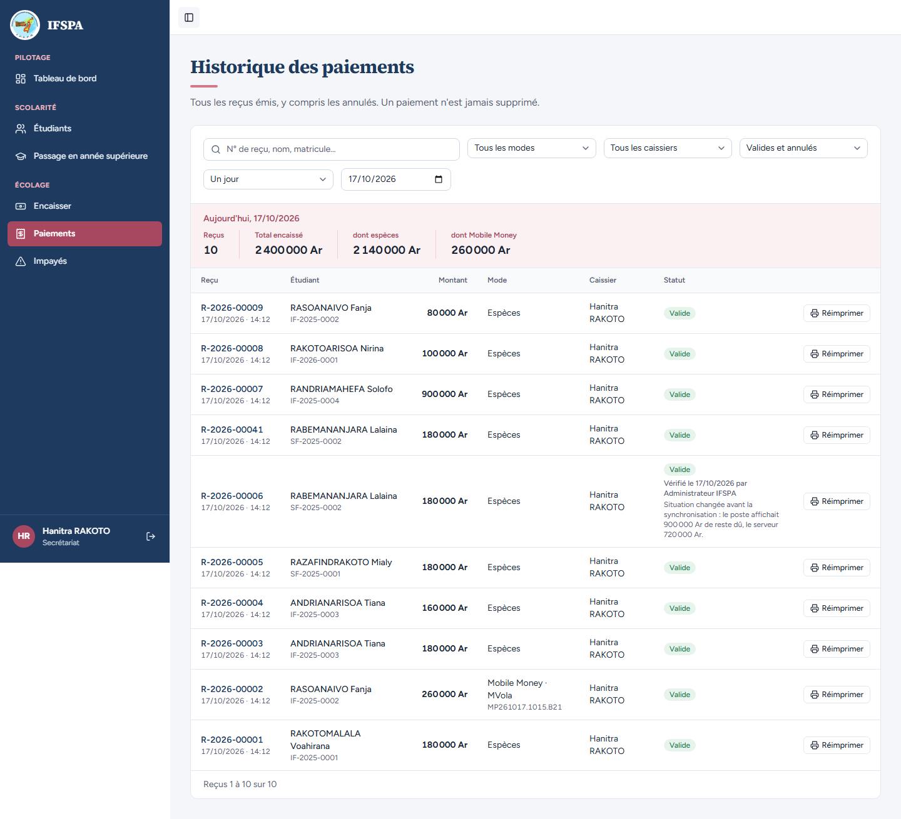

# UC13-07. Le Wi-Fi reste allumé mais Internet est coupé en amont : l'écran passe hors ligne, puis reprend seul en 30 secondes ou au bouton

| | |
|---|---|
| Use case | UC13. Encaisser sans Internet |
| Règles couvertes | R-HL (bandeau d'état, synchronisation automatique, bouton « Synchroniser »), R-REP, R-RECU |
| Rôle | Secrétariat, compte « Hanitra RAKOTO » |
| Durée estimée | 8 minutes |

## La situation

C'est la panne la plus courante : le poste reste connecté au Wi-Fi de l'institut, mais l'opérateur a coupé Internet en amont. Le navigateur se croit « en ligne » : aucun événement de coupure ne se produit. L'écran s'en aperçoit à son premier envoi raté et passe hors ligne ; la secrétaire encaisse les droits d'octobre d'un étudiant à jour. Quand Internet revient, le Wi-Fi n'a pas bougé : l'écran retente tout seul toutes les 30 secondes, et la secrétaire peut aussi forcer l'envoi avec « Synchroniser ». Une seconde panne montre le bouton.

## Avant de commencer

- Mêmes préparatifs que [UC13-01](UC13-01-nominal.md) (points 1 à 4). Avoir déroulé UC13-01 à UC13-06 dans le même navigateur : les tickets de ce cas sont les **R-2026-00008** et **R-2026-00009**.
- Étudiants : RAKOTOARISOA Nirina, **IF-2026-0001**, rien en retard ([00-PREPARATION.md](../00-PREPARATION.md), section C2) ; RASOANAIVO Fanja, **IF-2025-0002**, qui a déjà payé 260 000 Ar au cas UC13-02 (il lui reste 640 000 Ar).
- Compte **secrétariat** (`SEED_USER_*`).
- **Couper Internet « en amont » sans éteindre le Wi-Fi** : débrancher le câble qui relie la box à Internet **ou**, plus simplement, F12 › onglet Réseau, puis bloquer les adresses `/api/encaissement/` (clic droit sur une requête de ce type, « Bloquer l'URL de la requête »). Ne **pas** utiliser « Hors connexion » ni couper le Wi-Fi du poste : ce serait le cas UC13-01.
- La page doit rester **ouverte et visible** pendant l'attente de l'étape 6.

## Étapes

| # | Qui | Action | Résultat attendu | Capture | ✓ |
|---|---|---|---|---|---|
| 1 | Secrétariat | Menu **Encaisser**, avec Internet, attendre le bandeau vert. | « En ligne · tout est synchronisé », bouton « Synchroniser » actif. |  | |
| 2 | Secrétariat | Couper Internet **en amont** (voir ci-dessus), puis cliquer **Synchroniser**. | L'envoi échoue et le bandeau passe à l'orange « **Hors ligne · vous pouvez continuer à encaisser** » avec « liste du JJ/MM à HH:MM » ; **« Synchroniser » reste actif**. Le menu reste entièrement actif (aucune mention « Connexion nécessaire ») : le navigateur se croit toujours en ligne (décision actuelle, voir « Ce que ce scénario ne couvre pas »). |  | |
| 3 | Secrétariat | Chercher `RAKOTOARISOA`, Entrée. | « Reste à payer : 900 000 Ar ». **Aucune échéance n'est cochée** (rien n'est en retard : octobre 2026 est « À venir ») ; sous le champ vide : « Cochez une échéance ou saisissez le montant reçu. » Cliquer **Droits d'inscription** : « Montant reçu » **100 000**, « Après ce paiement, il restera 800 000 Ar à payer. » |  | |
| 4 | Secrétariat | Cliquer **Encaisser 100 000 Ar et imprimer le reçu**. | « **Ticket R-2026-00008 remis.** Paiement gardé sur ce poste… » avec « 100 000 Ar · Espèces · RAKOTOARISOA Nirina. Reste à payer : 800 000 Ar. » ; bandeau « 1 paiement en attente ». En bas à gauche : « Déconnexion impossible : 1 paiement à envoyer. Ouvrez Encaisser et attendez la fin de la synchronisation. » |  | |
| 5 | Secrétariat | Rétablir Internet (rebrancher le câble ou retirer le blocage), **sans toucher** au Wi-Fi ni à la page. | Le bandeau reste orange « Hors ligne… » avec « 1 paiement en attente » (l'écran ne reçoit aucun signal), mais **« Synchroniser » est actif**. |  | |
| 6 | Secrétariat | Attendre, sans rien toucher. | **Au plus tard 30 secondes après**, le bandeau passe tout seul au vert « **En ligne · tout est synchronisé** » avec « **1 paiement envoyé au serveur** ». (Mesuré par le parcours : 30 secondes.) |  | |
| 7 | Secrétariat | Couper de nouveau Internet en amont, cliquer **Synchroniser** (bandeau « Hors ligne »). Chercher `RASOANAIVO`, Entrée, cliquer la carte **Janvier 2026**, puis **Encaisser 80 000 Ar et imprimer le reçu**. | « Reste à payer : 640 000 Ar » ; la liste commence à Décembre 2025 ; montant 80 000. « **Ticket R-2026-00009 remis.** » ; bandeau « 1 paiement en attente ». |  | |
| 8 | Secrétariat | Rétablir Internet, puis cliquer **Synchroniser** tout de suite. | Bandeau vert « En ligne · tout est synchronisé » et « **1 paiement envoyé au serveur** », sans attendre les 30 secondes. |  | |
| 9 | Secrétariat | Menu **Paiements**. | Lignes **R-2026-00008** (RAKOTOARISOA Nirina, 100 000 Ar) et **R-2026-00009** (RASOANAIVO Fanja, 80 000 Ar), toutes deux « Valide ». |  | |

## Ce que ce scénario ne couvre pas

- Le retour du réseau **avec** événement (câble rebranché, Wi-Fi rallumé) : envoi immédiat, démontré par UC13-01 et suivants.
- Le menu qui reste actif quand seul le serveur est injoignable (il suit `navigator.onLine`) : constat connu, laissé en l'état (anomalie n° 3 du rapport, non corrigée, mineure).
- Coupure plus longue que la session de 12 h (décision provisoire n° 35) : non démontrable ici.

## Dernière exécution par l'agent

- 17/10/2026 (après corrections) : ✅ 9 étapes sur 9, reprise automatique mesurée à 30 s. Premier passage du jour (avant corrections) : constats sur « Synchroniser » grisé et reprise après 299 s, corrigés ensuite. Voir [RAPPORT_2026-10-17_UC13](../../rapports/RAPPORT_2026-10-17_UC13.md), anomalie n° 2.
- Parcours : [UC13-07-wifi-sans-internet.recette.ts](../../parcours/UC13-07-wifi-sans-internet.recette.ts) (environ 35 secondes).
