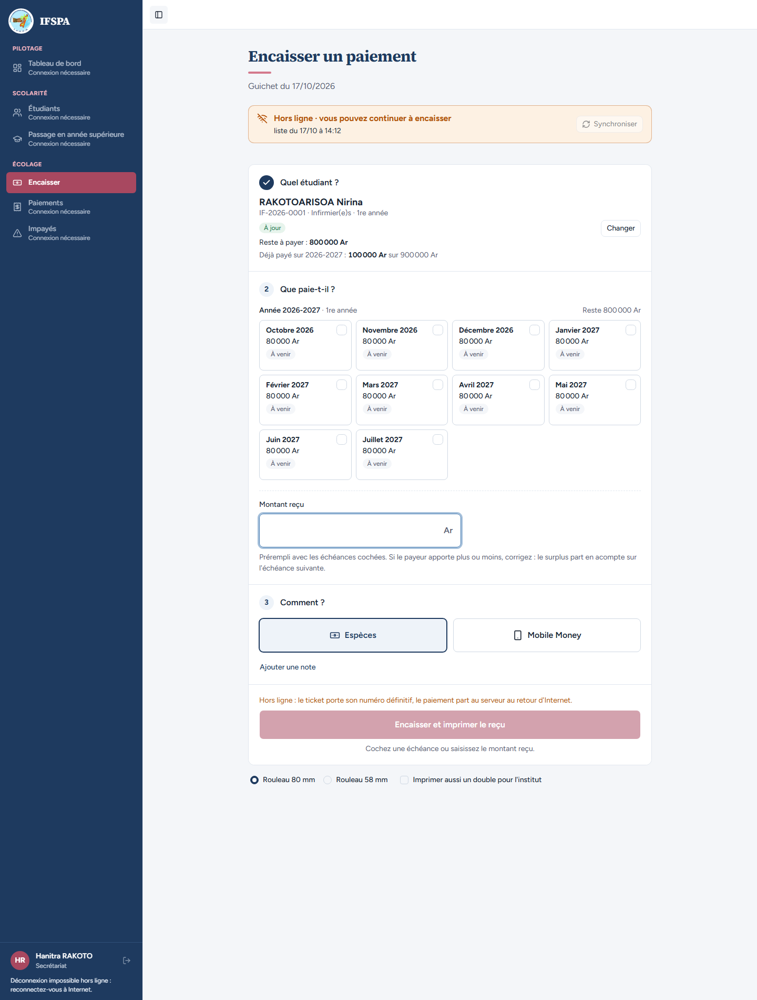
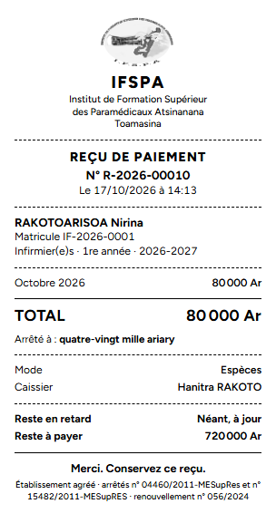

# UC13-08. Sans Internet, octobre d'un étudiant à jour : le ticket est complet, logo compris

| | |
|---|---|
| Use case | UC13. Encaisser sans Internet |
| Règles couvertes | R-RECU (ticket complet : logo, numéro, montant en lettres, reste à payer ; plan, section Vérification, point 3 : « vérifier le logo »), R-RET (« À venir » n'est pas en retard), R-HL |
| Rôle | Secrétariat, compte « Hanitra RAKOTO » |
| Durée estimée | 5 minutes |

## La situation

Internet est coupé. Le père de Nirina RAKOTOARISOA, étudiant à jour, vient payer octobre : le mois est en cours, donc « À venir », rien n'est coché d'office. La secrétaire coche octobre, encaisse, imprime. Le parent doit recevoir le même ticket qu'en ligne, **logo de l'institut compris**.

## Avant de commencer

- Mêmes préparatifs que [UC13-01](UC13-01-nominal.md) (points 1 à 5). Avoir déroulé UC13-01 à UC13-07 dans le même navigateur : le ticket de ce cas est le **R-2026-00010** (le cas UC13-07 a pris les numéros 8 et 9), et les droits de Nirina ont déjà été payés au cas UC13-07 (il lui reste 800 000 Ar).
- Étudiant : RAKOTOARISOA Nirina, **IF-2026-0001** ([00-PREPARATION.md](../00-PREPARATION.md), section C2).
- Compte **secrétariat** (`SEED_USER_*`).
- Le logo du ticket est préchargé par le poste dès l'ouverture d'Encaisser (correction du jour) ; le cas d'un poste neuf est contrôlé à part : [UC13-09](UC13-09-logo-poste-neuf.md).

## Étapes

| # | Qui | Action | Résultat attendu | Capture | ✓ |
|---|---|---|---|---|---|
| 1 | Secrétariat | **Encaisser** avec Internet, attendre le bandeau vert, couper Internet, recharger (F5). Chercher `RAKOTOARISOA`, Entrée. | Bandeau orange « Hors ligne · vous pouvez continuer à encaisser ». Badge « À jour ». « Reste à payer : **800 000 Ar** », « Déjà payé sur 2026-2027 : 100 000 Ar sur 900 000 Ar ». Octobre 2026 et les mois suivants « À venir », **aucun coché**, « Montant reçu » vide, « Cochez une échéance ou saisissez le montant reçu. » |  | |
| 2 | Secrétariat | Cliquer la carte **Octobre 2026**, puis **Encaisser 80 000 Ar et imprimer le reçu**. | « Montant reçu » **80 000** ; « **Ticket R-2026-00009 remis.** Paiement gardé sur ce poste… » avec « Reste à payer : 720 000 Ar. » ; bandeau « 1 paiement en attente ». | | |
| 3 | Secrétariat | Regarder le ticket dans l'aperçu avant impression. | Ticket 80 mm : **logo de l'institut en tête**, IFSPA, « REÇU DE PAIEMENT », **N° R-2026-00010**, Octobre 2026 80 000 Ar, **TOTAL 80 000 Ar**, « Arrêté à : quatre-vingt mille ariary », Mode Espèces, Caissier Hanitra RAKOTO, Reste en retard « **Néant, à jour** », Reste à payer **720 000 Ar**. |  | |
| 4 | Secrétariat | Rétablir Internet. | Bandeau vert « En ligne · tout est synchronisé » et « 1 paiement envoyé au serveur ». | | |

## Ce que ce scénario ne couvre pas

- Le ticket d'un poste qui n'a encore jamais encaissé en ligne : [UC13-09](UC13-09-logo-poste-neuf.md).
- Ticket 58 mm et « double pour l'institut » hors ligne : non déroulés.
- Rendu sur l'imprimante thermique réelle (contraste du logo, coupe) : à faire par vous, voir le rapport.

## Dernière exécution par l'agent

- 17/10/2026 (après corrections) : ✅ 4 étapes sur 4. Voir [RAPPORT_2026-10-17_UC13](../../rapports/RAPPORT_2026-10-17_UC13.md).
- Parcours : [UC13-08-logo-ticket.recette.ts](../../parcours/UC13-08-logo-ticket.recette.ts).
