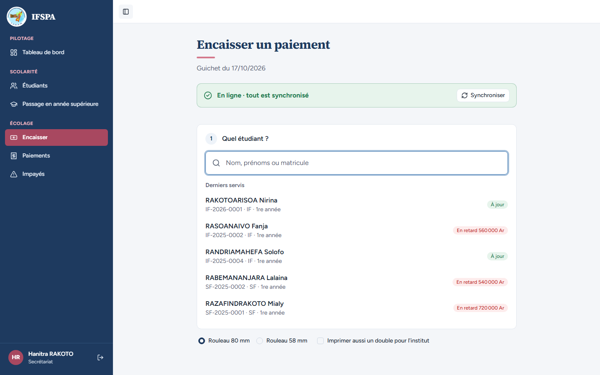
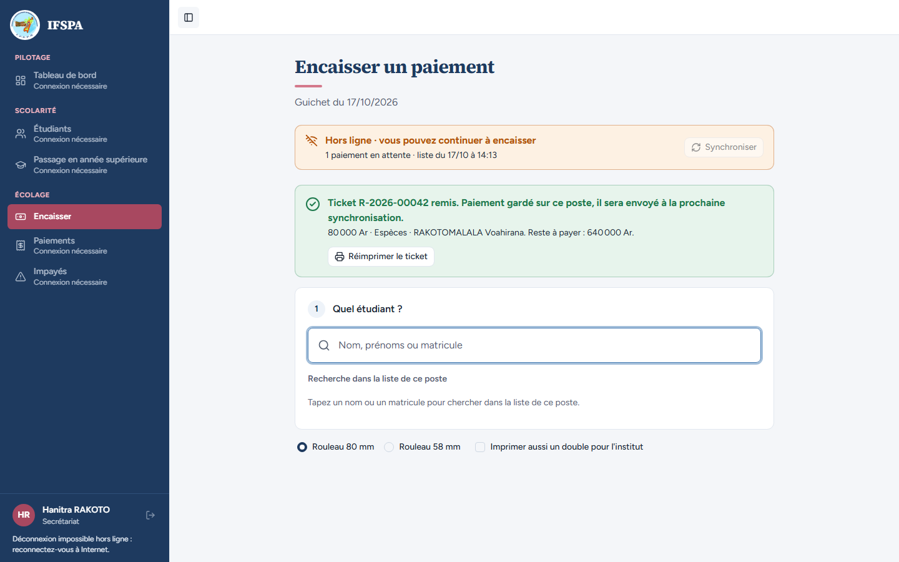
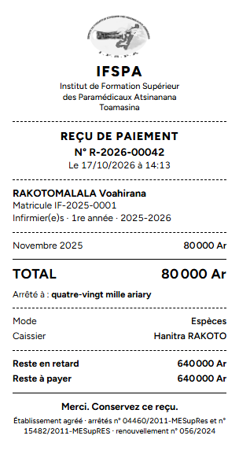

# UC13-09. Un poste neuf encaisse son premier ticket sans Internet : le logo doit être là

| | |
|---|---|
| Use case | UC13. Encaisser sans Internet |
| Règles couvertes | R-RECU (logo sur le ticket, plan section Vérification point 3), R-HL (la page et ses ressources restent disponibles sans Internet) |
| Rôle | Secrétariat, compte « Hanitra RAKOTO » |
| Durée estimée | 8 minutes |

## La situation

Le matin, un ordinateur du guichet vient d'être démarré (ou son navigateur n'a jamais encaissé en ligne). Il ouvre Encaisser une fois avec Internet, puis la connexion tombe. Le premier parent de la journée paie en espèces : le ticket doit porter le logo de l'institut, comme tous les autres, et la page ne doit montrer aucune image cassée.

## Avant de commencer

- Mêmes préparatifs que [UC13-01](UC13-01-nominal.md) (points 1 à 5). Avoir déroulé UC13-01 à UC13-08.
- **Un poste neuf** : une fenêtre de navigation privée, ou un autre profil de navigateur, jamais encore utilisé sur `http://localhost:3200`. Se connecter avec le compte **secrétariat** (`SEED_USER_*`) ; le nom « Hanitra RAKOTO » est en bas de la barre latérale.
- Étudiante : RAKOTOMALALA Voahirana, **IF-2025-0001** : elle a déjà payé 180 000 Ar au cas UC13-01, il lui reste 720 000 Ar. Le ticket de ce cas est le **R-2026-00042** (le poste neuf réserve ses numéros après ceux des deux postes précédents ; sur une autre suite de cas, le numéro peut différer).
- Ne **pas** ouvrir d'autre page de l'application, ni imprimer en ligne, avant la coupure : c'est tout le sujet du cas.

## Étapes

| # | Qui | Action | Résultat attendu | Capture | ✓ |
|---|---|---|---|---|---|
| 1 | Secrétariat, poste neuf | Menu **Encaisser**, avec Internet. Attendre le bandeau vert. | « En ligne · tout est synchronisé ». Le logo de l'institut est affiché en haut de la barre latérale. |  | |
| 2 | Secrétariat, poste neuf | Couper Internet, recharger (F5), chercher `RAKOTOMALALA`, Entrée. | Bandeau « Hors ligne · vous pouvez continuer à encaisser ». « Reste à payer : 720 000 Ar ». | | |
| 3 | Secrétariat, poste neuf | Cliquer la carte **Décembre 2025** pour ne garder que novembre, puis **Encaisser 80 000 Ar et imprimer le reçu**. | « **Ticket R-2026-00042 remis.** Paiement gardé sur ce poste… » avec « 80 000 Ar · Espèces · RAKOTOMALALA Voahirana. Reste à payer : 640 000 Ar. » ; bandeau « 1 paiement en attente ». **Le logo de la barre latérale est toujours affiché.** |  | |
| 4 | Secrétariat, poste neuf | Regarder le ticket dans l'aperçu avant impression. | Ticket 80 mm : **logo de l'institut en tête**, IFSPA, **N° R-2026-00042**, Novembre 2025 80 000 Ar, **TOTAL 80 000 Ar**, « Arrêté à : quatre-vingt mille ariary », Mode Espèces, Caissier Hanitra RAKOTO, Reste en retard 640 000 Ar, Reste à payer 640 000 Ar. |  | |
| 5 | Secrétariat, poste neuf | Rétablir Internet. | Bandeau vert « En ligne · tout est synchronisé » et « 1 paiement envoyé au serveur ». |  | |

## Ce que ce scénario ne couvre pas

- Le même poste après un premier encaissement **en ligne** : le logo y est alors mis en cache à l'usage (c'est le cas de [UC13-08](UC13-08-logo-ticket.md)).
- Rendu sur l'imprimante thermique réelle : à faire par vous, voir le rapport.

## Dernière exécution par l'agent

- 17/10/2026 (après corrections) : ✅ 5 étapes sur 5 ; le parcours constate que le logo du ticket est dans le cache du poste après l'ouverture d'Encaisser en ligne. Premier passage du jour : ❌ étapes 3 et 4 (logos de la barre latérale et du ticket cassés hors ligne sur un poste neuf), corrigé ensuite. Voir [RAPPORT_2026-10-17_UC13](../../rapports/RAPPORT_2026-10-17_UC13.md), anomalie n° 1.
- Parcours : [UC13-09-logo-poste-neuf.recette.ts](../../parcours/UC13-09-logo-poste-neuf.recette.ts).
