# UC14-01. Un visiteur parcourt la page d'accueil de l'institut

| | |
|---|---|
| Use case | UC14. Découvrir l'institut et le contacter |
| Règles couvertes | Aucune règle de la matrice (page publique : PLAN.md, écran `/`) |
| Rôle | Visiteur, sans compte |
| Durée estimée | 8 minutes (ordinateur), 8 minutes de plus sur téléphone |

## La situation

Un parent trouve l'IFSPA sur Internet. Il ouvre le site, lit ce que l'institut propose, passe d'une section à l'autre avec le menu, regarde la galerie, puis cherche le bouton pour se connecter. Le même parcours se fait sur ordinateur et sur téléphone (menu en tiroir).

## Avant de commencer

1. `pnpm recette:base`, `pnpm build`, `pnpm recette:app`, ouvrir `http://localhost:3200` (déconnecté : fenêtre de navigation privée).
2. Aucune donnée à préparer ([00-PREPARATION.md](../00-PREPARATION.md) inutile).
3. Les coordonnées de l'institut (adresse, téléphone, courriel) ne sont pas saisies dans cette base : les textes « À compléter » sont normaux (voir la fin du scénario).
4. Sur téléphone : mêmes étapes, le menu est derrière le bouton « Ouvrir le menu » (captures suffixées `-mobile` dans le dossier `captures/`).

## Étapes

| # | Qui | Action | Résultat attendu | Capture | ✓ |
|---|---|---|---|---|---|
| 1 | Visiteur | Ouvrir `http://localhost:3200/`. | Onglet « IFSPA — Institut de Formation Supérieur des Paramédicaux Atsinanana ». En-tête collé en haut : logo, « IFSPA », « Paramédicaux · Toamasina », liens L'institut, Filières, Galerie, Agréments, Contact, bouton « Se connecter ». Grande photo d'étudiants et le titre « Se former aux métiers paramédicaux à Toamasina », les boutons « Découvrir les filières » et « Nous contacter ». |  | |
| 2 | Visiteur | Faire défiler jusqu'au bandeau rose puis à la présentation. | Bandeau « Établissement agréé par le ministère de l'Enseignement supérieur » et « Arrêté N° 04460/2011-MESupRes · Renouvellement du 3 avril 2024 ». Titre « Un institut de formation au service de la santé en Atsinanana », deux paragraphes, écusson de l'institut. | 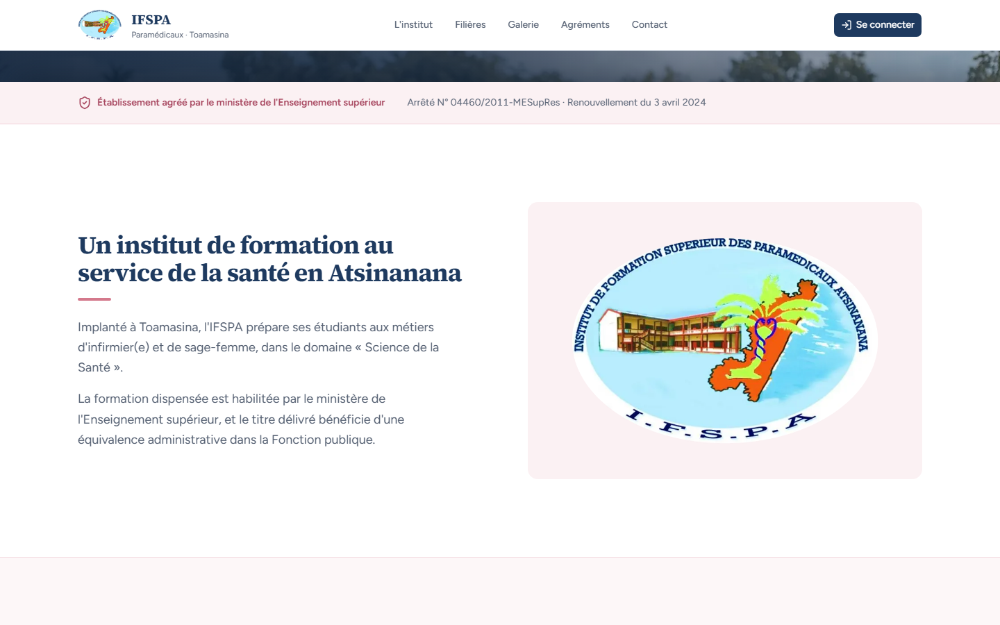 | |
| 3 | Visiteur | Cliquer **L'institut** dans le menu (sur téléphone : « Ouvrir le menu », puis **L'institut**). | L'adresse se termine par `#institut`, la page glisse, le titre « Un institut de formation au service de la santé en Atsinanana » est sous l'en-tête, pas caché par lui. Sur téléphone, le tiroir « Menu » liste les 5 liens et se referme au clic. | 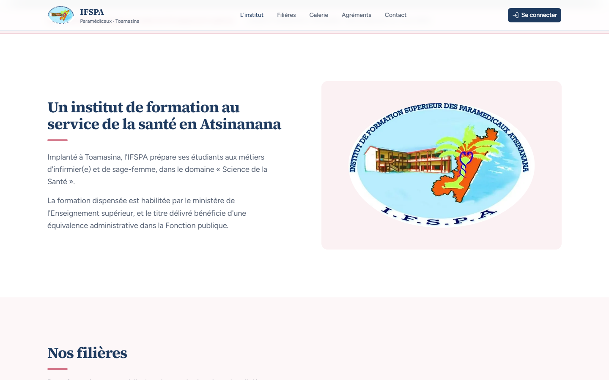 | |
| 4 | Visiteur | Cliquer **Filières**. | `#filieres`, titre « Nos filières », « Deux formations paramédicales, du premier jour jusqu'au diplôme. », début de la fiche Infirmier(e)s. | 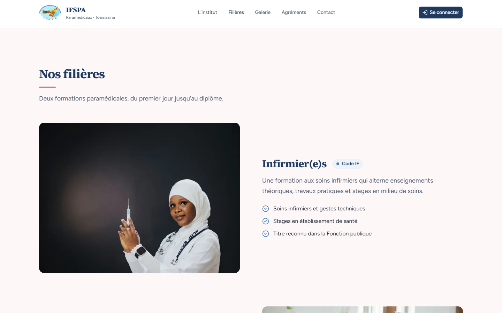 | |
| 5 | Visiteur | Cliquer **Galerie**. | `#galerie`, titre « Galerie », « Travaux pratiques, stages et vie de l'institut en images. », grande photo avec flèches. | 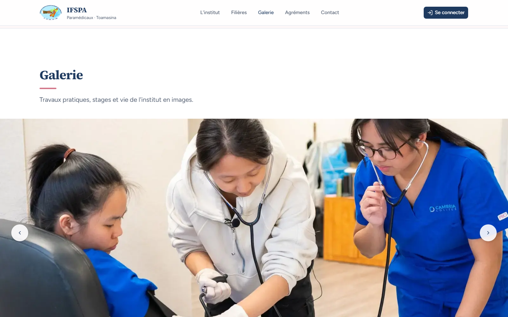 | |
| 6 | Visiteur | Cliquer **Agréments**. | `#agrements`, titre « Agréments officiels », puis la liste des arrêtés. | 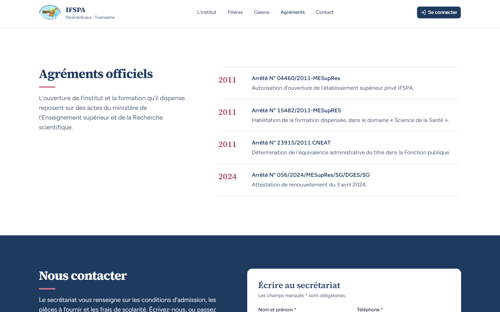 | |
| 7 | Visiteur | Cliquer **Contact**. | `#contact`, fond bleu nuit, titre « Nous contacter », Adresse (« Plle 32/32, Station FJKM David Jones, Toamasina »), Téléphone (034 07 576 81, lien d'appel), Courriel (ifspagerardolivier@gmail.com), Horaires du secrétariat (8 h – 11 h 30, 14 h – 16 h 30), « Suivez-nous » avec l'icône Facebook, formulaire « Écrire au secrétariat ». |  | |
| 8 | Visiteur | Lire les filières puis les agréments. | Deux fiches : « Infirmier(e)s » (pastille « Code IF ») et « Sage-femmes » (« Code SF »), chacune avec photo et trois points. Quatre arrêtés : 2011 N° 04460/2011-MESupRes, 2011 N° 15482/2011-MESupRES, 2011 N° 23915/2011 CNEAT, 2024 N° 056/2024/MESupRes/SG/DGES/SG. | 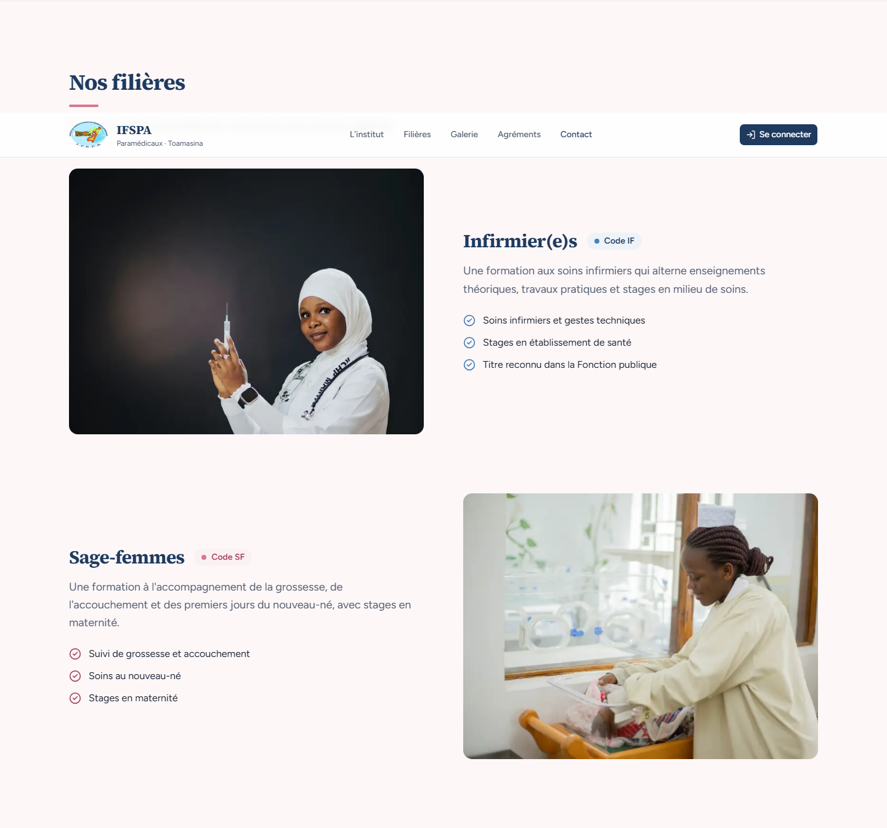 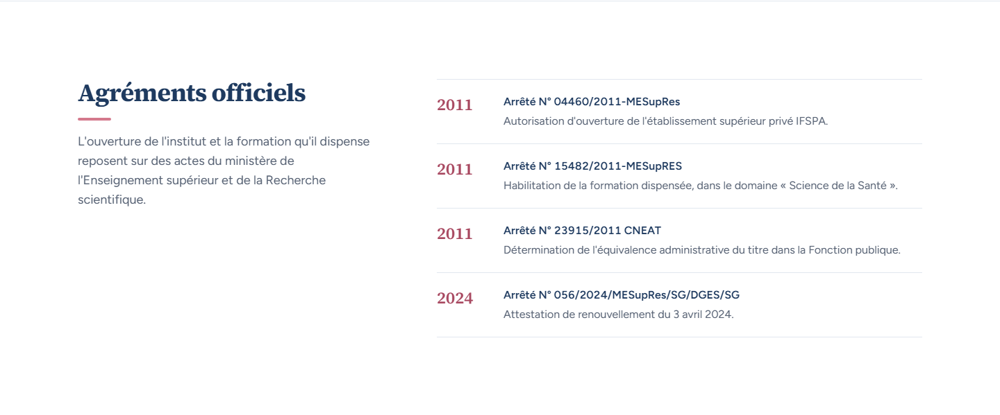 | |
| 9 | Visiteur | Dans la galerie : cliquer la flèche « Photo suivante », puis la vignette « Afficher la photo 5 : Gestes d'urgence », puis « Photo précédente ». | Compteur « 1 / 8 » avec « Travaux pratiques : prise de la tension artérielle » ; « 2 / 8 » « Simulation sur mannequin » ; « 5 / 8 » « Gestes d'urgence » ; retour à « 4 / 8 » « Soins au nouveau-né en maternité ». Pas de défilement tout seul. | 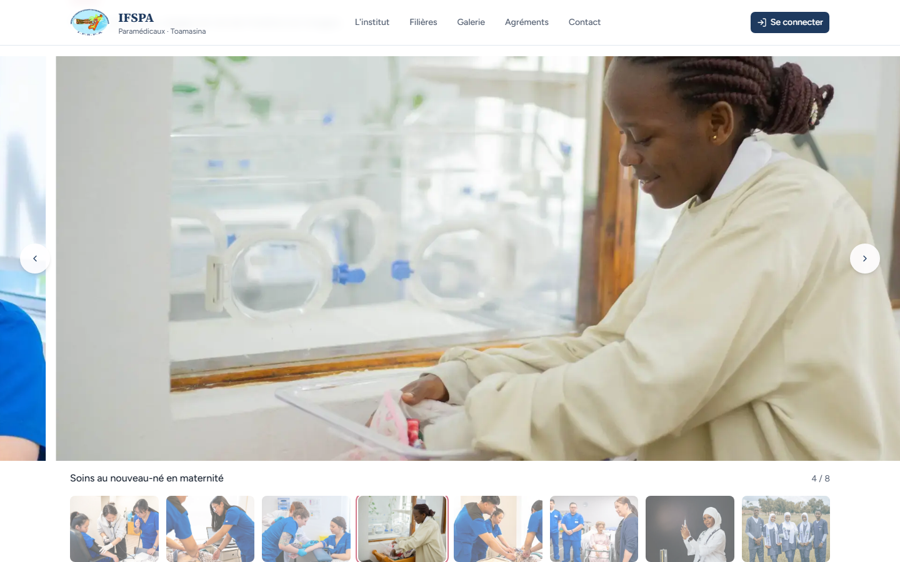 | |
| 10 | Visiteur | Revenir en haut de la page, cliquer **Découvrir les filières**, revenir en haut, cliquer **Nous contacter**. | Le premier bouton amène à « Nos filières » (`#filieres`), le second à « Nous contacter » (`#contact`). | 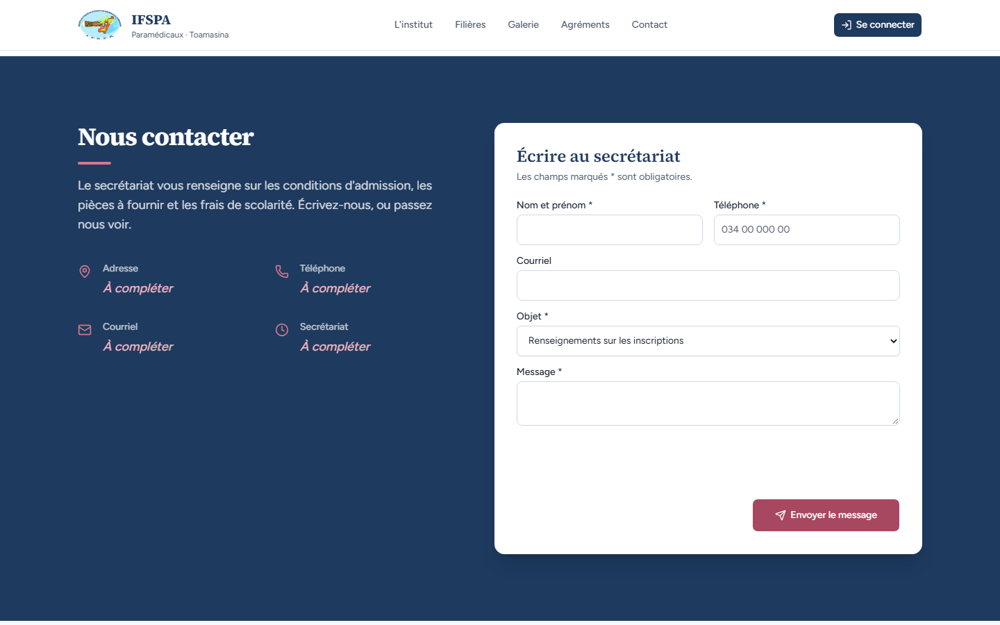 | |
| 11 | Visiteur | Aller tout en bas. | Pied de page : logo, nom complet de l'institut, devise « Foi – Civisme – Performance », colonnes Navigation (6 liens, dont Admission), Filières (Infirmier(e)s, Sage-femmes, qui renvoient à `#filieres`), Contact (adresse, 034 07 576 81, ifspagerardolivier@gmail.com). Aucun « à compléter » visible. En bas, centré : « © 2026 IFSPA — Conçu et réalisé par Diano ANDRIANTSALAMA » (lien vers `https://dians98.vercel.app/`, nouvel onglet). | 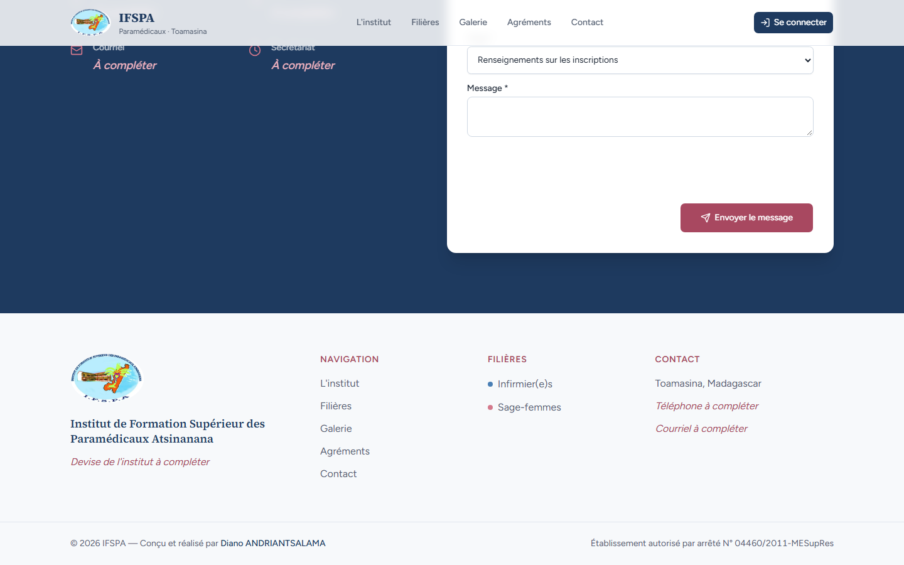 | |
| 12 | Visiteur | En haut, cliquer **Se connecter** (en-tête), puis **Retour au site**. | `/connexion` : « Connexion », « Espace du personnel : gérez les étudiants et l'écolage. ». « Retour au site » ramène à `/`. | 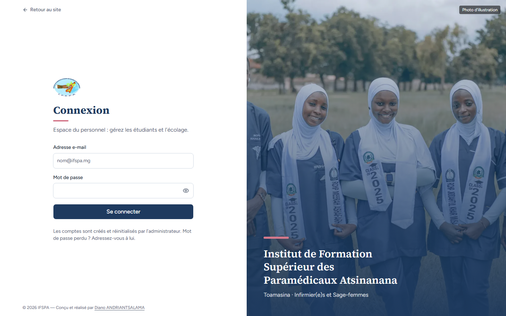 | |
| 13 | Visiteur | Depuis `#contact`, cliquer le logo de l'en-tête. | Retour à `/` (haut de la page d'accueil). | (aucune) | |
| 14 | Visiteur | Regarder la largeur de la page. | Aucune barre de défilement horizontale (ordinateur et téléphone). | (aucune) | |

## Ce que ce scénario ne couvre pas

- Les coordonnées (adresse, téléphone, courriel, horaires du secrétariat) et la devise ne sont pas renseignées : la landing affiche « À compléter » en italique rose (STATUS.md : coordonnées attendues du client). Non anomalie ici, à régler avant la mise en ligne.
- Les photos sont des illustrations (Pexels) à remplacer par celles de l'institut (commentaire de `src/app/page.tsx`).
- Les écrans intermédiaires de 768 à 1023 px (menu en tiroir, mise en page à deux colonnes) ne sont pas photographiés.

## Dernière exécution par l'agent

- 18/10/2026 : ✅ 14 étapes sur 14, ordinateur (1440 px) et mobile (Pixel 7). Voir [RAPPORT_2026-10-18_UC14](../../rapports/RAPPORT_2026-10-18_UC14.md).
- Parcours : [UC14-01-parcours-landing.recette.ts](../../parcours/UC14-01-parcours-landing.recette.ts) (`pnpm recette:parcours UC14-01 --project ordinateur`, puis `--project mobile`).
