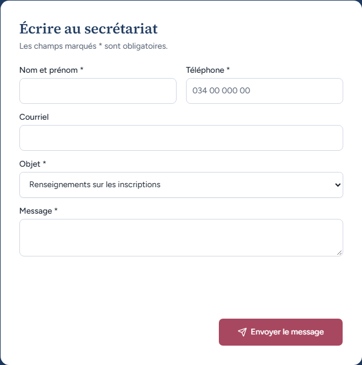
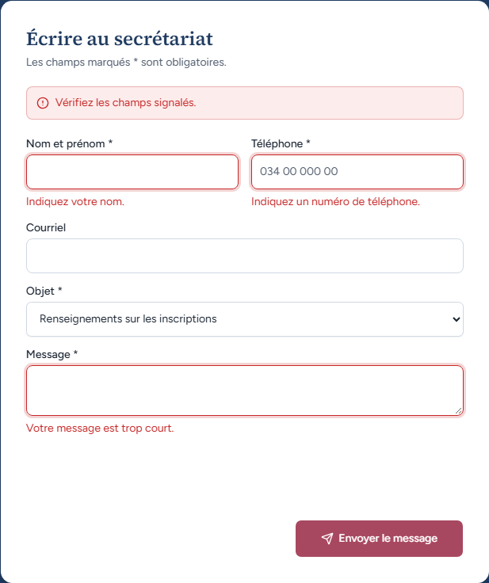
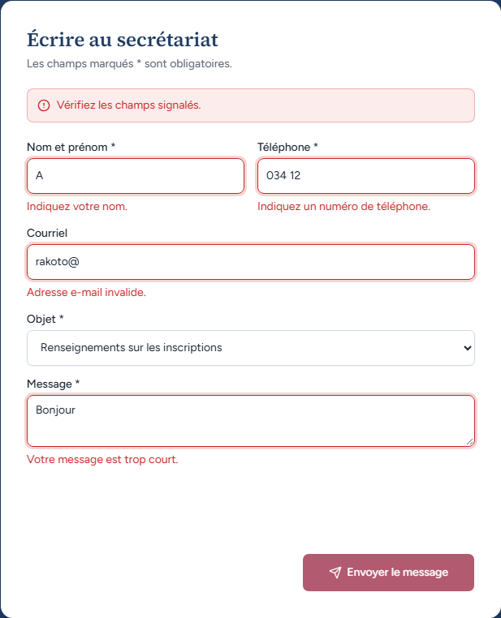
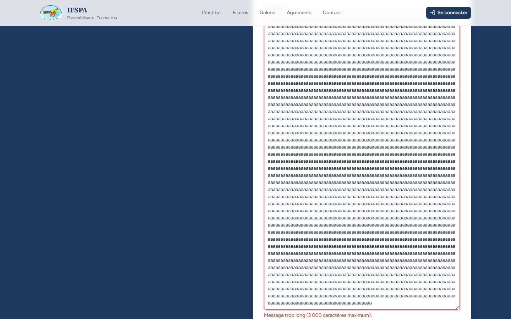

# UC14-02. Un visiteur remplit mal le formulaire de contact

| | |
|---|---|
| Use case | UC14. Découvrir l'institut et le contacter |
| Règles couvertes | Aucune règle de la matrice (formulaire de contact : PLAN.md, phase 1) |
| Rôle | Visiteur, sans compte |
| Durée estimée | 6 minutes |

## La situation

Une mère veut écrire au secrétariat. Elle envoie d'abord le formulaire vide, puis avec un nom d'une lettre, un téléphone avec des lettres, un courriel inachevé et un message d'un mot. Le site doit dire clairement ce qui ne va pas, champ par champ, et ne rien envoyer.

## Avant de commencer

1. `pnpm recette:base`, `pnpm build`, `pnpm recette:app`, ouvrir `http://localhost:3200/#contact` (sans compte).
2. Aucune donnée à préparer.
3. Les refus de ce scénario viennent du site avant toute vérification anti-robot : aucun courriel ne peut partir, quoi qu'il arrive.

## Étapes

| # | Qui | Action | Résultat attendu | Capture | ✓ |
|---|---|---|---|---|---|
| 1 | Visiteur | Regarder le formulaire « Écrire au secrétariat ». | « Les champs marqués * sont obligatoires. » Champs : « Nom et prénom * », « Téléphone * » (exemple grisé « 034 00 000 00 »), « Courriel », « Objet * » (déjà sur « Renseignements sur les inscriptions »), « Message * », bouton « Envoyer le message ». |  | |
| 2 | Visiteur | Cliquer **Envoyer le message** sans rien remplir. | Bandeau rouge « Vérifiez les champs signalés. ». Sous « Nom et prénom * » : « Indiquez votre nom. ». Sous « Téléphone * » : « Indiquez un numéro de téléphone. ». Sous « Message * » : « Votre message est trop court. ». Les champs en cause ont un contour rouge ; Courriel (facultatif) et Objet n'ont pas d'erreur. Aucun « Message envoyé ». |  | |
| 3 | Visiteur | Saisir Nom « A », Téléphone « abc12345 », Courriel « rakoto@ », Objet « Frais de scolarité », Message « Bonjour ». Cliquer **Envoyer le message**. | Bandeau « Vérifiez les champs signalés. ». Erreurs : « Indiquez votre nom. », « Numéro de téléphone invalide. », « Adresse e-mail invalide. », « Votre message est trop court. ». **Les saisies restent affichées**, y compris l'Objet « Frais de scolarité ». |  | |
| 4 | Visiteur | Remplacer le Téléphone par « 034 12 » et cliquer **Envoyer le message**. | Sous Téléphone : « Indiquez un numéro de téléphone. » (moins de 8 caractères). |  | |
| 5 | Visiteur | Nom « RAKOTOMALALA Hanitra », Téléphone « 034 00 000 12 », Courriel vide, Message de 3 001 lettres « a ». Cliquer **Envoyer le message**. | Sous Message : « Message trop long (3 000 caractères maximum). ». Plus d'erreur sur le nom, le téléphone ni le courriel. |  | |
| 6 | Visiteur | Regarder la page. | Aucun écran « Message envoyé » ni « Merci, votre message a bien été envoyé. » : rien n'est parti. | (aucune) | |

## Ce que ce scénario ne couvre pas

- Le refus de l'étape 3 sur l'**Objet** n'est pas respecté (voir « Dernière exécution ») : c'est le seul écart.
- Longueur maximale du nom (120 caractères) et du téléphone (30) : non essayées.
- Après un refus, le focus clavier retombe sur la page (pas sur le premier champ en erreur ni sur le bandeau) : constat d'accessibilité, voir [UC14-05](UC14-05-accessibilite.md) et le rapport.

## Dernière exécution par l'agent

- 18/10/2026 : ❌ étape 3 (ordinateur et mobile) : après le refus, l'Objet « Frais de scolarité » est revenu à « Renseignements sur les inscriptions » alors que les quatre autres saisies étaient conservées. Les autres étapes sont ✅ (5 sur 6). Voir [RAPPORT_2026-10-18_UC14](../../rapports/RAPPORT_2026-10-18_UC14.md), correction n° 1.
- Parcours : [UC14-02-formulaire-validation.recette.ts](../../parcours/UC14-02-formulaire-validation.recette.ts) (`pnpm recette:parcours UC14-02 --project ordinateur`, puis `--project mobile`).
