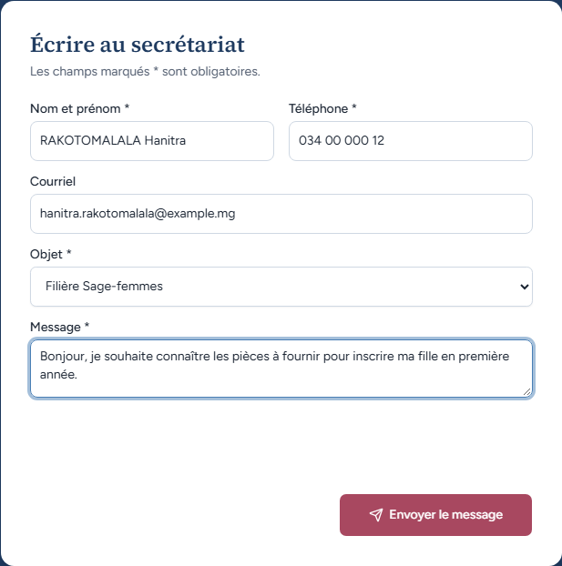
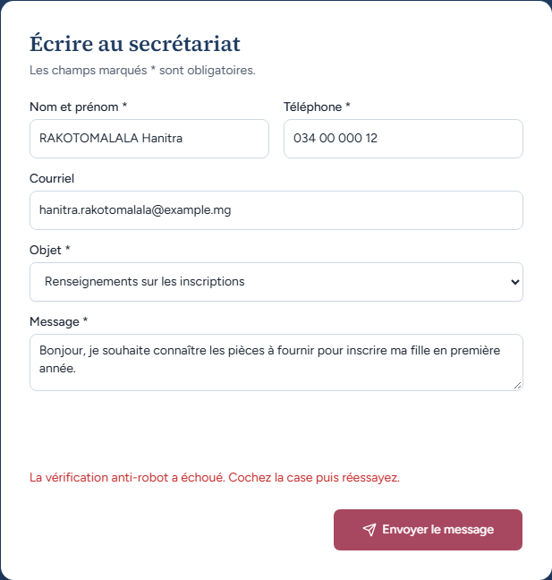
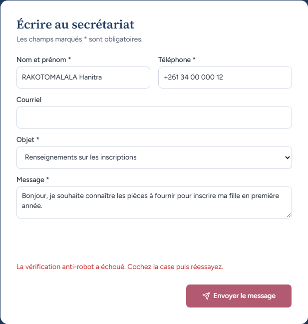

# UC14-03. Un message complet est envoyé, mais la vérification anti-robot ne passe pas

| | |
|---|---|
| Use case | UC14. Découvrir l'institut et le contacter |
| Règles couvertes | Aucune règle de la matrice (formulaire de contact : PLAN.md, phase 1) |
| Rôle | Visiteur, sans compte |
| Durée estimée | 5 minutes |

## La situation

La mère de Hanitra RAKOTOMALALA écrit au secrétariat pour connaître les pièces à fournir. Tous les champs sont corrects. Le site demande une vérification anti-robot (Cloudflare Turnstile) avant d'envoyer. Dans la recette, aucun courriel ne doit partir : on constate ce que voit la visiteuse quand la vérification n'aboutit pas.

## Avant de commencer

1. `pnpm recette:base`, `pnpm build`, `pnpm recette:app`, ouvrir `http://localhost:3200/#contact` (sans compte).
2. **Important** : le build de recette embarque la clé Turnstile du `.env` (`NEXT_PUBLIC_TURNSTILE_SITE_KEY`). Le widget appelle donc le vrai service Cloudflare. Pour rejouer ce scénario à l'identique, bloquer le domaine `challenges.cloudflare.com` dans le navigateur (outils de développement › Réseau › « Bloquer le domaine de la requête » sur le script `api.js`), puis recharger. Si le widget se charge et passe, l'envoi est tenté : `SMTP2GO_API_KEY` n'est pas renseigné, donc rien ne part (voir « Ce que ce scénario ne couvre pas »).
3. Aucune donnée à préparer.

## Étapes

| # | Qui | Action | Résultat attendu | Capture | ✓ |
|---|---|---|---|---|---|
| 1 | Visiteur | Remplir : Nom « RAKOTOMALALA Hanitra », Téléphone « 034 00 000 12 », Courriel « hanitra.rakotomalala@example.mg », Objet « Filière Sage-femmes », Message « Bonjour, je souhaite connaître les pièces à fournir pour inscrire ma fille en première année. ». | Formulaire rempli, sans erreur. |  | |
| 2 | Visiteur | Cliquer **Envoyer le message**. | En rouge, juste au-dessus du bouton : « La vérification anti-robot a échoué. Cochez la case puis réessayez. ». Pas de bandeau « Vérifiez les champs signalés. », aucun champ en erreur, pas de « Message envoyé ». Nom, téléphone, courriel et message sont conservés **et l'Objet « Filière Sage-femmes »** aussi. Aucune case à cocher n'est visible (le script est bloqué). |  | |
| 3 | Visiteur | Cliquer encore **Envoyer le message**. | Même refus, mêmes saisies conservées (Téléphone « 034 00 000 12 »). | (aucune) | |
| 4 | Visiteur | Vider le Courriel, remplacer le Téléphone par « +261 34 00 000 12 », cliquer **Envoyer le message**. | Le courriel est facultatif et le numéro international est accepté : seul le refus anti-robot s'affiche (« La vérification anti-robot a échoué. Cochez la case puis réessayez. »), ni « Numéro de téléphone invalide. » ni « Adresse e-mail invalide. ». |  | |

## Ce que ce scénario ne couvre pas

- **Envoi réussi** (« Message envoyé », « Merci, votre message a bien été envoyé. Le secrétariat vous répondra dans les meilleurs délais. ») : non démontré. Il exige un jeton Turnstile valide et un compte SMTP2GO ; la recette n'a ni l'un ni l'autre. Aucun test automatisé ne l'atteste (`tests/` ne contient rien sur le contact).
- **Échec de l'envoi** (« L'envoi a échoué. Réessayez dans un instant, ou appelez directement le secrétariat. ») : non démontré, mêmes raisons. D'après le code (`src/lib/email.ts`), sans `SMTP2GO_API_KEY` en production, l'envoi renvoie cet échec.
- **Champ piège** anti-robot : non démontré (invisible à l'écran).
- Le widget Cloudflare lui-même (case ou vérification invisible) : non démontré ici, on l'a volontairement bloqué.
- Sans clé du tout (cas de `pnpm dev`), le widget et la vérification sont désactivés et l'envoi est simulé dans la console : non applicable au build de recette.

## Dernière exécution par l'agent

- 18/10/2026 : ❌ étape 2 (ordinateur et mobile) : l'Objet « Filière Sage-femmes » est revenu à « Renseignements sur les inscriptions » après le refus (la visiteuse qui réessaierait enverrait son message sous le mauvais objet). Étapes 1, 3 et 4 ✅ (3 sur 4). Voir [RAPPORT_2026-10-18_UC14](../../rapports/RAPPORT_2026-10-18_UC14.md), corrections n° 1 et 2.
- Parcours : [UC14-03-formulaire-envoi-sans-cle.recette.ts](../../parcours/UC14-03-formulaire-envoi-sans-cle.recette.ts) (`pnpm recette:parcours UC14-03 --project ordinateur`, puis `--project mobile`).
