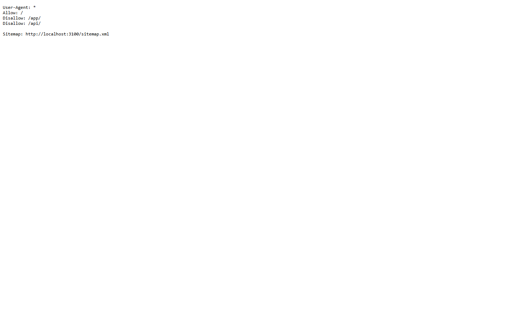
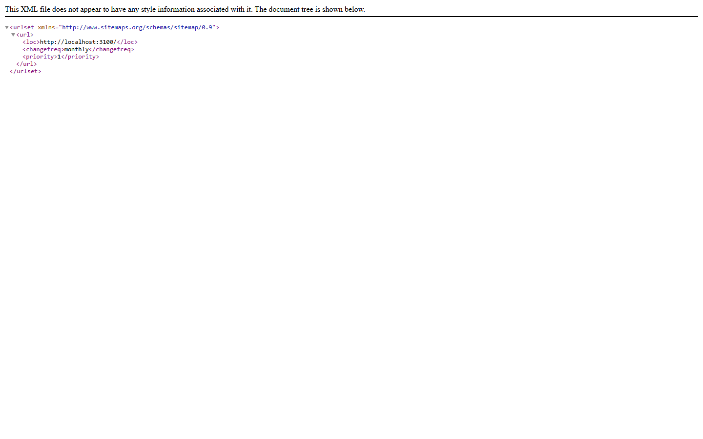
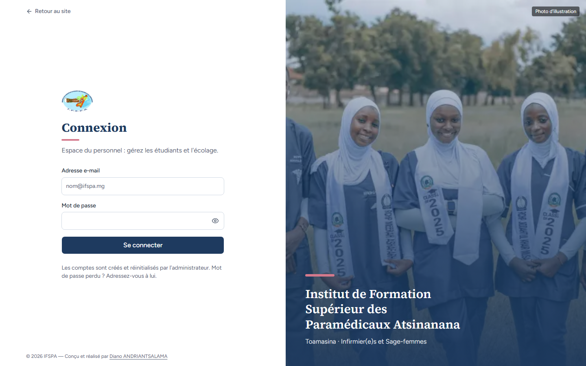
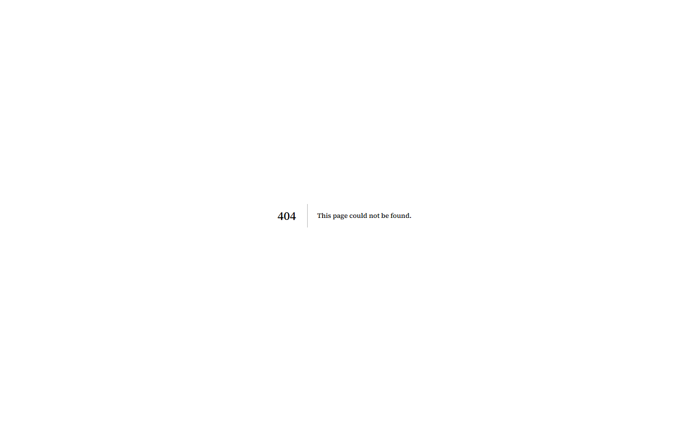
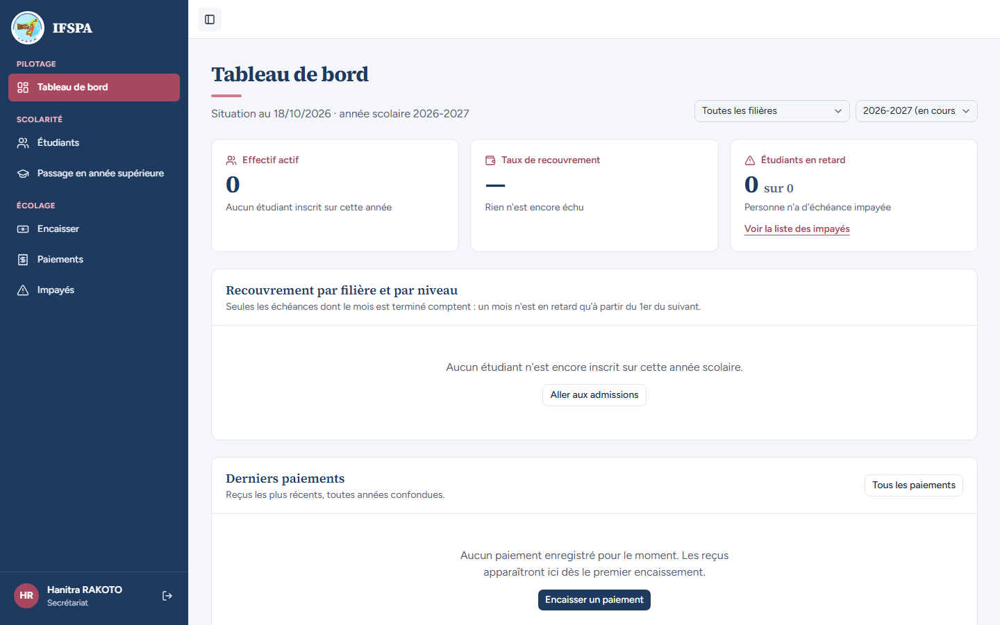

# UC14-04. Les moteurs de recherche voient la landing, et seulement la landing

| | |
|---|---|
| Use case | UC14. Découvrir l'institut et le contacter |
| Règles couvertes | Aucune règle de la matrice (SEO : PLAN.md et STATUS.md, audit du 09/10) |
| Rôle | Visiteur sans compte ; secrétariat pour l'étape 8 |
| Durée estimée | 8 minutes |

## La situation

Le référencement doit faire connaître la page d'accueil (titre, description, adresse canonique, plan du site) et tenir les moteurs à l'écart de l'espace du personnel : connexion, `/app` et `/api` ne doivent pas être indexés.

## Avant de commencer

1. `pnpm recette:base`, `pnpm build`, `pnpm recette:app`, ouvrir `http://localhost:3200/`.
2. Aucune donnée à préparer. Étapes 1 et 2 : lire le code source de la page (`Ctrl+U`, chercher `<title>`, `canonical`, `og:`, `ld+json`).
3. **L'adresse publique est figée au build** (`NEXT_PUBLIC_APP_URL`). Sur ce build de recette elle vaut `http://localhost:3100` : c'est elle qui apparaît partout ci-dessous, pas `3200`. En production, le `.env` de build porte le vrai domaine.
4. Étape 8 : se connecter avec le compte **secrétariat** (identifiants `SEED_USER_*` de `.env`).

## Étapes

| # | Qui | Action | Résultat attendu | Capture | ✓ |
|---|---|---|---|---|---|
| 1 | Visiteur | Ouvrir `/` et lire l'en-tête du code source. | `<html lang="fr">`. Titre « IFSPA — Institut de Formation Supérieur des Paramédicaux Atsinanana ». Description « Établissement supérieur privé de formation paramédicale à Toamasina : filières Infirmier(e)s et Sage-femmes, domaine « Science de la Santé ». ». `<link rel="canonical" href="http://localhost:3100">`. Open Graph : type `website`, locale `fr_FR`, site `IFSPA`, titre et description identiques. **Aucune** balise `robots` (la page reste indexable). Pas d'`og:image` ni d'`og:url` (constat). Un seul titre de niveau 1. | (code source) | |
| 2 | Visiteur | Chercher `application/ld+json` dans le code source. | Données `EducationalOrganization` : nom complet, `alternateName` « IFSPA », adresse Toamasina, région Atsinanana, pays `MG`. **Ni téléphone ni courriel** (non saisis : omis plutôt qu'inventés). | (code source) | |
| 3 | Visiteur | Ouvrir `/robots.txt`. | `User-Agent: *`, `Allow: /`, `Disallow: /app/`, `Disallow: /api/`, `Sitemap: http://localhost:3100/sitemap.xml`. `/connexion` n'est pas interdite (pour que les moteurs lisent son « noindex »). |  | |
| 4 | Visiteur | Ouvrir `/sitemap.xml`. | Une seule adresse : `<loc>http://localhost:3100/</loc>`, `monthly`, priorité `1`. |  | |
| 5 | Visiteur | Ouvrir `/connexion` et lire le code source. | Onglet « Connexion · IFSPA » ; `<meta name="robots" content="noindex, nofollow">`. |  | |
| 6 | Visiteur | Ouvrir `/app/dashboard` sans être connecté. | Redirigé vers `/connexion?retour=%2Fapp%2Fdashboard` (code 307) : page « Connexion ». |  | |
| 7 | Visiteur | Ouvrir `/cette-page-n-existe-pas`. | Page d'erreur avec le code 404. Aujourd'hui elle est **en anglais**, « 404 | This page could not be found. » (voir le rapport). |  | |
| 8 | Secrétariat | Connecté (« Hanitra RAKOTO », Secrétariat), ouvrir `/app/dashboard` et lire le code source. | Tableau de bord affiché ; `<meta name="robots" content="noindex, nofollow">` dans l'en-tête. |  | |

## Ce que ce scénario ne couvre pas

- Aucun test de classement ni de partage réel (Google Search Console, aperçu WhatsApp ou Facebook) : sans domaine public, non démontrable.
- Pas d'image de partage Open Graph ni de carte Twitter (STATUS.md : « à faire avec les vraies photos »).
- Le canonique de `/` s'écrit sans barre finale (`http://localhost:3100`) : forme standard de Next.js pour la racine, équivalente.
- `/api/*` n'est protégé des moteurs que par `robots.txt` (chaque route exige déjà une session).

## Dernière exécution par l'agent

- 18/10/2026 : ✅ 8 étapes sur 8 (ordinateur et mobile). Voir [RAPPORT_2026-10-18_UC14](../../rapports/RAPPORT_2026-10-18_UC14.md) (constats : 404 en anglais, pas d'og:image).
- Parcours : [UC14-04-referencement.recette.ts](../../parcours/UC14-04-referencement.recette.ts) (`pnpm recette:parcours UC14-04 --project ordinateur`).
