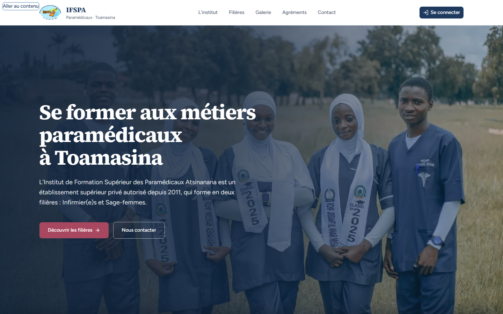
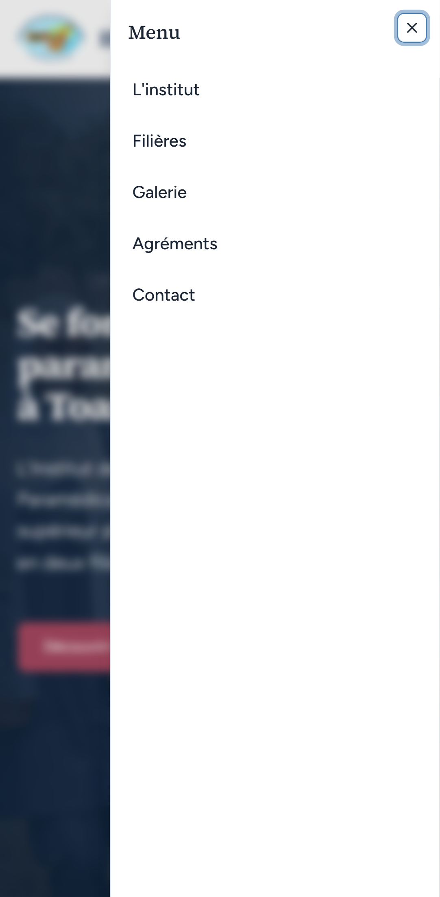
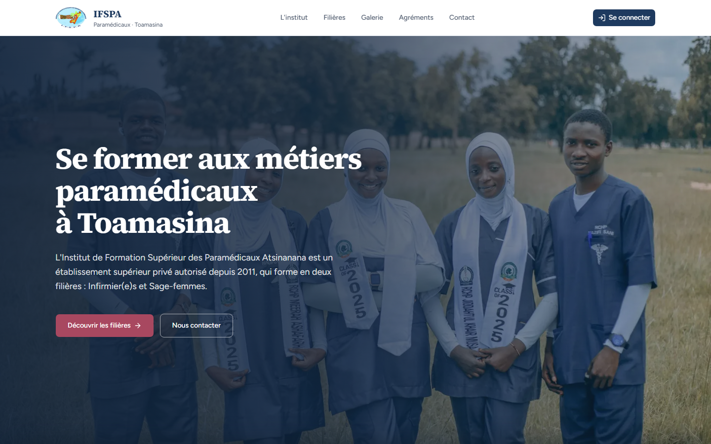

# UC14-05. Utiliser la landing au clavier et avec un contraste suffisant

| | |
|---|---|
| Use case | UC14. Découvrir l'institut et le contacter |
| Règles couvertes | Aucune règle de la matrice (accessibilité, cible WCAG 2.2 AA : CLAUDE.md, skill `accessibility`) |
| Rôle | Visiteur, sans compte |
| Durée estimée | 10 minutes |

## La situation

Un visiteur ne peut pas utiliser la souris, ou lit le site en plein soleil sur un téléphone d'entrée de gamme. Il doit pouvoir sauter au contenu, voir où est le focus, comprendre les images et lire les textes, y compris ceux posés sur la grande photo d'ouverture.

## Avant de commencer

1. `pnpm recette:base`, `pnpm build`, `pnpm recette:app`, ouvrir `http://localhost:3200/` (sans compte).
2. Aucune donnée à préparer. Pour les étapes 1 à 3 : souris posée, uniquement les touches Tab, Entrée et Échap.
3. Étape 6 : les ratios ci-dessous sont mesurés par l'agent ; on les contrôle avec les outils de développement (inspecter le texte, la pastille de couleur affiche le ratio de contraste).

## Étapes

| # | Qui | Action | Résultat attendu | Capture | ✓ |
|---|---|---|---|---|---|
| 1 | Visiteur | Recharger `/`, appuyer une fois sur **Tab**, puis **Entrée**, puis **Tab**. | Au premier Tab, le lien « Aller au contenu » apparaît en haut à gauche, entouré d'un anneau de focus (il passe sur le logo : normal). Entrée : l'adresse se termine par `#contenu`. Le Tab suivant arrive sur « Découvrir les filières » (le contenu), pas dans l'en-tête. |  | |
| 2 | Visiteur | Continuer à tabuler depuis le haut jusqu'à « Se connecter ». | Le bouton « Se connecter » a un anneau de focus bien visible (contour bleu clair autour du bouton). |  | |
| 3 | Visiteur | **Téléphone seulement** : tabuler jusqu'au bouton à trois traits « Ouvrir le menu », **Entrée**, puis **Échap**. | Le tiroir « Menu » s'ouvre avec les 5 liens ; Échap le referme et le focus revient sur « Ouvrir le menu ». Le bouton mesure au moins 24 px de côté. |  | |
| 4 | Visiteur | Repérer la structure de la page (lecteur d'écran, ou outils de développement › Accessibilité). | Langue `fr`. Un seul en-tête (banner), un `main`, un pied de page (contentinfo). Un seul titre de niveau 1, puis des niveaux 2 et 3 sans saut de niveau. Le zoom du navigateur n'est pas bloqué. | (aucune) | |
| 5 | Visiteur | Passer en revue les images. | Toutes les images ont un attribut `alt`. Les images porteuses d'information ont une description (« Étudiants en tenue de soins posant en extérieur », « Écusson de l'Institut de Formation Supérieur des Paramédicaux Atsinanana », « Logo de l'IFSPA », photos de la galerie). Seules les vignettes de la galerie ont `alt=""`, et leur bouton porte un nom (« Afficher la photo 5 : Gestes d'urgence »). | (aucune) | |
| 6 | Visiteur | Regarder le contraste des textes (norme : 4,5 pour du texte courant, 3 pour du grand texte). | Tous les textes sur fond uni sont à 5,05 ou plus (navigation 6,26 ; bandeau d'agrément 5,05 et 5,66 ; présentation 6,26 ; pastille « Code SF » 5,05 ; arrêtés 5,58 et 6,26 ; contact 7,99, 6,5 et « À compléter » 6,56 ; étiquettes du formulaire 15,45 ; boutons rose 5,58 ; « Se connecter » 11,5 ; pied de page 5,28 à 5,92). Texte blanc sur la photo d'ouverture : **ordinateur** titre 6,53 et paragraphe 6,69 ; **téléphone** titre 2,92 et paragraphe 2,34 (sous les seuils de 3 et 4,5, mesuré sur le pixel de fond le plus clair). |  | |
| 7 | Visiteur | Ouvrir `#contact`, envoyer le formulaire vide, puis rempli sans vérification anti-robot. | Le bandeau « Vérifiez les champs signalés. » est annoncé (`role="alert"`) et chaque champ en erreur est relié à son message. **Attendu aussi** : le focus va sur le bandeau ou le premier champ en erreur, et le refus « La vérification anti-robot a échoué. Cochez la case puis réessayez. » est annoncé (zone `alert`). **Obtenu** : les deux premiers points sont bons, mais le focus retombe sur la page (le bouton « Envoyer le message » est désactivé pendant l'envoi) et le refus anti-robot n'a ni `role="alert"` ni zone vive. | (aucune) | |

## Ce que ce scénario ne couvre pas

- Aucune écoute au lecteur d'écran réel (NVDA, VoiceOver, TalkBack) : voir « À faire par Diano » du rapport.
- Pas d'audit axe-core ni Lighthouse (non installés dans la recette) : STATUS.md cite un audit du 09/10 à 0 violation axe, fait avant le retour du dégradé de l'ouverture (11/10).
- Le contraste du texte sur la photo est une estimation par pixel (99e centile du fond), pas un calcul de l'outil des navigateurs.
- Le mouvement (animation de recouvrement de la photo, `prefers-reduced-motion`) n'est pas évalué.

## Dernière exécution par l'agent

- 18/10/2026 : ordinateur ❌ étape 7 (5 étapes sur 6 ✅). Mobile ❌ étape 6 (texte blanc sur la photo d'ouverture : titre 2,92, paragraphe 2,34) et ❌ étape 7 (5 étapes sur 7 ✅). Étape 7 : focus perdu après un refus et refus anti-robot non annoncé. Voir [RAPPORT_2026-10-18_UC14](../../rapports/RAPPORT_2026-10-18_UC14.md), corrections n° 3, 4 et 5.
- Parcours : [UC14-05-accessibilite.recette.ts](../../parcours/UC14-05-accessibilite.recette.ts) (`pnpm recette:parcours UC14-05 --project ordinateur`, puis `--project mobile`).
