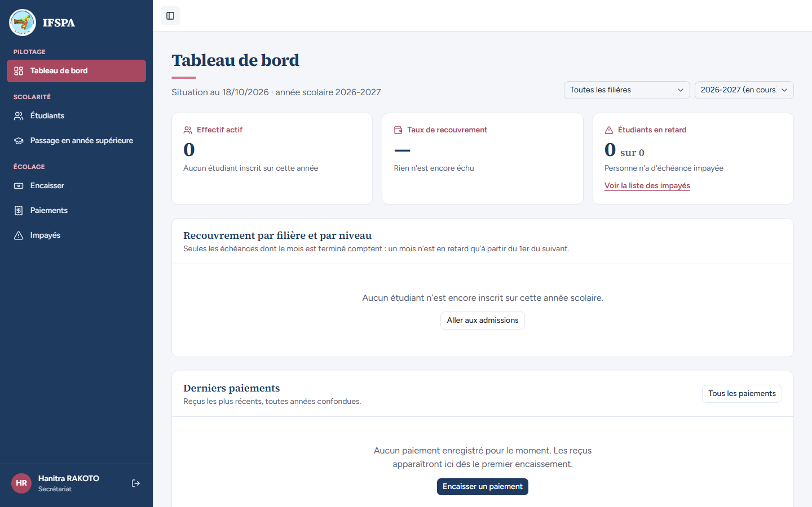

# UC14-06. Un membre du personnel déjà connecté ouvre le site public

| | |
|---|---|
| Use case | UC14. Découvrir l'institut et le contacter |
| Règles couvertes | R-ROLE (indirect : l'espace connecté reste derrière la connexion) |
| Rôle | Secrétariat, compte « Hanitra RAKOTO » |
| Durée estimée | 3 minutes |

## La situation

La secrétaire a laissé sa session ouverte et tape l'adresse du site de l'institut. Elle voit la page publique, comme tout le monde. Quand elle clique « Se connecter », elle ne doit pas retaper son mot de passe : elle arrive directement sur son tableau de bord.

## Avant de commencer

1. `pnpm recette:base`, `pnpm build`, `pnpm recette:app`, ouvrir `http://localhost:3200`.
2. Se connecter avec le compte **secrétariat** (identifiants `SEED_USER_*` de `.env`), puis ouvrir `http://localhost:3200/` (barre d'adresse).
3. Aucune donnée à préparer.

## Étapes

| # | Qui | Action | Résultat attendu | Capture | ✓ |
|---|---|---|---|---|---|
| 1 | Secrétariat | Ouvrir `http://localhost:3200/`. | La page d'accueil publique s'affiche, sans redirection. Le bouton de l'en-tête dit toujours « Se connecter » (aucun lien « Tableau de bord » ou « Mon espace »). |  | |
| 2 | Secrétariat | Cliquer **Se connecter**. | Arrivée directe sur `/app/dashboard`, « Tableau de bord », « Hanitra RAKOTO » et « Secrétariat » en bas de la barre latérale (sur téléphone : après « Ouvrir le menu »). |  | |
| 3 | Secrétariat | Ouvrir `/connexion` à la main. | Redirigé vers `/app/dashboard` sans formulaire. | (aucune) | |

## Ce que ce scénario ne couvre pas

- La page d'accueil ne reconnaît pas la session : le plan ne prévoit pas de bouton « Mon espace » (question dans le rapport).
- La reconnexion d'un compte désactivé ou d'une session expirée : voir UC01 et UC03.

## Dernière exécution par l'agent

- 18/10/2026 : ✅ 3 étapes sur 3 (ordinateur et mobile). Voir [RAPPORT_2026-10-18_UC14](../../rapports/RAPPORT_2026-10-18_UC14.md).
- Parcours : [UC14-06-utilisateur-connecte.recette.ts](../../parcours/UC14-06-utilisateur-connecte.recette.ts) (`pnpm recette:parcours UC14-06 --project ordinateur`, puis `--project mobile`).
