# UC15-01. L'administrateur reprend six étudiants et sept paiements depuis le classeur Excel de l'institut

| | |
|---|---|
| Use case | UC15. Reprendre les données de l'institut |
| Règles couvertes | R-REPRISE (rapport avant d'écrire, une confirmation, matricules par filière et année d'entrée puis ordre des N°, paiements répartis comme au guichet, reçus datés du jour du fichier), R-MAT, R-ECH, R-TRA, R-REP, R-PAR, R-RECU, R-ROLE (admin) |
| Rôle | Administrateur, compte « Administrateur IFSPA » |
| Durée estimée | 15 minutes |

## La situation

L'institut a tenu ses comptes sur Excel jusqu'ici. Avant d'utiliser l'application, l'administrateur remplit le modèle fourni par l'écran avec ses étudiants de 2026-2027 et les paiements déjà reçus depuis la rentrée, puis le dépose. L'application montre d'abord ce qu'elle va faire sans rien écrire. L'administrateur confirme une fois, et retrouve ses étudiants avec leur matricule, leur reste dû et leurs reçus.

## Avant de commencer

- `pnpm db:up`, `pnpm recette:base`, `pnpm build`, `pnpm recette:app`, puis ouvrir `http://localhost:3200`.
- Dérouler **uniquement la section E** de [00-PREPARATION.md](../00-PREPARATION.md) (année 2025-2026 créée puis clôturée). Ne pas dérouler les sections A à D : les matricules `IF-2025-0001`… de ce scénario en seraient décalés.
- Se connecter avec le compte administrateur (identifiants `SEED_ADMIN_*` de `.env`).
- Fichier à déposer : [fichiers/reprise-ifspa-2026-2027.xlsx](fichiers/reprise-ifspa-2026-2027.xlsx). C'est le modèle téléchargé à l'étape 2 dont les trois lignes d'exemple sont remplacées par six étudiants et sept paiements. Contenu :

| N° | Nom et prénoms | Filière · entrée · niveau | Droits en | Paiements du fichier |
|---|---|---|---|---|
| 1 | RANDRIANASOLO Haingo Mirana | IF · 2026 · 1re année | 3 fois | 05/10 114 000 Ar espèces (reçu papier 0412) ; 15/10 33 000 Ar Mobile Money Orange Money, sans référence |
| 2 | RAZANAKOLONA Miora | SF · 2026 · 1re année | 1 fois | 08/10 180 000 Ar Mobile Money MVola, MP261008.1432.A1 |
| 3 | RAKOTONDRAZAFY Fidy Andry | IF · 2025 · 2e année | 1 fois | 03/10 100 000 Ar ; 12/10 80 000 Ar, espèces |
| 4 | RAVELOSON Tahiana | SF · 2025 · 2e année | 2 fois | 10/10 50 000 Ar espèces |
| 5 | ANDRIANTSOA Mamy | IF · 2026 · 1re année | 1 fois | aucun |
| 6 | RANAIVOSOA Lova Hasina | SF · 2025 · 1re année, redoublante | 1 fois | 14/10 130 000 Ar espèces |

## Étapes

| # | Qui | Action | Résultat attendu | Capture | ✓ |
|---|---|---|---|---|---|
| 1 | Administrateur | Menu **Paramètres**, onglet **Reprise des données**. | Deux panneaux : « Télécharger le modèle » et « Déposer le fichier rempli ». Le bouton « Analyser le fichier » est grisé. L'onglet « Reprise des données » est actif ; « Administrateur IFSPA » est en bas de la barre latérale. | 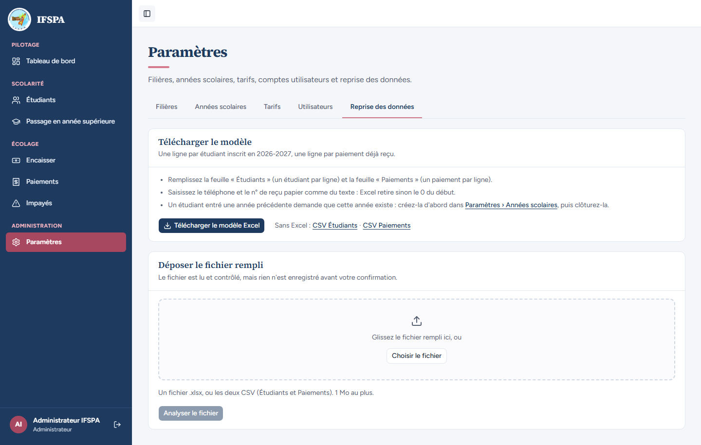 | |
| 2 | Administrateur | Cliquer **Télécharger le modèle Excel**. | Un fichier `modele-import-ifspa-2026-2027.xlsx` est téléchargé (feuilles « Lisez-moi », « Étudiants », « Paiements »). Le remplir comme indiqué plus haut, ou utiliser le fichier fourni. | | |
| 3 | Administrateur | Cliquer **Choisir le fichier**, choisir `reprise-ifspa-2026-2027.xlsx`. | « Fichiers choisis » liste `reprise-ifspa-2026-2027.xlsx` (8 Ko). Le bouton « Analyser le fichier » devient actif. | 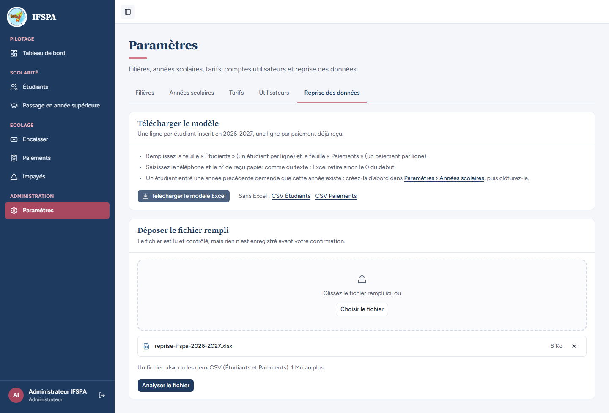 | |
| 4 | Administrateur | Cliquer **Analyser le fichier**. | Panneau « Rapport de contrôle » : « Rien n'est écrit tant que vous n'avez pas lancé l'import. Fichier analysé : reprise-ifspa-2026-2027.xlsx. » Message vert **« Prêt à importer 6 nouveaux étudiants et 7 paiements. »** Étudiants : 6 nouveaux, 0 déjà en base, 0 refusé. Paiements : 7 à importer, soit 687 000 Ar, 0 déjà importé, 0 refusé. « À vérifier (1) » : « Paiements, ligne 4, colonne « Référence » : paiement Mobile Money sans référence : il sera importé sans référence. » Tableau « Étudiants du fichier (6) », tous « Nouveau », « Dû de l'année » 900 000 Ar, matricule « — » : RAKOTONDRAZAFY, RANDRIANASOLO, ANDRIANTSOA, RAVELOSON, RANAIVOSOA, RAZANAKOLONA (ordre de création). | 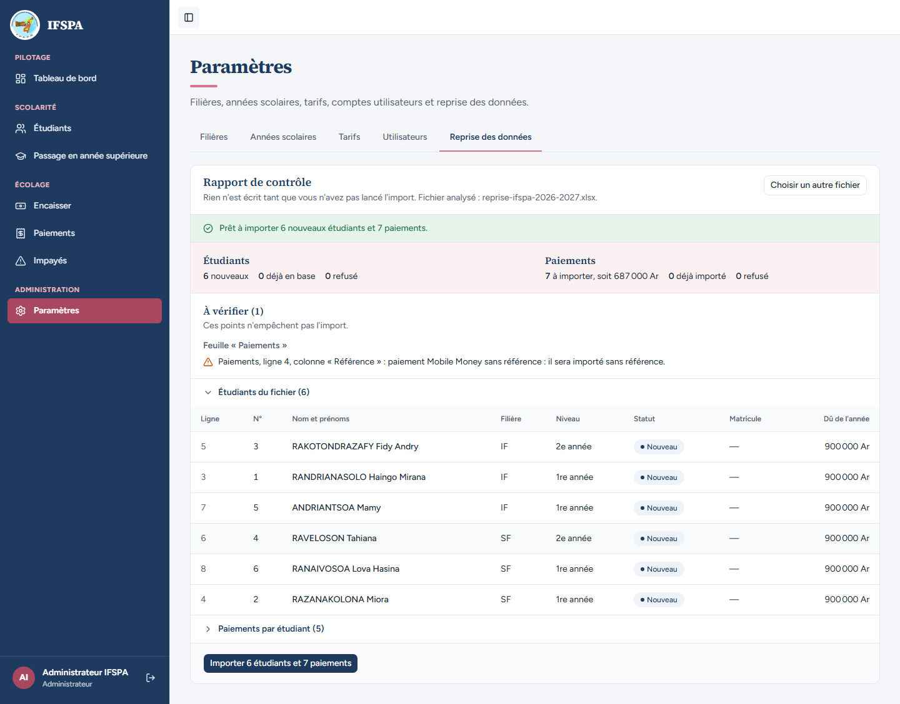 | |
| 5 | Administrateur | Cliquer **Paiements par étudiant (5)**. | Reste à payer après import : RAKOTONDRAZAFY 720 000 Ar (2 paiements, 180 000 Ar), RANDRIANASOLO 753 000 Ar (2 paiements, 147 000 Ar), RAVELOSON 850 000 Ar (50 000 Ar), RANAIVOSOA 770 000 Ar (130 000 Ar), RAZANAKOLONA 720 000 Ar (180 000 Ar). Aucun refusé. | 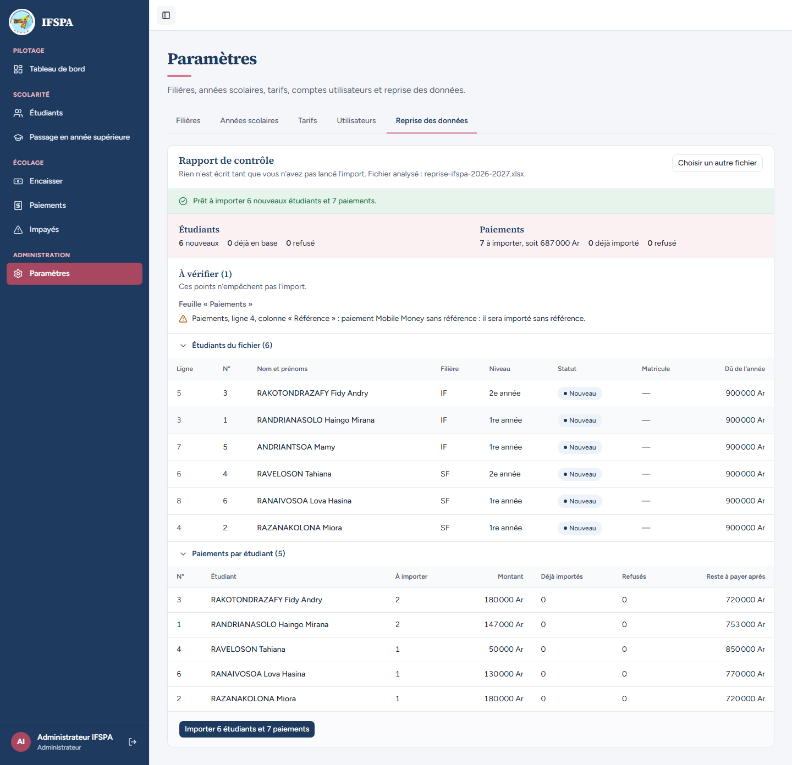 | |
| 6 | Administrateur | Cliquer **Importer 6 étudiants et 7 paiements**. | Fenêtre « Importer 6 étudiants et 7 paiements ? » : « 6 étudiants seront créés et 7 paiements seront enregistrés pour 687 000 Ar. » ; « Un import ne s'annule pas. » ; « Pendant l'import (jusqu'à 2 minutes), le guichet ne peut enregistrer aucun paiement : lancez-le hors des heures de guichet. » Boutons « Annuler » et « Importer maintenant ». C'est la seule confirmation. | 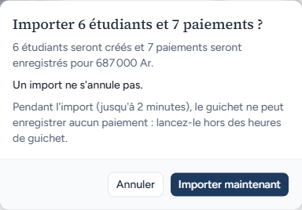 | |
| 7 | Administrateur | Cliquer **Importer maintenant**. | Panneau « Import terminé » ; message « **Import terminé : 6 étudiants créés, 7 paiements enregistrés pour 687 000 Ar (reçus R-2026-00001 à R-2026-00007).** » (repris dans une bulle verte qui disparaît seule). Tableau N° → matricule, tous « Créé » : 3 → **IF-2025-0001**, 1 → **IF-2026-0001**, 5 → **IF-2026-0002**, 4 → **SF-2025-0001**, 6 → **SF-2025-0002**, 2 → **SF-2026-0001**. Les matricules portent l'année d'entrée du fichier (2025 ou 2026), numérotés dans l'ordre des N° par filière et année. | 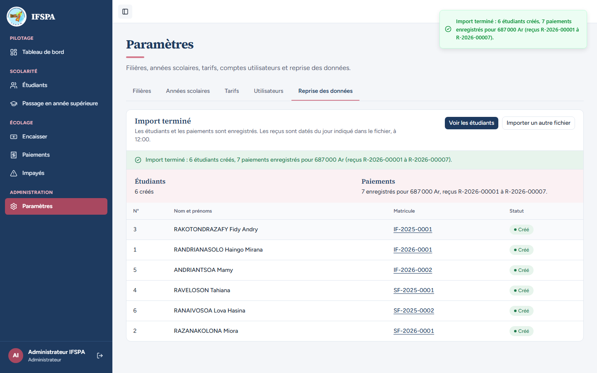 | |
| 8 | Administrateur | Cliquer **Voir les étudiants**. | « 6 étudiants inscrits » ; RANAIVOSOA Lova Hasina est « 1re année (redoublant) » ; tous « Actif » et « À jour » (octobre est le mois en cours : rien n'est encore échu). | 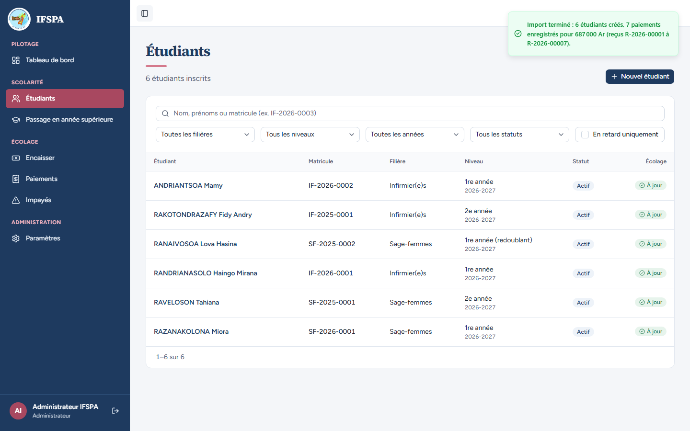 | |
| 9 | Administrateur | Ouvrir la fiche **RANDRIANASOLO Haingo Mirana**, onglet **Écolage**. | « Matricule IF-2026-0001 », « 1re année · 2026-2027 ». Reste à payer **753 000 Ar**, « Aucun retard », Déjà payé **147 000 Ar** (« Sur 900 000 Ar dus au total »). « Droits payés en 3 fois » : « Droits — tranche 1/3 » payée (34 000 Ar), « Octobre 2026 » payé (80 000 Ar), « Droits — tranche 2/3 » payée (33 000 Ar) ; les autres mois « À venir ». | 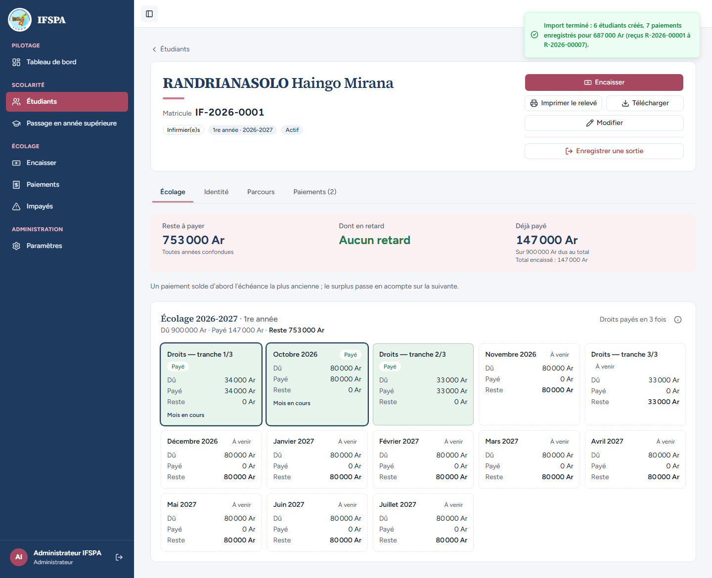 | |
| 10 | Administrateur | Onglet **Paiements (2)** de la même fiche. | Deux reçus, caissier « Administrateur IFSPA », statut « Validé » : **R-2026-00007**, 15/10/2026 à 12:00, 33 000 Ar, Mobile Money · Orange Money ; **R-2026-00002**, 05/10/2026 à 12:00, 114 000 Ar, Espèces. Les reçus sont datés du jour du fichier, à 12:00. Le n° du reçu papier (0412) n'apparaît pas ici (voir « Ce que ce scénario ne couvre pas »). | 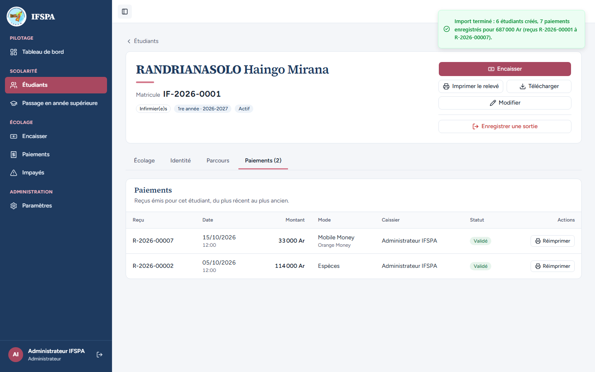 | |
| 11 | Administrateur | Cliquer **Réimprimer** sur R-2026-00002. | Le ticket 80 mm : « N° R-2026-00002 », « Le 05/10/2026 à 12:00 », RANDRIANASOLO Haingo Mirana, « Matricule IF-2026-0001 », « Droits — tranche 1/3 » 34 000 Ar, « Octobre 2026 » 80 000 Ar, TOTAL 114 000 Ar, « Arrêté à : cent quatorze mille ariary », Mode Espèces, Caissier Administrateur IFSPA, « Reste en retard : Néant, à jour », « Reste à payer 786 000 Ar ». Aucune mention de « reçu papier ». | 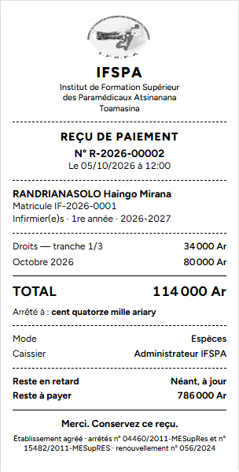 | |
| 12 | Administrateur | Menu **Paiements**, cliquer **Voir ce mois-ci** (la vue « Aujourd'hui » est vide : les reçus sont datés du 03 au 15 octobre). | « Octobre 2026 » : Reçus **7**, Total encaissé **687 000 Ar**, dont espèces 474 000 Ar, dont Mobile Money 213 000 Ar. Liste de R-2026-00007 à R-2026-00001, du plus récent au plus ancien, numérotés dans l'ordre des dates (R-2026-00001 est le paiement du 03/10). « Reçus 1 à 7 sur 7 ». | 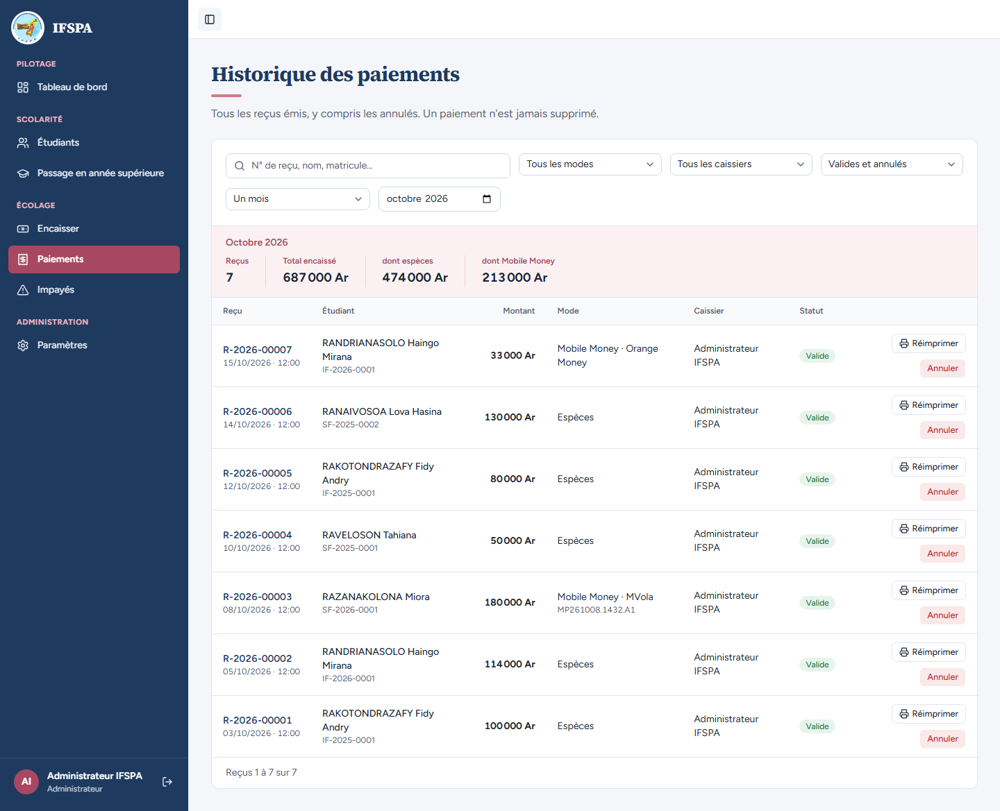 | |

## Ce que ce scénario ne couvre pas

- **Le n° du reçu papier** (0412, 0420…) est gardé en base (observation « Reprise des données · reçu papier n° 0412 »), mais l'écran ne l'affiche nulle part : ni la fiche, ni la liste Paiements, ni le ticket réimprimé. Voir le rapport (anomalie).
- L'ouverture du modèle et du fichier rempli dans **Excel** (accents, 0 initial des téléphones) : à faire par Diano (voir le rapport).
- Les dates sont de vraies dates Excel et les montants des nombres dans ce classeur ; le cas des cellules en texte est couvert par UC15-06 (CSV) et UC15-02 (dates en texte).
- Les impayés des années précédentes ne sont pas repris (décision provisoire n° 51). Les reçus de reprise sont numérotés `R-{année civile}-…` dans l'ordre des dates, caissier = l'administrateur qui importe (décision provisoire n° 52).
- Le refus d'un import sans signature valide ou d'un plan qui a changé entre l'analyse et l'import : couvert par Vitest, `tests/integration/actions-import.test.ts`.
- Ordinateur seulement : écran d'administration, non déroulé sur téléphone.

## Dernière exécution par l'agent

- 17/10/2026 : ✅ 12 étapes sur 12. Voir [RAPPORT_2026-10-17_UC15](../../rapports/RAPPORT_2026-10-17_UC15.md).
- Parcours : [UC15-01-nominal.recette.ts](../../parcours/UC15-01-nominal.recette.ts) (préparation : [00c-preparation-reprise.recette.ts](../../parcours/00c-preparation-reprise.recette.ts) ; fichiers fabriqués par [fabriquer-fichiers-reprise.py](../../parcours/fabriquer-fichiers-reprise.py)).
