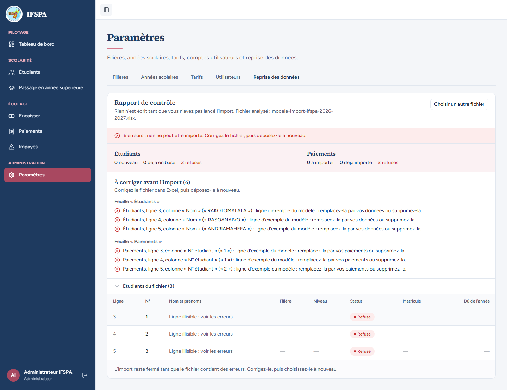
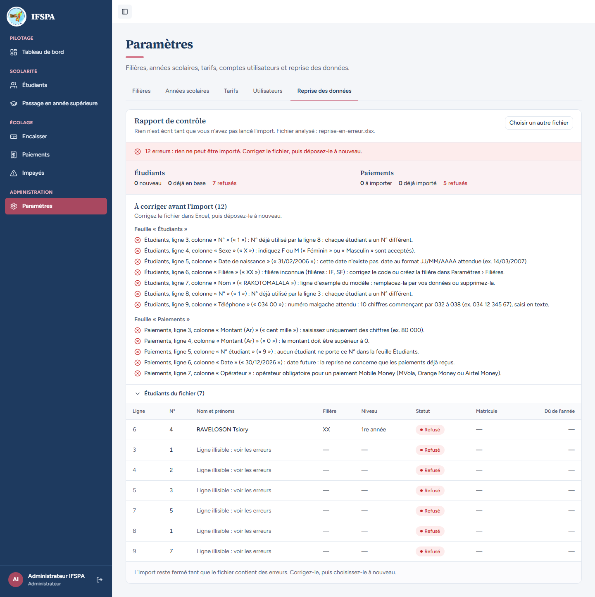

# UC15-02. Un classeur mal rempli est refusé ligne par ligne, et rien n'est importé

| | |
|---|---|
| Use case | UC15. Reprendre les données de l'institut |
| Règles couvertes | R-REPRISE (rapport ligne par ligne avant d'écrire, une erreur bloquante n'importe rien, lignes d'exemple du modèle refusées exprès), R-ROLE (admin) |
| Rôle | Administrateur, compte « Administrateur IFSPA » |
| Durée estimée | 8 minutes |

## La situation

L'administrateur dépose d'abord le modèle tel qu'il l'a téléchargé, en oubliant de remplacer les trois lignes d'exemple. Puis il dépose un classeur saisi trop vite : un sexe inconnu, une date du 31 février, un code de filière qui n'existe pas, un numéro de ligne en double, un téléphone incomplet, des paiements sans opérateur ou dans le futur. L'application liste chaque erreur avec sa ligne et sa colonne, ferme l'import, et ne crée aucun étudiant.

## Avant de commencer

- Mêmes préparatifs que [UC15-01](UC15-01-nominal.md) (section E de [00-PREPARATION.md](../00-PREPARATION.md)). Avoir déroulé UC15-01 : la liste compte alors 6 étudiants (ce scénario n'en dépend que pour comparer avant et après).
- Compte administrateur (`SEED_ADMIN_*`).
- Fichiers : [fichiers/modele-import-ifspa-2026-2027.xlsx](fichiers/modele-import-ifspa-2026-2027.xlsx) (le modèle téléchargé, non modifié) et [fichiers/reprise-en-erreur.xlsx](fichiers/reprise-en-erreur.xlsx).

## Étapes

| # | Qui | Action | Résultat attendu | Capture | ✓ |
|---|---|---|---|---|---|
| 1 | Administrateur | Menu **Étudiants**, noter le nombre d'étudiants inscrits. | « 6 étudiants inscrits » (après UC15-01). | | |
| 2 | Administrateur | **Paramètres › Reprise des données**, déposer `modele-import-ifspa-2026-2027.xlsx` sans l'avoir modifié, cliquer **Analyser le fichier**. | Message rouge **« 6 erreurs : rien ne peut être importé. Corrigez le fichier, puis déposez-le à nouveau. »** Étudiants : 0 nouveau, 0 déjà en base, 3 refusés. Paiements : 0 à importer, 0 déjà importé, 3 refusés. « À corriger avant l'import (6) » : pour les étudiants des lignes 3, 4 et 5 (RAKOTOMALALA, RASOANAIVO, ANDRIAMAHEFA) « ligne d'exemple du modèle : remplacez-la par vos données ou supprimez-la. », et pour les paiements des lignes 3, 4 et 5 « ligne d'exemple du modèle : remplacez-la par vos paiements ou supprimez-la. » Le tableau montre les trois étudiants « Refusé », « Ligne illisible : voir les erreurs ». |  | |
| 3 | Administrateur | Cliquer **Choisir un autre fichier**, déposer `reprise-en-erreur.xlsx`, cliquer **Analyser le fichier**. | Message rouge **« 12 erreurs : rien ne peut être importé. Corrigez le fichier, puis déposez-le à nouveau. »** Étudiants : 0 nouveau, 0 déjà en base, 7 refusés. Paiements : 0 à importer, 0 déjà importé, 5 refusés. « À corriger avant l'import (12) », sous « Feuille « Étudiants » » : ligne 3 « N° déjà utilisé par la ligne 8 » ; ligne 4 « indiquez F ou M (« Féminin » ou « Masculin » sont acceptés). » ; ligne 5 « cette date n'existe pas. date au format JJ/MM/AAAA attendue (ex. 14/03/2007). » ; ligne 6 « filière inconnue (filières : IF, SF) : corrigez le code ou créez la filière dans Paramètres › Filières. » ; ligne 7 « ligne d'exemple du modèle » (RAKOTOMALALA) ; ligne 8 « N° déjà utilisé par la ligne 3 » ; ligne 9 « numéro malgache attendu : 10 chiffres commençant par 032 à 038 (ex. 034 12 345 67), saisi en texte. » Sous « Feuille « Paiements » » : ligne 3 « saisissez uniquement des chiffres (ex. 80 000). » (« cent mille ») ; ligne 4 « le montant doit être supérieur à 0. » ; ligne 5 « aucun étudiant ne porte ce N° dans la feuille Étudiants. » ; ligne 6 « date future : la reprise ne concerne que les paiements déjà reçus. » ; ligne 7 « opérateur obligatoire pour un paiement Mobile Money (MVola, Orange Money ou Airtel Money). » |  | |
| 4 | Administrateur | Chercher un bouton d'import en bas du rapport. | Aucun bouton « Importer … ». À la place : « L'import reste fermé tant que le fichier contient des erreurs. Corrigez-le, puis choisissez-le à nouveau. » | | |
| 5 | Administrateur | Menu **Étudiants**. | Toujours « 6 étudiants inscrits » : aucun étudiant du classeur n'a été créé, pas même la ligne 3 (RAKOTOVELO Haingo), qui serait valide sans son N° en double. | | |

## Ce que ce scénario ne couvre pas

- La phrase de la ligne 5 est reproduite telle qu'affichée : « cette date n'existe pas. date au format… » (minuscule après le point, voir le rapport).
- Une ligne qui a une faute de saisie (téléphone, date, sexe) n'est pas contrôlée plus loin : son code de filière, son année d'entrée et son tarif ne le sont qu'une fois la saisie corrigée (observé en combinant téléphone et filière inconnue sur la même ligne lors d'un essai préalable). Un classeur peut donc demander deux ou trois allers-retours.
- Le refus côté serveur d'un import dont le plan est bloquant (même avec une signature valide) : couvert par Vitest, `tests/integration/actions-import.test.ts` (« rapport bloquant : refusé avec la première erreur »).
- Ordinateur seulement.

## Dernière exécution par l'agent

- 17/10/2026 : ✅ 5 étapes sur 5. Voir [RAPPORT_2026-10-17_UC15](../../rapports/RAPPORT_2026-10-17_UC15.md).
- Parcours : [UC15-02-fichier-en-erreur.recette.ts](../../parcours/UC15-02-fichier-en-erreur.recette.ts).
