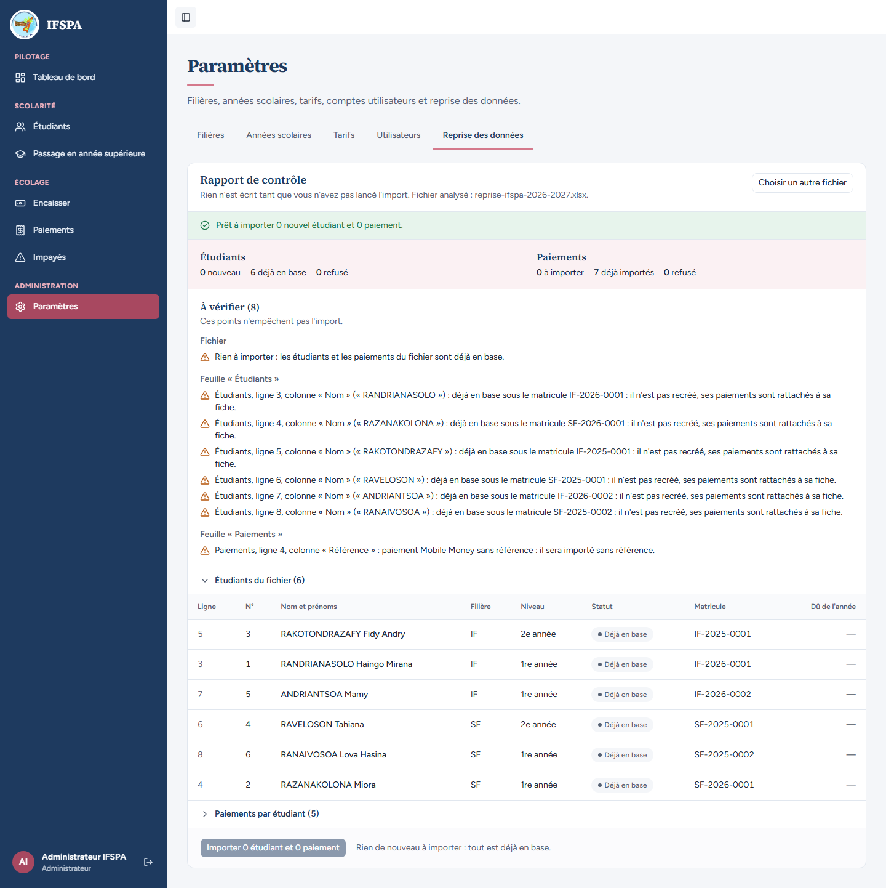
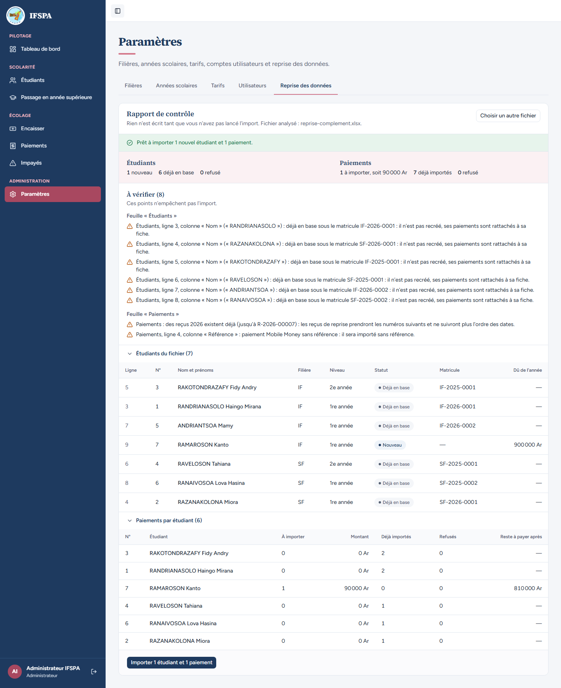
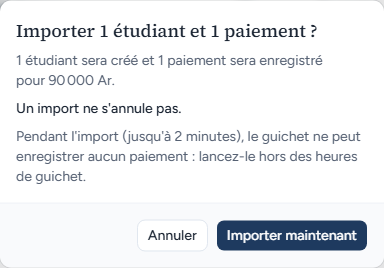
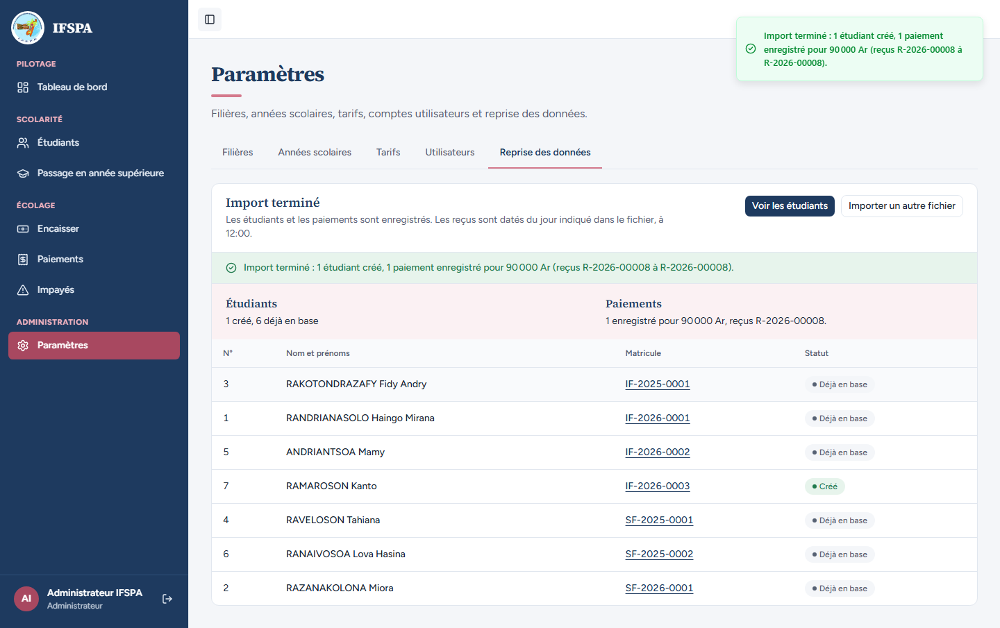
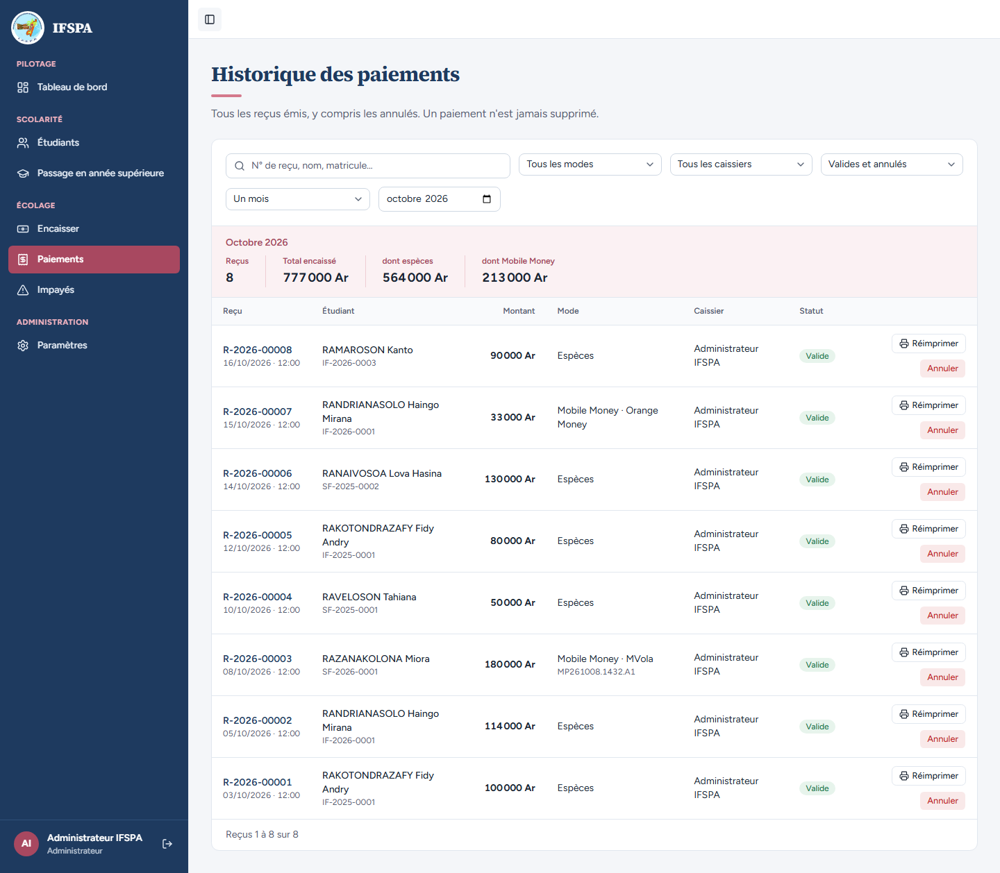

# UC15-03. Relancer le même fichier ne crée aucun doublon, et un fichier complété n'importe que le nouveau

| | |
|---|---|
| Use case | UC15. Reprendre les données de l'institut |
| Règles couvertes | R-REPRISE (relançable sans doublons, « Rien de nouveau à importer », reçus numérotés à la suite), R-MAT (séquence par filière et année d'entrée), R-RECU, R-ROLE (admin) |
| Rôle | Administrateur, compte « Administrateur IFSPA » |
| Durée estimée | 10 minutes |

## La situation

L'administrateur n'est pas sûr d'avoir importé son classeur : il le redépose. L'application répond que tout est déjà en base et ferme l'import. Le lendemain, un septième étudiant s'est présenté avec un paiement : l'administrateur l'ajoute au classeur et le redépose. Seuls l'étudiant et le paiement nouveaux sont importés, à la suite des matricules et des reçus existants.

## Avant de commencer

- Mêmes préparatifs que [UC15-01](UC15-01-nominal.md), et **UC15-01 déroulé** (6 étudiants, reçus R-2026-00001 à 00007). UC15-02 est facultatif.
- Compte administrateur (`SEED_ADMIN_*`).
- Fichiers : [fichiers/reprise-ifspa-2026-2027.xlsx](fichiers/reprise-ifspa-2026-2027.xlsx) (celui d'UC15-01) et [fichiers/reprise-complement.xlsx](fichiers/reprise-complement.xlsx) (le même, avec un 7e étudiant, RAMAROSON Kanto, IF, entrée 2026, 1re année, et un paiement de 90 000 Ar en espèces le 16/10/2026, reçu papier 0432).

## Étapes

| # | Qui | Action | Résultat attendu | Capture | ✓ |
|---|---|---|---|---|---|
| 1 | Administrateur | **Paramètres › Reprise des données**, déposer `reprise-ifspa-2026-2027.xlsx`, cliquer **Analyser le fichier**. | Message vert « **Prêt à importer 0 nouvel étudiant et 0 paiement.** » Étudiants : 0 nouveau, **6 déjà en base**, 0 refusé. Paiements : 0 à importer, **7 déjà importés**, 0 refusé. | | |
| 2 | Administrateur | Lire le rapport et le bas de page. | « À vérifier (8) » : « Rien à importer : les étudiants et les paiements du fichier sont déjà en base. », puis pour chaque étudiant « déjà en base sous le matricule IF-2026-0001 : il n'est pas recréé, ses paiements sont rattachés à sa fiche. » (et les cinq autres matricules), puis l'avertissement Mobile Money sans référence. Tableau : les six « Déjà en base » avec leur matricule. Le bouton **« Importer 0 étudiant et 0 paiement »** est grisé, avec à côté « Rien de nouveau à importer : tout est déjà en base. » |  | |
| 3 | Administrateur | Cliquer **Choisir un autre fichier**, déposer `reprise-complement.xlsx`, cliquer **Analyser le fichier**, ouvrir **Paiements par étudiant (6)**. | « **Prêt à importer 1 nouvel étudiant et 1 paiement.** » Étudiants : 1 nouveau, 6 déjà en base, 0 refusé. Paiements : 1 à importer, soit 90 000 Ar, 7 déjà importés, 0 refusé. « À vérifier » ajoute : « Paiements : des reçus 2026 existent déjà (jusqu'à R-2026-00007) : les reçus de reprise prendront les numéros suivants et ne suivront plus l'ordre des dates. » Seul RAMAROSON Kanto est « Nouveau » (900 000 Ar dus) ; dans « Paiements par étudiant », sa ligne indique 1 à importer, 90 000 Ar, reste à payer après **810 000 Ar** ; les autres lignes indiquent 0 à importer et 1 ou 2 déjà importés. |  | |
| 4 | Administrateur | Cliquer **Importer 1 étudiant et 1 paiement**. | Fenêtre « Importer 1 étudiant et 1 paiement ? » : « 1 étudiant sera créé et 1 paiement sera enregistré pour 90 000 Ar. », « Un import ne s'annule pas. » |  | |
| 5 | Administrateur | Cliquer **Importer maintenant**. | Message « **Import terminé : 1 étudiant créé, 1 paiement enregistré pour 90 000 Ar (reçus R-2026-00008 à R-2026-00008).** » Étudiants : « 1 créé, 6 déjà en base ». Paiements : « 1 enregistré pour 90 000 Ar, reçus R-2026-00008. » RAMAROSON Kanto : matricule **IF-2026-0003** (à la suite de IF-2026-0001 et 0002), « Créé » ; les six autres « Déjà en base » avec leur matricule inchangé. |  | |
| 6 | Administrateur | Menu **Étudiants**, puis menu **Paiements › Voir ce mois-ci**. | « 7 étudiants inscrits » (pas 13). Octobre 2026 : « Reçus 1 à 8 sur 8 » : un seul reçu de plus. |  | |

## Ce que ce scénario ne couvre pas

- Le même classeur importé en deux fois **simultanément** et le plan qui change entre l'analyse et l'import : couverts par Vitest, `tests/integration/actions-import.test.ts` (« deux imports simultanés du même fichier », « un second import avec la signature d'une analyse faite avant le premier est refusé »).
- Le refus serveur d'un import « sans rien de nouveau » (bouton contourné) : couvert par Vitest, même fichier (« un import sans rien de nouveau est refusé sans rien écrire »).
- Un paiement repris puis annulé par l'administrateur reste « déjà importé » : couvert par Vitest (« un paiement repris puis annulé reste « déjà importé » »), non déroulé ici (annulation = UC07).
- Le message de fin cite « reçus R-2026-00008 à R-2026-00008 » pour un seul reçu ; tel qu'affiché, relevé dans le rapport.

## Dernière exécution par l'agent

- 17/10/2026 : ✅ 6 étapes sur 6. Voir [RAPPORT_2026-10-17_UC15](../../rapports/RAPPORT_2026-10-17_UC15.md).
- Parcours : [UC15-03-relance-sans-doublon.recette.ts](../../parcours/UC15-03-relance-sans-doublon.recette.ts).
