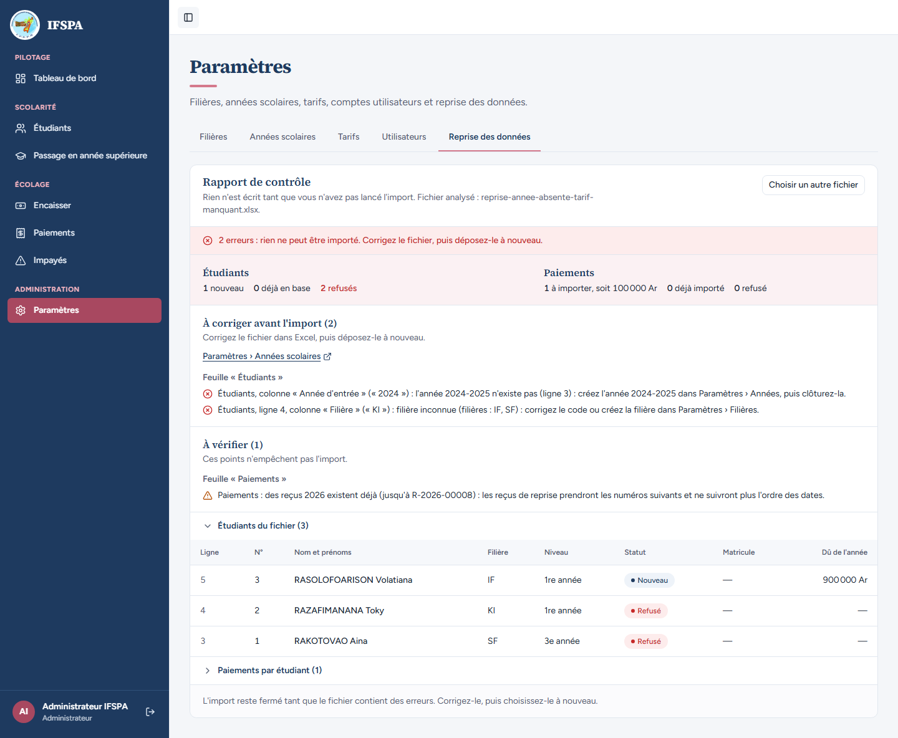
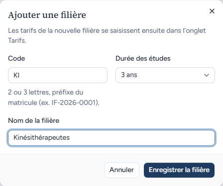
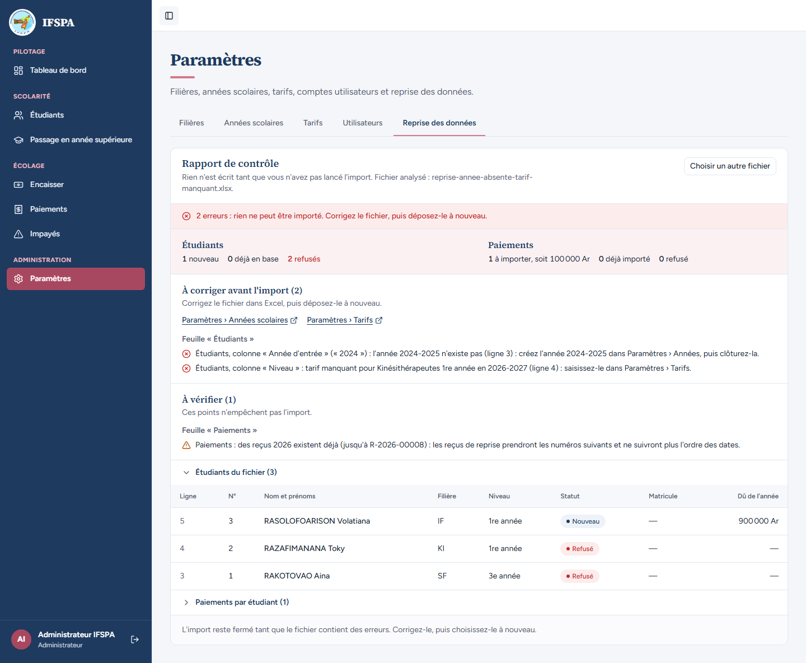
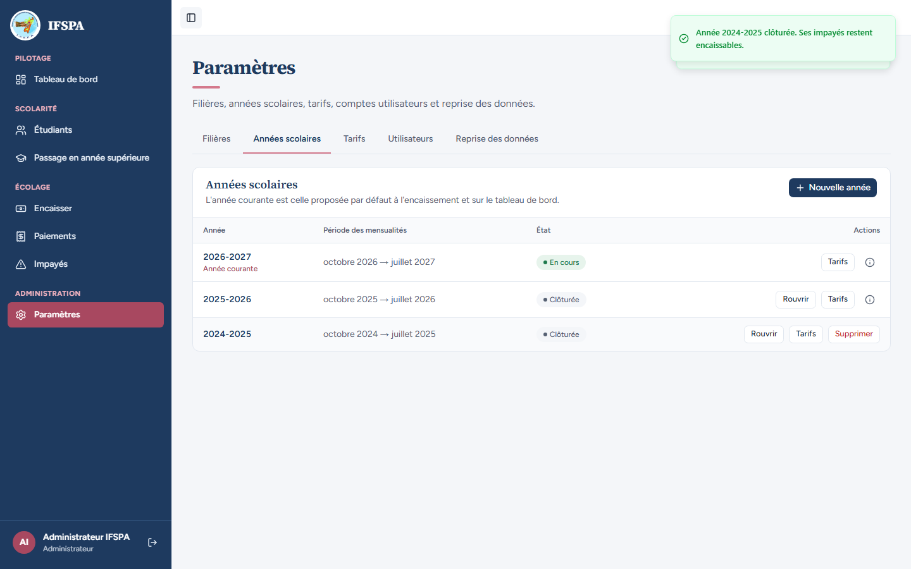
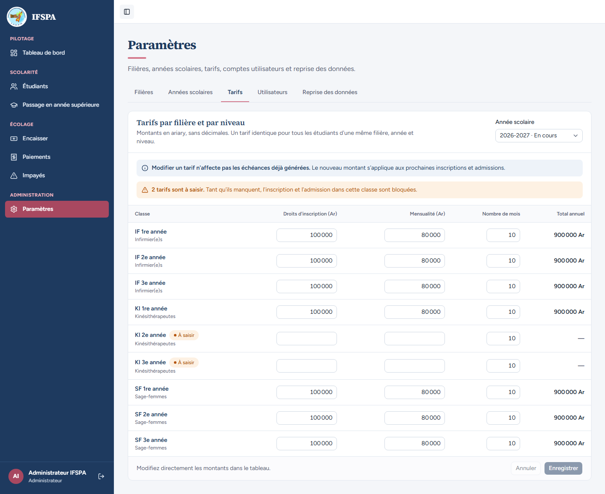
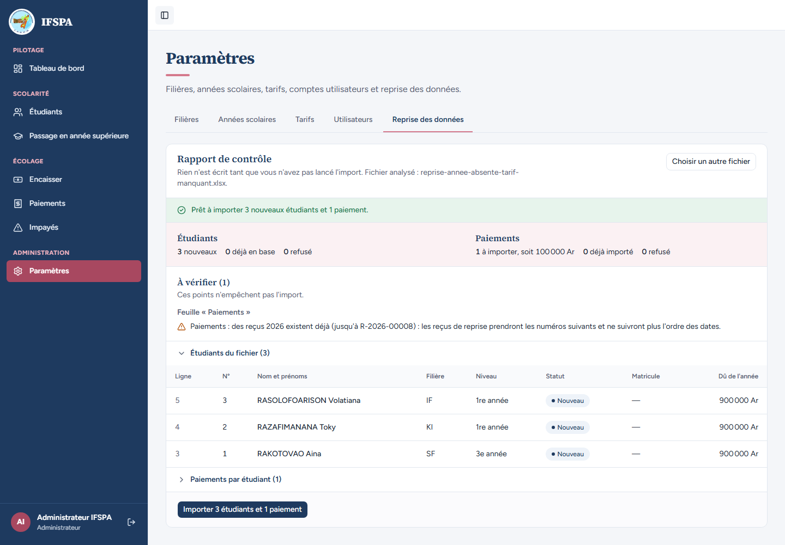

# UC15-04. Année d'entrée absente, filière inconnue, tarif manquant : l'administrateur prépare les Paramètres, puis le fichier passe

| | |
|---|---|
| Use case | UC15. Reprendre les données de l'institut |
| Règles couvertes | R-REPRISE (année d'entrée antérieure à créer puis clôturer, erreurs bloquantes qui renvoient aux Paramètres, rien n'est écrit), R-INS (tarif manquant bloque), R-MAT, R-ROLE (admin) |
| Rôle | Administrateur, compte « Administrateur IFSPA » |
| Durée estimée | 15 minutes |

## La situation

Le classeur contient une étudiante de 3e année entrée en 2024 (l'année 2024-2025 n'existe pas dans l'application), un étudiant d'une nouvelle filière, la Kinésithérapie (« KI »), que l'application ne connaît pas encore, et une étudiante d'Infirmier(e)s sans problème. L'administrateur suit les messages : il crée la filière, puis son tarif, puis l'année 2024-2025 qu'il clôture, et redépose le même classeur, qui passe. Il ne l'importe pas ici.

## Avant de commencer

- Mêmes préparatifs que [UC15-01](UC15-01-nominal.md) (section E de [00-PREPARATION.md](../00-PREPARATION.md)). UC15-01 déroulé : les reçus existants (jusqu'à R-2026-00008 après UC15-03) donnent l'avertissement « des reçus 2026 existent déjà ». Sans UC15-01, le scénario se déroule de même, sans cet avertissement.
- Compte administrateur (`SEED_ADMIN_*`).
- Fichier : [fichiers/reprise-annee-absente-tarif-manquant.xlsx](fichiers/reprise-annee-absente-tarif-manquant.xlsx) : RAKOTOVAO Aina (SF, entrée 2024, 3e année), RAZAFIMANANA Toky (KI, entrée 2026, 1re année), RASOLOFOARISON Volatiana (IF, entrée 2026, 1re année) avec un paiement de 100 000 Ar en espèces le 06/10/2026.

## Étapes

| # | Qui | Action | Résultat attendu | Capture | ✓ |
|---|---|---|---|---|---|
| 1 | Administrateur | **Paramètres › Reprise des données**, déposer le fichier, **Analyser le fichier**. | « **2 erreurs : rien ne peut être importé.** » Étudiants : 1 nouveau, 0 déjà en base, 2 refusés. Paiements : 1 à importer, soit 100 000 Ar, 0 déjà importé, 0 refusé. « À corriger avant l'import (2) » avec un lien « Paramètres › Années scolaires » (nouvel onglet) : « Étudiants, colonne « Année d'entrée » (« 2024 ») : l'année 2024-2025 n'existe pas (ligne 3) : créez l'année 2024-2025 dans Paramètres › Années, puis clôturez-la. » et « Étudiants, ligne 4, colonne « Filière » (« KI ») : filière inconnue (filières : IF, SF) : corrigez le code ou créez la filière dans Paramètres › Filières. » Tableau : RASOLOFOARISON « Nouveau », RAZAFIMANANA et RAKOTOVAO « Refusé ». L'import est fermé. |  | |
| 2 | Administrateur | **Paramètres › Filières**, **Ajouter une filière** : Code `KI`, Durée des études 3 ans, Nom `Kinésithérapeutes`, **Enregistrer la filière**. | La filière « Kinésithérapeutes » apparaît dans la liste. |  | |
| 3 | Administrateur | Revenir à **Reprise des données**, déposer le même fichier, **Analyser le fichier**. | Toujours « 2 erreurs ». L'erreur de filière a disparu ; la nouvelle dit : « Étudiants, colonne « Niveau » : tarif manquant pour Kinésithérapeutes 1re année en 2026-2027 (ligne 4) : saisissez-le dans Paramètres › Tarifs. » Un second lien, « Paramètres › Tarifs », apparaît. |  | |
| 4 | Administrateur | **Paramètres › Années scolaires**, **Nouvelle année**, saisir `2024`, **Créer l'année**, puis **Clôturer** sur la ligne 2024-2025 et confirmer **Clôturer l'année**. | La ligne 2024-2025 (octobre 2024 → juillet 2025) est « Clôturée ». Message « Année 2024-2025 clôturée. Ses impayés restent encaissables. » |  | |
| 5 | Administrateur | **Paramètres › Tarifs**, ligne **KI 1re année** : « Droits d'inscription » `100 000`, « Mensualité » `80 000`, **Enregistrer**, recharger la page. | Total annuel 900 000 Ar pour KI 1re année ; KI 2e et 3e années restent « À saisir » (« 2 tarifs sont à saisir »). |  | |
| 6 | Administrateur | **Reprise des données**, déposer le même fichier, **Analyser le fichier**. | Message vert « **Prêt à importer 3 nouveaux étudiants et 1 paiement.** » Plus aucune erreur ; les trois étudiants sont « Nouveau », dus 900 000 Ar chacun. Le bouton « Importer 3 étudiants et 1 paiement » est actif : **ne pas cliquer** (le scénario s'arrête ici). |  | |

## Ce que ce scénario ne couvre pas

- L'import final de ces trois étudiants (matricule `SF-2024-0001` pour l'étudiante entrée en 2024) n'est pas déroulé ; la règle (le matricule garde l'année d'entrée) est démontrée par UC15-01 (`IF-2025-0001`, `SF-2025-0001`).
- Le message ne propose pas de lien vers « Paramètres › Filières » : seuls les liens Années scolaires et Tarifs sont offerts (relevé dans le rapport).
- Les cas « année courante absente » et « année courante clôturée » (bloquants) : couverts par Vitest, `tests/integration/actions-import.test.ts` (« sans année courante : rapport bloquant, signature null », « l'année courante clôturée entre l'analyse et l'import : refusé, rien d'écrit »), non déroulés.
- Après ce cas, la base compte la filière KI et l'année 2024-2025 : à ne pas supposer pour les cas suivants (UC15-05, 06 n'en dépendent pas).

## Dernière exécution par l'agent

- 17/10/2026 : ✅ 6 étapes sur 6. Voir [RAPPORT_2026-10-17_UC15](../../rapports/RAPPORT_2026-10-17_UC15.md).
- Parcours : [UC15-04-annee-absente-tarif-manquant.recette.ts](../../parcours/UC15-04-annee-absente-tarif-manquant.recette.ts).
