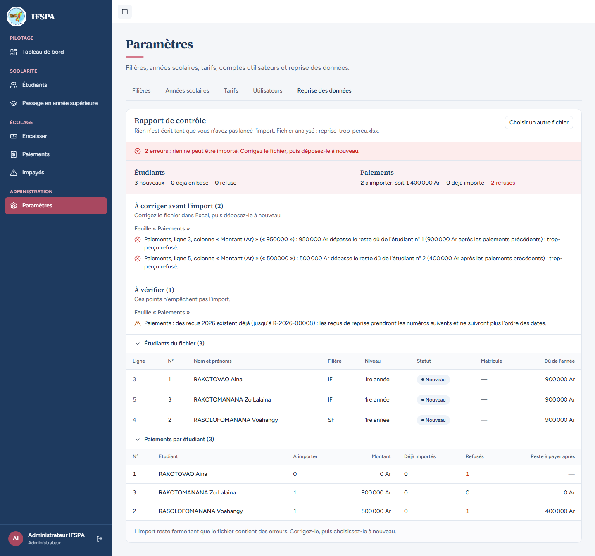

# UC15-05. Un paiement qui dépasse ce que l'étudiant doit est refusé, et avec lui tout l'import

| | |
|---|---|
| Use case | UC15. Reprendre les données de l'institut |
| Règles couvertes | R-TROP (montant refusé au-delà du reste dû), R-REP (répartition cumulée des paiements d'un même étudiant), R-REPRISE (une erreur bloquante n'importe rien) |
| Rôle | Administrateur, compte « Administrateur IFSPA » |
| Durée estimée | 5 minutes |

## La situation

Dans le classeur, une mère a payé 950 000 Ar pour une année à 900 000 Ar ; une autre a payé 500 000 Ar deux fois ; une troisième a payé exactement 900 000 Ar. L'application accepte le paiement exact, refuse les deux autres avec le reste dû réel (en tenant compte des paiements précédents de la même étudiante), et n'importe rien, pas même les étudiants valides.

## Avant de commencer

- Mêmes préparatifs que [UC15-01](UC15-01-nominal.md) (section E de [00-PREPARATION.md](../00-PREPARATION.md)). Ce cas n'écrit rien : il se déroule à tout moment après la préparation.
- Compte administrateur (`SEED_ADMIN_*`).
- Fichier : [fichiers/reprise-trop-percu.xlsx](fichiers/reprise-trop-percu.xlsx) : RAKOTOVAO Aina (IF, 1re année) 950 000 Ar le 06/10 ; RASOLOFOMANANA Voahangy (SF, 1re année) 500 000 Ar le 05/10 puis 500 000 Ar le 06/10 ; RAKOTOMANANA Zo Lalaina (IF, 1re année) 900 000 Ar le 07/10. Chacune doit 900 000 Ar.

## Étapes

| # | Qui | Action | Résultat attendu | Capture | ✓ |
|---|---|---|---|---|---|
| 1 | Administrateur | Menu **Étudiants**, noter le nombre d'étudiants inscrits. | Par exemple « 7 étudiants inscrits » après UC15-03. | | |
| 2 | Administrateur | **Paramètres › Reprise des données**, déposer `reprise-trop-percu.xlsx`, **Analyser le fichier**. | Message rouge « **2 erreurs : rien ne peut être importé. Corrigez le fichier, puis déposez-le à nouveau.** » | | |
| 3 | Administrateur | Lire « À corriger avant l'import (2) » et ouvrir **Paiements par étudiant (3)**. | Feuille « Paiements » : « Paiements, ligne 3, colonne « Montant (Ar) » (« 950000 ») : **950 000 Ar dépasse le reste dû de l'étudiant n° 1 (900 000 Ar après les paiements précédents) : trop-perçu refusé.** » et « Paiements, ligne 5, colonne « Montant (Ar) » (« 500000 ») : **500 000 Ar dépasse le reste dû de l'étudiant n° 2 (400 000 Ar après les paiements précédents) : trop-perçu refusé.** » Étudiants : 3 nouveaux, 0 refusé. Paiements : 2 à importer, soit 1 400 000 Ar, 0 déjà importé, **2 refusés**. Dans le tableau : RAKOTOVAO Aina 0 à importer, 1 refusé ; RAKOTOMANANA Zo Lalaina 1 à importer, 900 000 Ar, reste à payer après 0 Ar ; RASOLOFOMANANA Voahangy 1 à importer, 500 000 Ar, 1 refusé, reste à payer après 400 000 Ar. Aucun bouton d'import. |  | |
| 4 | Administrateur | Menu **Étudiants**. | Même nombre qu'à l'étape 1 : aucun des trois étudiants n'a été créé, même celui dont le paiement était exact. | | |

## Ce que ce scénario ne couvre pas

- Le refus d'un montant nul se voit dans [UC15-02](UC15-02-fichier-en-erreur.md) (« le montant doit être supérieur à 0. »).
- Le refus **côté serveur** d'un trop-perçu apparu entre l'analyse et l'import (un paiement saisi au guichet entre-temps) : couvert par Vitest, `tests/integration/actions-import.test.ts` (« un paiement saisi au guichet entre l'analyse et l'import change le plan : rien n'est importé », « un paiement refusé en cours d'import (SITUATION_CHANGEE) annule tout »).
- Les totaux du rapport comptent encore « 2 à importer, soit 1 400 000 Ar » alors que l'import est fermé : tel qu'affiché.

## Dernière exécution par l'agent

- 17/10/2026 : ✅ 4 étapes sur 4. Voir [RAPPORT_2026-10-17_UC15](../../rapports/RAPPORT_2026-10-17_UC15.md).
- Parcours : [UC15-05-trop-percu.recette.ts](../../parcours/UC15-05-trop-percu.recette.ts).
