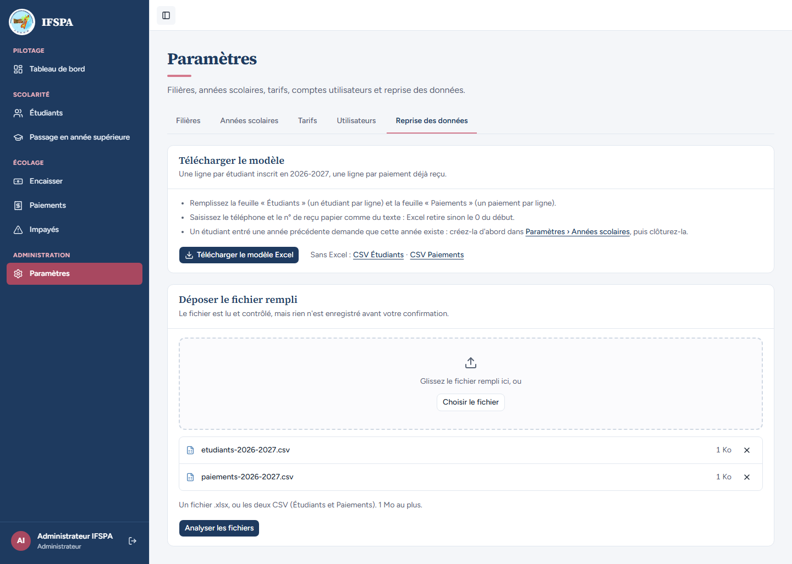
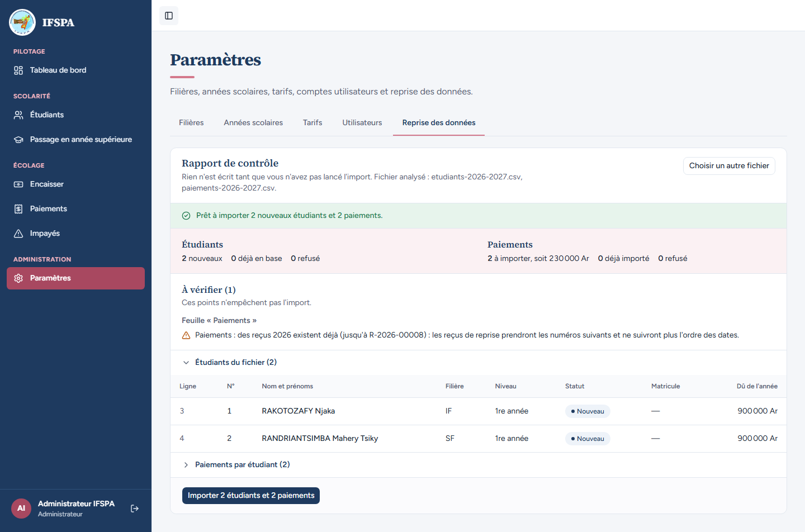
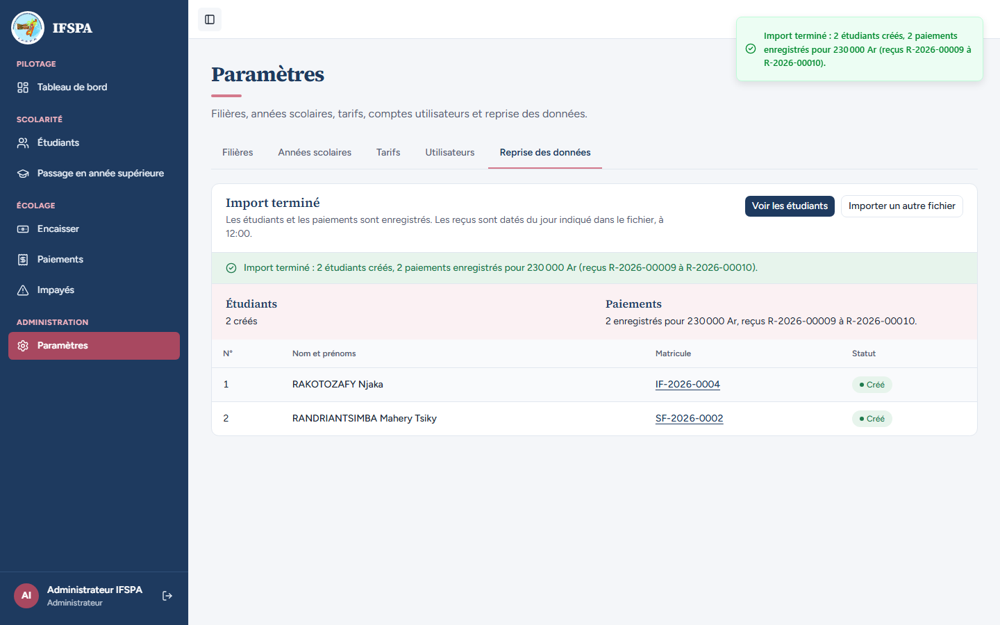
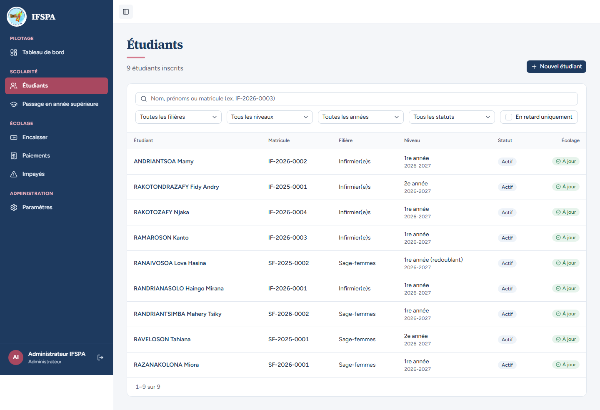

# UC15-06. Sans Excel : l'administrateur reprend deux étudiants avec deux fichiers CSV

| | |
|---|---|
| Use case | UC15. Reprendre les données de l'institut |
| Règles couvertes | R-REPRISE (variante CSV : étudiants et paiements en deux fichiers, rapport avant d'écrire, reçus à la suite), R-MAT, R-TRA (droits en 2 fois), R-REP, R-ROLE (admin) |
| Rôle | Administrateur, compte « Administrateur IFSPA » |
| Durée estimée | 8 minutes |

## La situation

Le poste de l'institut n'a pas Excel. L'administrateur télécharge les deux CSV du modèle (étudiants, paiements), les remplit avec un éditeur de texte ou un tableur libre, puis les dépose l'un après l'autre. Deux étudiants et deux paiements sont importés, à la suite des matricules et des reçus déjà créés.

## Avant de commencer

- Mêmes préparatifs que [UC15-01](UC15-01-nominal.md) (section E de [00-PREPARATION.md](../00-PREPARATION.md)). UC15-01 et UC15-03 déroulés : les numéros ci-dessous (IF-2026-0004, reçus R-2026-00009 et 00010) en dépendent.
- Compte administrateur (`SEED_ADMIN_*`).
- Fichiers : [fichiers/etudiants-2026-2027.csv](fichiers/etudiants-2026-2027.csv) et [fichiers/paiements-2026-2027.csv](fichiers/paiements-2026-2027.csv). Ce sont les CSV du modèle (en-tête et ligne d'aide conservés, séparateur point-virgule, BOM UTF-8) dont les lignes d'exemple sont remplacées : RAKOTOZAFY Njaka (IF, entrée 2026, 1re année, droits en 1 fois) et RANDRIANTSIMBA Mahery Tsiky (SF, entrée 2026, 1re année, droits en 2 fois) ; paiements de 180 000 Ar en Mobile Money Airtel Money (AM261004.0912.C7, le 04/10/2026, reçu papier 0440) et de 50 000 Ar en espèces (le 09/10/2026, reçu papier 0441). Les dates sont en texte `JJ/MM/AAAA`.

## Étapes

| # | Qui | Action | Résultat attendu | Capture | ✓ |
|---|---|---|---|---|---|
| 1 | Administrateur | **Paramètres › Reprise des données**, cliquer **CSV Étudiants** puis **CSV Paiements** (sous « Sans Excel »). | Deux fichiers téléchargés : `etudiants-2026-2027.csv` et `paiements-2026-2027.csv` (avec les lignes d'exemple, à remplacer). Les remplir comme indiqué plus haut, ou utiliser les fichiers fournis. | | |
| 2 | Administrateur | **Choisir le fichier**, choisir `etudiants-2026-2027.csv` ; puis de nouveau **Choisir le fichier** et choisir `paiements-2026-2027.csv`. | Les deux fichiers s'ajoutent dans « Fichiers choisis » (1 Ko chacun) au lieu de se remplacer. Le bouton devient **« Analyser les fichiers »**. |  | |
| 3 | Administrateur | Cliquer **Analyser les fichiers**. | « Fichier analysé : etudiants-2026-2027.csv, paiements-2026-2027.csv. » Message vert « **Prêt à importer 2 nouveaux étudiants et 2 paiements.** » Étudiants : 2 nouveaux, 0 déjà en base, 0 refusé. Paiements : 2 à importer, soit 230 000 Ar. « À vérifier (1) » : « Paiements : des reçus 2026 existent déjà (jusqu'à R-2026-00008) : les reçus de reprise prendront les numéros suivants et ne suivront plus l'ordre des dates. » |  | |
| 4 | Administrateur | Cliquer **Importer 2 étudiants et 2 paiements**, puis **Importer maintenant**. | « **Import terminé : 2 étudiants créés, 2 paiements enregistrés pour 230 000 Ar (reçus R-2026-00009 à R-2026-00010).** » RAKOTOZAFY Njaka : **IF-2026-0004** ; RANDRIANTSIMBA Mahery Tsiky : **SF-2026-0002**, tous deux « Créé ». |  | |
| 5 | Administrateur | Cliquer **Voir les étudiants**. | « 9 étudiants inscrits » : les deux nouveaux figurent dans la liste, « À jour », avec leur matricule. |  | |

## Ce que ce scénario ne couvre pas

- Le CSV des étudiants **seul** (sans paiements) est accepté sans paiement repris (décision provisoire n° 57) : couvert par Vitest, `tests/integration/actions-import.test.ts` (« le CSV des étudiants seul est accepté »), non déroulé à l'écran.
- L'ouverture des CSV dans Excel (accents, séparateur point-virgule, 0 initial des téléphones) : à faire par Diano.
- Un CSV enregistré en encodage ANSI ou avec une virgule comme séparateur : non déroulé à l'écran, couvert par Vitest, `tests/unit/import-lecture.test.ts` (« lit un CSV Windows (ANSI) avec un avertissement, accents conservés », « refuse un séparateur virgule ou tabulation, avec la marche à suivre »).
- Ordinateur seulement.

## Dernière exécution par l'agent

- 17/10/2026 : ✅ 5 étapes sur 5. Voir [RAPPORT_2026-10-17_UC15](../../rapports/RAPPORT_2026-10-17_UC15.md).
- Parcours : [UC15-06-deux-csv.recette.ts](../../parcours/UC15-06-deux-csv.recette.ts).
