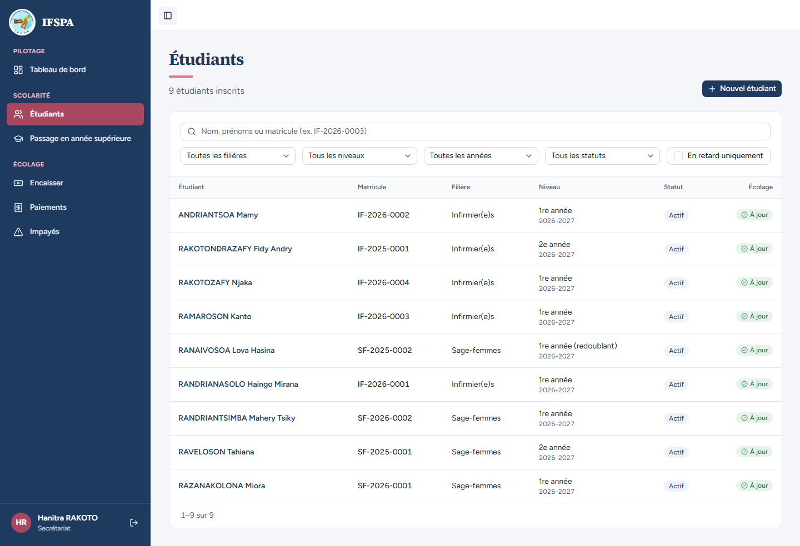
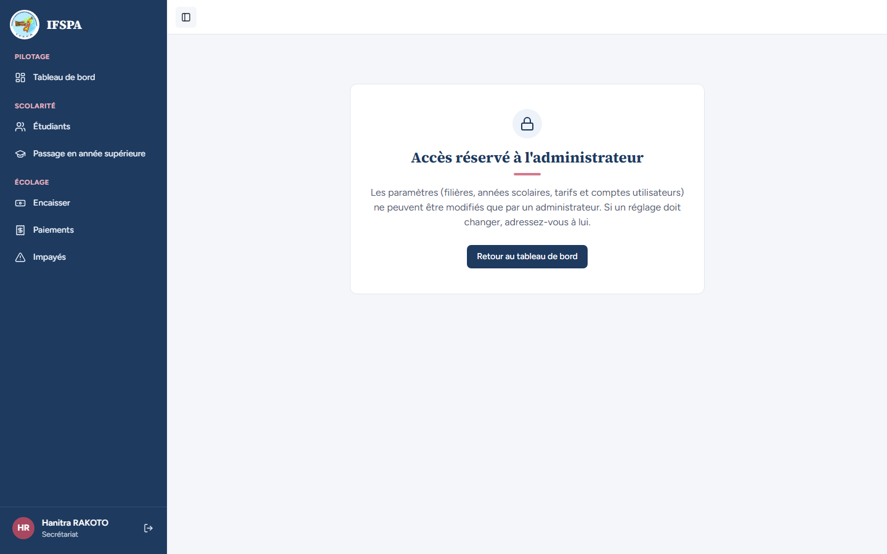
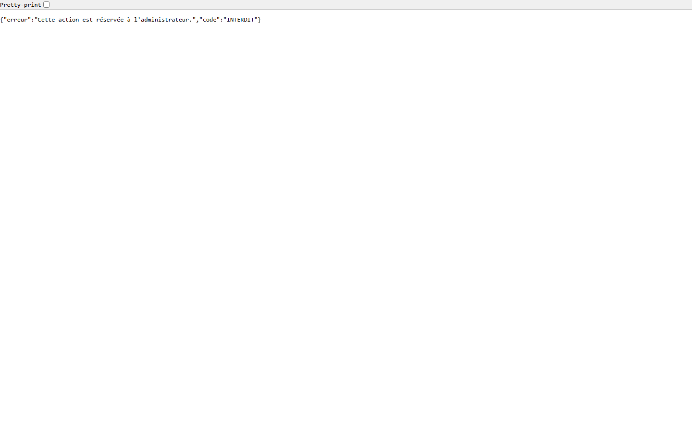
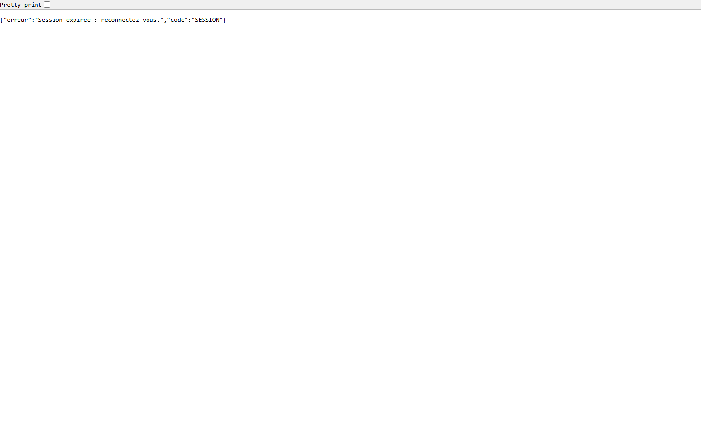

# UC15-07. Le secrétariat ne peut ni ouvrir la reprise des données, ni télécharger le modèle

| | |
|---|---|
| Use case | UC15. Reprendre les données de l'institut |
| Règles couvertes | R-ROLE (le secrétariat n'accède pas aux Paramètres), R-REPRISE (réservé à l'admin) |
| Rôle | Secrétariat, compte « Hanitra RAKOTO » |
| Durée estimée | 4 minutes |

## La situation

La secrétaire entend parler de l'import des données. Elle ne voit aucune rubrique « Paramètres » dans son menu ; si elle tape l'adresse de l'écran, un panneau lui dit que c'est réservé à l'administrateur et ne lui montre ni modèle ni zone de dépôt. Si elle tape l'adresse du modèle, elle n'obtient pas le fichier.

## Avant de commencer

- Mêmes préparatifs que [UC15-01](UC15-01-nominal.md) (aucune donnée n'est nécessaire).
- Se connecter avec le compte **secrétariat** (identifiants `SEED_USER_*` de `.env`, affiché « Hanitra RAKOTO »).

## Étapes

| # | Qui | Action | Résultat attendu | Capture | ✓ |
|---|---|---|---|---|---|
| 1 | Secrétariat | Ouvrir **Étudiants** et regarder le menu de gauche. | Rubriques : Tableau de bord, Étudiants, Passage en année supérieure, Encaisser, Paiements, Impayés. **Pas de « Paramètres »**. « Hanitra RAKOTO · Secrétariat » est en bas de la barre. |  | |
| 2 | Secrétariat | Taper dans la barre d'adresse `http://localhost:3200/app/parametres/import`. | Panneau « **Accès réservé à l'administrateur** » : « Les paramètres (filières, années scolaires, tarifs et comptes utilisateurs) ne peuvent être modifiés que par un administrateur. Si un réglage doit changer, adressez-vous à lui. » et un bouton « Retour au tableau de bord ». Ni « Télécharger le modèle Excel », ni « Choisir le fichier ». |  | |
| 3 | Secrétariat | Taper dans la barre d'adresse `http://localhost:3200/api/import/modele?format=xlsx`. | Aucun fichier n'est téléchargé ; le navigateur affiche `{"erreur":"Cette action est réservée à l'administrateur.","code":"INTERDIT"}` (réponse 403). |  | |
| 4 | Visiteur non connecté | Se déconnecter (ou ouvrir une fenêtre de navigation privée) et taper la même adresse. | Réponse 401 : `{"erreur":"Session expirée : reconnectez-vous.","code":"SESSION"}`. Aucun fichier. |  | |

## Ce que ce scénario ne couvre pas

- L'appel direct des Server Actions « Analyser le fichier » et « Importer » avec le rôle `user` (hors navigateur) : couvert par Vitest, `tests/integration/actions-import.test.ts` (« le rôle user est refusé par les deux actions avant toute lecture du fichier, rien n'est écrit », « un user ne peut pas importer avec la signature qu'un admin a obtenue », « sans session : redirection vers la connexion »).
- Les réponses 401 et 403 de la route du modèle pour chaque format : couvertes par Vitest, `tests/integration/routes-import-modele.test.ts`. Les étapes 3 et 4 en sont le pendant dans le navigateur ; ces deux captures n'affichent pas le nom de l'utilisateur (il est visible aux étapes 1 et 2, même session).
- Décision provisoire n° 6 : le secrétariat voit un panneau « Accès réservé » plutôt qu'une redirection (maquette 13f).
- Ordinateur seulement.

## Dernière exécution par l'agent

- 17/10/2026 : ✅ 4 étapes sur 4. Voir [RAPPORT_2026-10-17_UC15](../../rapports/RAPPORT_2026-10-17_UC15.md).
- Parcours : [UC15-07-secretariat-refuse.recette.ts](../../parcours/UC15-07-secretariat-refuse.recette.ts).
