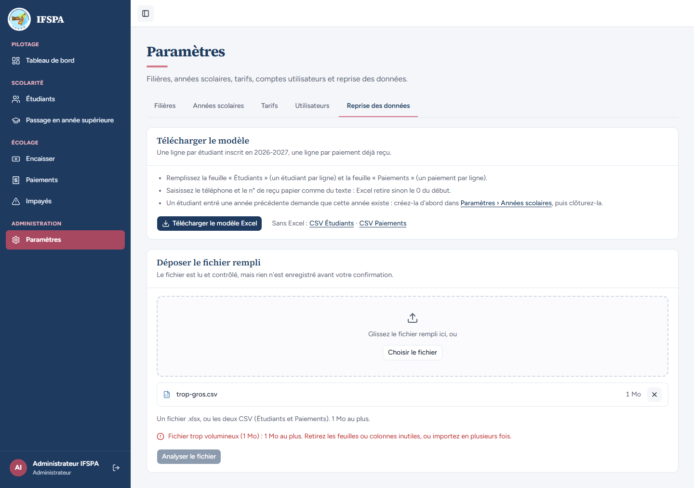
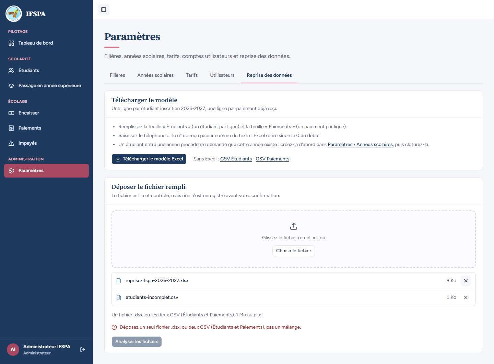
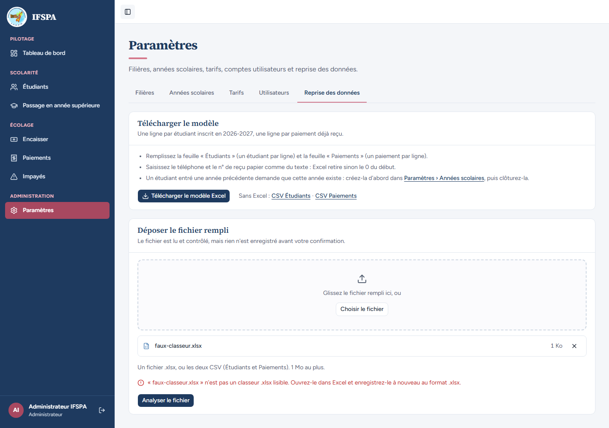

# UC15-08. Un ancien .xls, un fichier trop gros, un mélange de fichiers ou un faux classeur sont refusés avec un message clair

| | |
|---|---|
| Use case | UC15. Reprendre les données de l'institut |
| Règles couvertes | R-REPRISE (contrôles avant envoi : .xls, plus de 1 Mo, mélange ; lecture du dépôt refusée avec un message affichable), R-ROLE (admin) |
| Rôle | Administrateur, compte « Administrateur IFSPA » |
| Durée estimée | 6 minutes |

## La situation

L'administrateur dépose, un après l'autre, le mauvais fichier : un vieux classeur Excel `.xls`, un fichier de plus de 1 Mo, un classeur et un CSV ensemble, et un fichier texte renommé en `.xlsx`. Chaque fois, l'écran dit pourquoi et ce qu'il faut faire ; les trois premiers cas sont refusés avant même l'envoi.

## Avant de commencer

- Mêmes préparatifs que [UC15-01](UC15-01-nominal.md) (section E de [00-PREPARATION.md](../00-PREPARATION.md)). Ce cas n'écrit rien.
- Compte administrateur (`SEED_ADMIN_*`).
- Fichiers, dans [fichiers/](fichiers/) : `liste-etudiants-ancienne.xls` (en-tête d'un ancien classeur Excel, 520 octets), `trop-gros.csv` (1 Mo + 1 octet de lettres), `reprise-ifspa-2026-2027.xlsx` et `etudiants-incomplet.csv` (un CSV de deux lignes, étudiants seulement), `faux-classeur.xlsx` (une phrase de texte).

## Étapes

| # | Qui | Action | Résultat attendu | Capture | ✓ |
|---|---|---|---|---|---|
| 1 | Administrateur | **Paramètres › Reprise des données**, **Choisir le fichier**, choisir `liste-etudiants-ancienne.xls`. | Message rouge sous la zone : « **« liste-etudiants-ancienne.xls » est un ancien format Excel (.xls) : ouvrez-le dans Excel et enregistrez-le au format .xlsx.** » Le bouton « Analyser le fichier » est grisé. |  | |
| 2 | Administrateur | Cliquer **Retirer liste-etudiants-ancienne.xls** (la croix), puis choisir `trop-gros.csv`. | « **Fichier trop volumineux (1 Mo) : 1 Mo au plus. Retirez les feuilles ou colonnes inutiles, ou importez en plusieurs fois.** » Bouton grisé. (Le message affiche « 1 Mo » des deux côtés : le fichier fait 1 Mo + 1 octet, arrondi.) |  | |
| 3 | Administrateur | Retirer `trop-gros.csv`, puis, dans **une seule** fenêtre de choix, sélectionner ensemble `reprise-ifspa-2026-2027.xlsx` et `etudiants-incomplet.csv`. | « **Déposez un seul fichier .xlsx, ou deux CSV (Étudiants et Paiements), pas un mélange.** » Le bouton, devenu « Analyser les fichiers », est grisé. (Choisis l'un après l'autre, un classeur puis un CSV ne s'additionnent pas : le second remplace le premier.) |  | |
| 4 | Administrateur | Recharger la page, choisir `faux-classeur.xlsx`, cliquer **Analyser le fichier**. | Le fichier passe les contrôles avant envoi, puis le serveur le refuse : « **« faux-classeur.xlsx » n'est pas un classeur .xlsx lisible. Ouvrez-le dans Excel et enregistrez-le à nouveau au format .xlsx.** » Pas de panneau « Rapport de contrôle » ; on reste sur l'écran de dépôt. |  | |

## Ce que ce scénario ne couvre pas

- Un classeur sans feuille « Étudiants » ou « Paiements », vide ou trop lourd côté serveur : couvert par Vitest, `tests/integration/actions-import.test.ts` (« dépôt vide, illisible ou trop gros : refus affichable, sans rapport ») et `tests/unit/import-lecture.test.ts`, non déroulé à l'écran.
- Un vrai fichier `.xls` (le fichier fourni n'en a que l'en-tête, ce qui suffit au contrôle par extension de l'écran) : le refus serveur d'un `.xls` renommé est couvert par Vitest, non déroulé.
- Ordinateur seulement.

## Dernière exécution par l'agent

- 17/10/2026 : ✅ 4 étapes sur 4. Voir [RAPPORT_2026-10-17_UC15](../../rapports/RAPPORT_2026-10-17_UC15.md).
- Parcours : [UC15-08-depots-refuses.recette.ts](../../parcours/UC15-08-depots-refuses.recette.ts).
