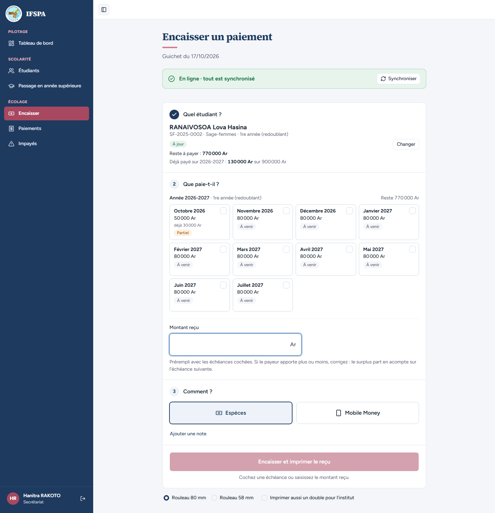
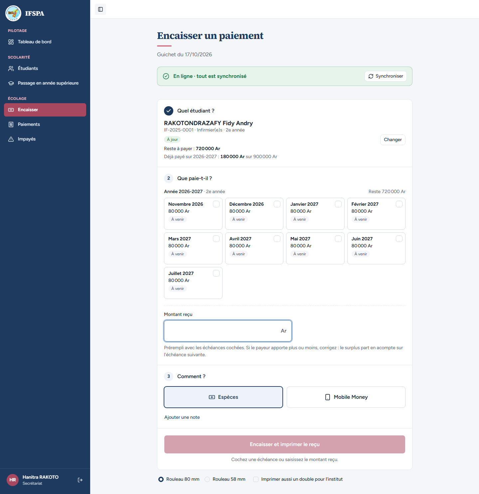
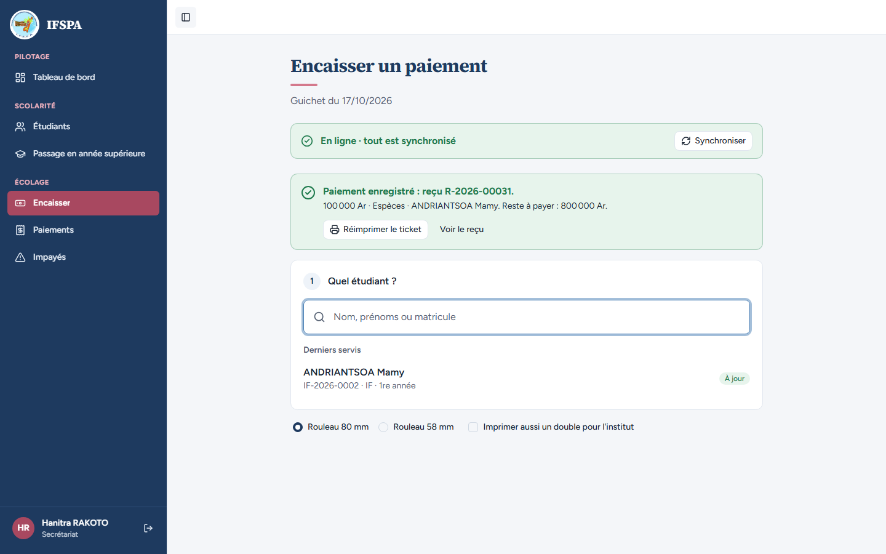

# UC15-09. Les étudiants importés se retrouvent au guichet avec leur reste dû exact

| | |
|---|---|
| Use case | UC15. Reprendre les données de l'institut |
| Règles couvertes | R-REPRISE (paiements répartis comme au guichet, échéance partielle conservée), R-REP, R-PAR, R-RET, R-RECU, R-ROLE (le secrétariat encaisse) |
| Rôle | Secrétariat, compte « Hanitra RAKOTO » |
| Durée estimée | 6 minutes |

## La situation

Le lendemain de la reprise, la secrétaire cherche au guichet les étudiants dont les paiements ont été repris. Elle retrouve leur reste dû et l'acompte déjà versé ; elle encaisse les droits d'un étudiant qui n'avait encore rien payé, et son reçu prend le numéro qui suit ceux de la reprise.

## Avant de commencer

- Mêmes préparatifs que [UC15-01](UC15-01-nominal.md) (section E de [00-PREPARATION.md](../00-PREPARATION.md)), avec UC15-01 déroulé. Dérouler ce cas **en dernier** : l'ouverture d'Encaisser réserve des numéros de reçu pour le poste (décision provisoire n° 48) et décale les numéros des imports suivants.
- Se connecter avec le compte **secrétariat** (identifiants `SEED_USER_*` de `.env`, affiché « Hanitra RAKOTO »).

## Étapes

| # | Qui | Action | Résultat attendu | Capture | ✓ |
|---|---|---|---|---|---|
| 1 | Secrétariat | Menu **Encaisser**, chercher `RANAIVOSOA`, Entrée. | « RANAIVOSOA Lova Hasina », « SF-2025-0002 · Sage-femmes · 1re année (redoublant) », badge « À jour ». « Reste à payer : **770 000 Ar** », « Déjà payé sur 2026-2027 : **130 000 Ar** sur 900 000 Ar ». Les droits (100 000 Ar) n'apparaissent plus : « Octobre 2026 » affiche 50 000 Ar, « déjà 30 000 Ar », badge **« Partiel »**. Le paiement de 130 000 Ar a soldé les droits puis versé 30 000 Ar d'acompte sur octobre. |  | |
| 2 | Secrétariat | Retourner sur **Encaisser**, chercher `RAKOTONDRAZAFY`, Entrée. | « IF-2025-0001 », « Reste à payer : **720 000 Ar** », « Déjà payé sur 2026-2027 : **180 000 Ar** sur 900 000 Ar » (droits 100 000 Ar le 03/10 et octobre 80 000 Ar le 12/10). |  | |
| 3 | Secrétariat | Retourner sur **Encaisser**, chercher `ANDRIANTSOA`, Entrée : « Reste à payer : 900 000 Ar ». Cliquer la carte **Droits d'inscription**, puis **Encaisser 100 000 Ar et imprimer le reçu**. | Message « **Paiement enregistré : reçu R-2026-00031.** » (si UC15-01, 03 et 06 sont déroulés : 10 reçus repris, 20 numéros réservés au poste, puis le 31e), « 100 000 Ar · Espèces · ANDRIANTSOA Mamy. Reste à payer : 800 000 Ar. » ; ANDRIANTSOA est dans « Derniers servis », « À jour ». Le bandeau repasse à « En ligne · tout est synchronisé ». |  | |

## Ce que ce scénario ne couvre pas

- Le numéro du reçu de l'étape 3 dépend des blocs de numéros réservés au poste (décision provisoire n° 48) : avec seulement UC15-01 déroulé, ce serait R-2026-00028. Un numéro différent n'est pas une anomalie si les trous correspondent aux « Numéros non utilisés » de Paiements (administrateur).
- Le ticket imprimé de ce reçu (80 mm, 58 mm, double) : couvert par UC06-01 et UC06-08.
- Un étudiant **en retard** repris : non applicable avant le 1er novembre 2026 (aucun mois de 2026-2027 n'est échu), et les impayés des années précédentes ne sont pas repris (décision provisoire n° 51).
- Écran Encaisser sur téléphone : non déroulé pour UC15.

## Dernière exécution par l'agent

- 17/10/2026 : ✅ 3 étapes sur 3. Voir [RAPPORT_2026-10-17_UC15](../../rapports/RAPPORT_2026-10-17_UC15.md).
- Parcours : [UC15-09-importes-au-guichet.recette.ts](../../parcours/UC15-09-importes-au-guichet.recette.ts).
